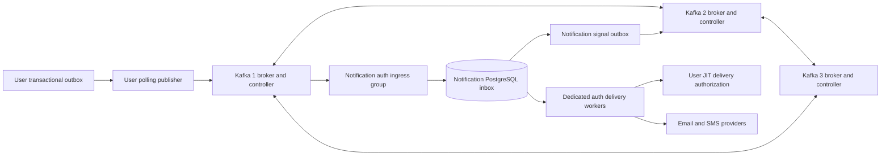
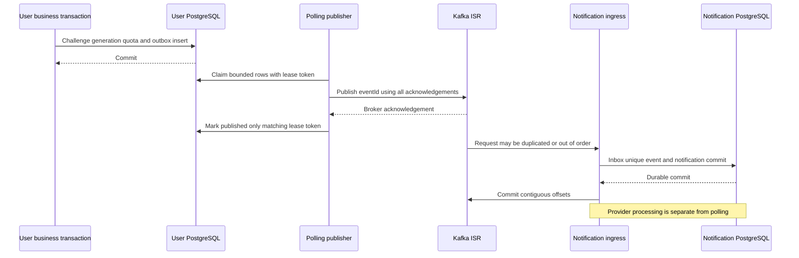

# MVP-ACC — Kafka Notification Architecture

| Thuộc tính | Giá trị |
|---|---|
| Feature / Issue | MVP-ACC / [#43](https://github.com/duvanan/shopee/issues/43), mở rộng thiết kế theo yêu cầu chủ dự án ngày 05/11/2026 |
| Status | **Draft / Needs review — chưa Approved, DESIGN ONLY** |
| Phiên bản / ngày | 0.1 / 05/11/2026 (Asia/Saigon) |
| Tác giả | Codex `devops`, phối hợp Architect và Coordinator |
| Liên quan | [Auth Technical Design](../features/MVP-ACC/TECHNICAL_DESIGN.md), [Notification Service](NOTIFICATION_SERVICE_TECHNICAL_DESIGN.md), [BA Approved](../features/MVP-ACC/BA_SPEC.md), [UX Approved](../features/MVP-ACC/UX_SPEC.md) |
| Phê duyệt | Các KN-D01..08 tại §12 còn Pending; yêu cầu vẽ kiến trúc không phải phê duyệt cấu hình, roadmap hoặc triển khai |

## 1. Hiện trạng, phạm vi và ranh giới

Đã đối chiếu `AGENTS.md`, workflow/spec handoff/roadmap hiện hành, BA/UX/handoff MVP-ACC và Draft Auth 0.1. Source thực tế: `backend/pom.xml` chỉ có Common, Eureka, Config, Gateway, User, Product; **chưa có Notification/Order/Payment module hoặc Kafka integration**. `docker-compose.yml` hiện chỉ có PostgreSQL16 và Redis7 (profile cache), data volumes và host ports loopback. `infra/postgres/init-databases.sql` chỉ tạo thêm DB Product; chưa có DB Notification. `.github/workflows/ci.yml` chạy Maven Java25 và frontend Node24, chưa có job kiểm Kafka ba node. `rg --files backend` không tìm thấy source test trong lần kiểm này; không suy ra test infrastructure đã sẵn sàng.

Gateway hiện đi User/Product; `HeaderAuthenticationFilter` nhận X-User-Id chưa chứng thực nguồn; reset service log raw token. Các điểm P0 đó được giữ trong Auth design; Kafka **không** sửa được trust boundary HTTP hoặc thu hồi JWT. Không dùng header người dùng thay Kafka workload identity. Không sửa source/config/Compose/CI/migrations trong công việc này, không start cluster, chưa đo hiệu năng hoặc kiểm broker failure.

Thiết kế local Kafka ba node combined broker/controller KRaft, kết nối transactional outbox User→Notification. Order/Payment/Shipping và In-App/Push là integration tương lai, không được coi đã có hoặc đưa vào MVP mặc định. ELK log pipeline cũng không được triển khai; nếu dùng chung Kafka về sau phải tách topic/ACL/capacity khỏi auth.

Roadmap hiện đặt Kafka/notification ở S7 và cluster ở S8 (Beta); đưa luồng này vào Auth MVP làm thay dependency. Chủ dự án đã yêu cầu **thiết kế** hướng mới; lịch/chi phí triển khai còn cần KN-D08 và TD-D10 review. Không tự sửa lịch hoặc ưu tiên Cart→Order→Payment.

## 2. Topology và lựa chọn KRaft

Chọn ba combined node cho học tập/local vì ít process hơn ba controller + ba broker độc lập; mất một process đồng thời mất một broker và một controller. Một máy Docker Desktop không có ba failure domain: host, disk, Docker VM hoặc power failure có thể làm cả cluster mất. Thiết kế này không được gắn nhãn production HA. Apache Kafka mô tả combined mode dùng được cho development, tránh deployment quan trọng; production cần review dedicated controller và failure domain riêng. [Kafka KRaft operations](https://kafka.apache.org/41/operations/kraft/).

| Node đề xuất | `node.id` / vai trò | Storage riêng | Controller endpoint chỉ nội bộ |
|---|---|---|---|
| `kafka-1` | 1 / `broker,controller` | `kafka_1_data`, chứa metadata/log đúng node1 | `kafka-1:9093` |
| `kafka-2` | 2 / `broker,controller` | `kafka_2_data`, không dùng volume node1 | `kafka-2:9093` |
| `kafka-3` | 3 / `broker,controller` | `kafka_3_data`, không dùng volume node khác | `kafka-3:9093` |

Baseline tài liệu Kafka **4.1.x** là lựa chọn thiết kế, không tuyên bố mới nhất. Khi triển khai phải chọn patch và image Apache chính thức có digest cố định, kiểm compatibility với client do Spring Boot BOM quản lý; không pin client tùy tiện chỉ vì broker version, không dùng tag `latest`. Các câu lệnh phụ thuộc bản image phải thử trong Issue triển khai.

KN-D01 đề xuất static quorum cho cluster local cố định: `kraft.version=0`, `controller.quorum.voters=1@kafka-1:9093,2@kafka-2:9093,3@kafka-3:9093`; format ba storage rỗng có **cùng cluster ID**, IDs duy nhất. Đầu vào format phải được kiểm chứng với image/version đã pin. Không copy nguyên ví dụ bootstrap dynamic vào static quorum. Phương án dynamic (`kraft.version>=1`) dùng `controller.quorum.bootstrap.servers` và quy trình initial-controller membership phù hợp lúc format, thay vì static voters. Hai cơ chế không trộn lẫn. Feature/quorum thực tế phải được kiểm trước startup và ghi runbook; topology không được tự chuyển sau khi đã có dữ liệu. [Kafka quorum modes](https://kafka.apache.org/41/operations/kraft/).

## 3. Networking, listener và TLS identity

Các giá trị dưới đây chỉ là cấu hình **đề xuất trong tài liệu**, chưa áp dụng cho Compose. Docker network riêng `shopee-notification` nối authorized publishers, brokers và Notification; controller listener không được publish host. Network segmentation bổ sung cho authentication, không thay authentication.

| Listener | Bind trong mỗi container | Advertised theo node | Client dùng |
|---|---|---|---|
| `INTERNAL` | `0.0.0.0:9092` | `kafka-1:9092`, `kafka-2:9092`, `kafka-3:9092` | Docker publishers/consumers, inter-broker |
| `EXTERNAL` | `0.0.0.0:19092` | node1 `localhost:19092`; node2 `localhost:29092`; node3 `localhost:39092` | Java services/CLI chạy trên host |
| `CONTROLLER` | `0.0.0.0:9093` | Không đưa vào `advertised.listeners` broker | Quorum/controller-to-broker channel theo role |

Host mappings: `127.0.0.1:19092:19092`, `127.0.0.1:29092:19092`, `127.0.0.1:39092:19092`. Host bootstrap cung cấp đủ ba external endpoints, container bootstrap cung cấp ba internal endpoints. Client trong Docker không dùng localhost host metadata; host không dùng DNS `kafka-1`. Tất cả broker metadata addresses phải reachable từ client tương ứng, không chỉ bootstrap. Nếu remote dev cần truy cập, thay localhost bằng DNS hợp lệ và review firewall/SAN/ACL riêng, không bind tất cả host interfaces mặc định.

`listener.security.protocol.map=INTERNAL:SSL,EXTERNAL:SSL,CONTROLLER:SSL`; `inter.broker.listener.name=INTERNAL`; `controller.listener.names=CONTROLLER`. mTLS yêu cầu client cert, truststore chỉ CA dự án; broker SAN gồm đúng Docker DNS và localhost cho external endpoint. Controller SSL có cấu hình scoped listener tương ứng. Mỗi broker/controller có identity riêng; key/cert/keystore passwords mount read-only secret ở ngoài Git, không nhúng vào document/Compose. Local CA chỉ dùng demo, không tái sử dụng production. TLS hostname verification bật, không chữa lỗi SAN bằng tắt verification.

Thiết kế security integration dùng Kafka `StandardAuthorizer`, default deny (`allow.everyone.if.no.acl.found=false`). Bootstrap admin có credential riêng, thao tác ACL/topics qua reviewed admin job; publisher/consumer không là superuser. Broker/controller principals được cấp cluster operations thật sự cần cho replication/forwarding theo version; không wildcard mọi service. Đặt principals và ACL ở server, JSON `producerService` chỉ là dữ liệu do client khai báo. [Kafka authorization/ACLs](https://kafka.apache.org/41/security/authorization-and-acls/).

| Principal logic | Cho phép | Không cho phép |
|---|---|---|
| User publisher | WRITE/DESCRIBE `notification.auth.requested.v1`, quyền idempotent producer cần thiết | READ topic auth, publish order/payment, create/delete topic |
| Notification auth ingress | READ/DESCRIBE auth topic + group `notification-auth-ingress-v1` | WRITE auth request, dùng group business khác |
| Notification signal publisher | WRITE/DESCRIBE retry/DLQ signals | Replay auth bằng ciphertext, ghi topic User |
| Notification ops worker | READ retry signal với group `notification-retry-ops-v1`, READ DLQ signal với group `notification-dlq-ops-v1` | Đọc secrets hoặc tự bỏ JIT User |
| Future Order/Payment publisher | Chỉ WRITE topic domain chính nó, chưa provision hiện tại | WRITE auth hoặc domain khác |
| Ops admin | Topic/config/ACL lifecycle theo audit | Dùng trong app container hoặc developer browser |

Kafka record không mang authenticated producer principal có thể tin chỉ bằng đọc payload. Domain topic chỉ cho đúng producer principal; Notification validate topic→allowed producer/service/type mapping. Baseline yêu cầu **producer signature trên mọi requested event**, kể cả topic chỉ một producer: verify key identity được registry allowlist gắn producer/domain/template, đồng thời bind event metadata và encrypted payload digest; không tin `producerService` tự khai. Chữ ký hỗ trợ xác minh origin sau replay/re-publication, không thay ACL hoặc JIT. Nếu nhiều producer cùng ghi một topic về sau phải review producer mapping/policy, không mở wildcard. TLS bảo vệ transport; payload AEAD và Notification key policy bảo vệ secret khỏi broker/log reader. Cả key source, DB backups, broker volumes và DLQ access cần vận hành riêng (§8).

## 4. Topic, partition, retention và ordering

Chọn **domain-scoped request topics** để tách ACL, retention và auth priority. Channel là field do allowlist template quyết định, không tạo mọi cặp domain×channel ngay từ đầu. Tách auth consumer group/pool khỏi future business, không dựa tên priority field để Kafka tự ưu tiên. Phương án một topic chung đơn giản hơn nhưng producer có thể giả auth và noisy-neighbor khó kiểm; chỉ theo channel khó phân quyền domain. Đây là KN-D02, chưa approved.

| Topic đề xuất | Scope / partitions | RF / min ISR | Retention / cleanup |
|---|---|---|---|
| `notification.auth.requested.v1` | Initial Auth; 6 | 3 / 2 | 24h; `delete`; secret5m/24h deadlines vẫn enforce bởi User |
| `notification.order.requested.v1` | Future only; 3 khi được duyệt | 3 / 2 | Đề xuất7d/delete, cần domain data-retention review |
| `notification.payment.requested.v1` | Future only; 3 khi được duyệt | 3 / 2 | Đề xuất7d/delete, không card/payment credential |
| `notification.delivery.retry.v1` | Signal-only; 3 | 3 / 2 | 7d/delete; không là delayed queue authority |
| `notification.delivery.dlq.v1` | Sanitized incident signal; 3 | 3 / 2 | 7d/delete; không chứa payload/ciphertext auth |

Retry/DLQ signal contract liên kết Notification document: `schemaVersion,eventId,notificationId,reasonCode,occurredAt,traceparent`; không email/phone/OTP/links/ciphertext/exception stack/body. Reason code allowlist; `notificationId`/event IDs opaque không là capability. Broker auth-topic retention24h **không** gia hạn OTP5m hoặc token24h/pending7d. Broker cleanup chạy theo segments và lịch, không xóa chính xác tại mốc retention. Đề xuất `segment.ms=3600000`, `file.delete.delay.ms=60000` để bound chi phí disk sau rotation, phải đo; không tuyên bố secure erasure hoặc đồng bộ xóa backups. Không dùng compaction như cơ chế xóa OTP vì có thể giữ latest record vô hạn. Retention/dedupe metadata cuối cùng chờ KN-D03/ND decisions.

Auth key: `auth:<HMAC(canonical identity|purpose)>`, không raw số/email. Workflow cùng purpose/identity đi cùng partition; event envelope có generation, eventId, createdAt/expiresAt và metadata đã bind vào AEAD; contract đầy đủ và năm ví dụ ở [Notification design](NOTIFICATION_SERVICE_TECHNICAL_DESIGN.md). Future order/payment dùng opaque domain aggregate key, không customer contact. HMAC có key/version, không gửi key ra Kafka. Chuyển key version hoặc tăng partition count có thể đổi mapping: pause/drain hoặc version topic và kiểm generation; không làm trong lúc auth đang hoạt động rồi hứa giữ order.

Kafka chỉ sắp thứ tự **append trong từng partition**. Nhiều publisher/lease takeover có thể append generation2 trước generation1; key giống nhau không sửa thứ tự đó. Poller ưu tiên serialized active publisher theo workflow giảm reorder, receiver vẫn phải JIT kiểm current generation. Một event bị replay từ topic/DLQ không được tự tạo quyền gửi. Consumer group có tối đa số active readers theo partition; thêm instance lớn hơn6 không tăng auth ingress throughput; delivery workers có thể scale độc lập theo DB claim/provider budget.

## 5. Replication và cấu hình client đề xuất

Critical topic RF3, `min.insync.replicas=2`, `unclean.leader.election.enable=false`; broker `auto.create.topics.enable=false`. Explicit topic creation/validation job kiểm partitions/RF/minISR/retention trước feature-ready. Internal `__consumer_offsets` RF3; nếu Kafka transactions được dùng sau này, transaction-state log RF3/minISR2. Producer `acks=all` kết hợp ISR policy, không chấp nhận hạ minISR để giữ UX khi thiếu replica. Quorum metadata majority và ISR data là hai điều kiện khác nhau.

| Producer property | Đề xuất ban đầu / lý do |
|---|---|
| `acks` / `enable.idempotence` | `all` / `true`, khai báo explicit để không bị cấu hình khác làm đổi mặc định |
| `retries` / `max.in.flight.requests.per.connection` | retries>0; max-in-flight≤5 (đề xuất5); retry SDK bounded bằng delivery timeout |
| `delivery.timeout.ms` / `request.timeout.ms` / `linger.ms` | 10000 / 3000 / 5; đây là ngân sách thử nghiệm, không cam kết latency |
| `max.block.ms` / batch | 1000ms để relay không chặn vô hạn; batch vừa phải (đề xuất16KiB); record max64KiB |
| `bootstrap.servers` / security | Ba địa chỉ đúng listener; SSL mTLS hostname verification và service cert riêng |
| Header | `traceparent`, `tracestate` allowlist bounded, event type/schema; không PII/OTP/tokens |

Idempotent producer giảm duplicate do client retry trong producer session; **không dedupe** outbox resend sau crash/restart với cùng business event. Cấu hình idempotence có ràng buộc acks/retries/in-flight và phải fail startup nếu conflict. [Kafka producer configuration](https://kafka.apache.org/41/configuration/producer-configs/).

| Consumer property | Đề xuất ban đầu / xử lý |
|---|---|
| `group.id` | `notification-auth-ingress-v1`; business groups tách khi thực sự tích hợp |
| `enable.auto.commit` | `false`; commit chỉ sau Notification DB inbox+notification/quarantine commit |
| `isolation.level` | `read_committed` để tương thích transactional producers về sau; poll relay hiện không dùng Kafka tx |
| `auto.offset.reset` | `none`; provisioning group phải đặt reviewed starting offsets, không âm thầm bỏ backlog |
| `max.poll.records` / `max.poll.interval.ms` | 50 / 300000 ban đầu; không gọi provider trong poll loop |
| `group.protocol` | Đề xuất classic đã pin khi thử; nếu chọn consumer protocol mới phải review server/group timeout configs |
| Rebalance | Dừng nhận partition bị revoke, chờ transaction inbox ngắn, commit contiguous processed offsets khi còn owner; duplicate sau takeover đi unique inbox |

Commit offset là next offset của prefix đã DB-committed; không commit vượt record đang lỗi chưa persist. DB unavailable→pause partitions bounded, giữ heartbeat/poll; không ack hoặc đẩy raw event vào DLQ để bỏ qua failure. Poison record phải persist sanitized quarantine metadata trước tiến offset, nếu quarantine DB cũng fail thì pause. Chọn cooperative assignor chỉ sau compatibility test, không dùng nó thay DB uniqueness. [Kafka consumer configurations](https://kafka.apache.org/41/configuration/consumer-configs/).

## 6. Transactional outbox và inbox handoff

User transaction cập nhật challenge/token/generation/quota và insert immutable encrypted request vào **User-owned PG outbox**, commit rồi API có thể trả202. Notification không đọc/ghi DB User. Kafka unavailable không rollback domain commit đã hoàn tất. 202 chỉ bảo đảm tiếp nhận bền vững vào workflow/outbox nếu eligible; synthetic anti-enumeration vẫn cùng contract, không hứa Kafka/provider/handset đã nhận. Public failure/status không lộ existence; API/UI chi tiết ở Auth design.

Poll outbox đề xuất có `event_id UUID PK, aggregate_key, generation, event_type, schema_version, payload_ciphertext, payload_key_ref, expires_at, status, available_at, claimed_until, claim_token, attempts, published_at,last_error_code`. User canonical source full schema ở Auth/Notification documents; Notification có outbox riêng cho sanitized ops signals. Không chia một bảng outbox đa-domain xuyên DB; future producer dùng cùng pattern và contract tests, không shared database.

Claim transaction ngắn dùng `FOR UPDATE SKIP LOCKED`, set lease/token rồi commit; external Kafka send ngoài PG lock. Sau ack update PUBLISHED chỉ `WHERE claim_token=...`. Crash trước publish→lease hết được claim lại; sau Kafka ack trước PG mark→republication cùng eventId, inbox dedupe. Timeout Kafka có thể đã append, không coi timeout là chưa gửi. Stale poller sau lease hết có thể vẫn append: fencing trong PG ngăn overwrite status, **không** ngăn Kafka append; receiver generation và idempotency giữ correctness. `claimToken` không được coi là Kafka producer fencing. Claim batch20/poll250ms/lease30s là tuning proposal; heartbeat lease đúng ownership, batch và expiry phải không vượt ngân sách OTP. Expired pending outbox đánh EXPIRED/purge secret, không publish lại để “bù”.

Backpressure: broker unavailable/ISR<2→exponential jitter backoff ngắn (250ms→5s, deadline-bound), không busy-loop. Bounded queues; không load toàn bộ outbox vào memory; metric oldest auth age và hàng gần expiry. DB capacity watermark/health gate trước nhận mutation mới phản hồi neutral503 theo **outage toàn cục**, không tùy existing identity. Request đã202 không thể thu hồi response khi Kafka lỗi về sau; giữ retry/expiry outcome và đường resend đã duyệt, không âm thầm kéo dài TTL hay reset quota. Source ledger mới là authority business sending quotas; Notification provider throttles chỉ trì hoãn/deny theo budget, không tạo OTP mới hay hoàn quota User.

So sánh: polling có thêm query/relay latency và phải tự làm lease/cleanup, nhưng hợp scope hiện repo không có Kafka Connect/Debezium. CDC Debezium giảm poll và dùng transaction-log ordering, đổi lại cần WAL logical replication/slot retention, connector offsets/schema transforms, vận hành Connect, quản trị PII và failure modes mới. Chọn polling cho tích hợp đầu, giữ eventId/aggregate/schema stable để thay relay về sau; CDC chỉ khi metrics chứng minh cần. Kafka transactions atomically commit Kafka writes/offsets trong phạm vi Kafka, không atomically commit PG challenge/quota cùng Kafka; không thay transactional outbox. Không giả định XA hoặc “Spring transaction” tự ghép hai storage thành một. [Debezium outbox event router](https://debezium.io/documentation/reference/stable/transformations/outbox-event-router.html).

## 7. Retry, DLQ, auth latency và provider race

Notification DB inbox dedupe `(producerService,eventId)` và business idempotency key; Notification delivery attempts dùng DB row claim/version/fencing và unique attempt. Kafka ingress offset commit **trước** provider delivery nhưng **sau** durable inbox. Vì vậy consumer chết sau provider acceptance là worker/attempt recovery, không phải cứ replay Kafka rồi gửi lại. Worker hết lease khi state SENDING→UNKNOWN nếu không chứng minh provider chưa nhận; không tự cho instance mới resend. Provider idempotency key ổn định theo logical notification; cần verify actual provider support và TTL. Không có provider dedupe/status query thì UNKNOWN dừng blind retry.

DB `next_attempt_at` + scheduler là nguồn quyết định retries. Retry-topic chỉ signal phục vụ operational consumers; Kafka không tự hiểu timestamp là delayed delivery queue. Signal mất/duplicate không được tạo send khác hoặc bỏ DB schedule. Cùng transaction Notification status→RETRY_SCHEDULED/FAILED/UNKNOWN và insert signal outbox; replay admin tạo audit operation kiểm state, expiry và User JIT, không copy raw/ciphertext auth message từ DLQ. Auth expired/replaced không được replay; người dùng resend tạo generation mới chịu quota.

Auth phải có dedicated ingress/pool, DB priority queue index và reserved provider capacity, không để future bulk email chiếm hết worker threads/connection pools. Kafka vẫn dùng chung hardware nên đây là resource isolation có giới hạn; ngưỡng load cần thử. Proposed goal ở điều kiện healthy demo: request commit→Notification inbox p95≤1s, p99≤2s; commit→provider accepted p95≤5s, p99≤15s tại workload được duyệt (§10). Không yêu cầu hoặc khẳng định SMS đã tới trong15s. Khi backlog/lag làm remaining OTP lifetime dưới floor đề xuất30s, drop EXPIRED/STALE và không gửi mã sắp vô dụng; floor là quyết định ND/TD chưa approved, không đổi expiresAt5m.

Worker hỏi mTLS User `/internal/auth/deliveries/{eventId}/authorize` ngay trước send: User checks current generation/account/request/expiry/quota reservation và `requestDigest` đã bind với event gốc, trả grant một attempt5s bound notification/workload/digest. Không gửi raw OTP/link/recipient trong JIT payload; complete audit contract theo Auth design. No authorization or timeout→không gửi, deadline-bound retry. `/complete` chỉ audit delivery outcome, không activate account hoặc consume OTP. Secret AEAD decrypt vào memory khi cần, không đưa raw ra logs/retry/DLQ. Notification compromised vẫn nằm trong trusted delivery boundary và có thể thấy secret để gửi; không thể gọi nó là không có quyền truy cập secret.

Generation check/JIT grant **không loại bỏ check–send race**: grant generation1 được cấp, resend commit generation2, provider nhận/đưa SMS1 tới sau đó. Kafka partition ordering, encrypted payload và DB lease không fence được external provider. Guarantee mạnh là mã cũ không được User verify sau generation2; best effort là hạn chế gửi stale bằng recheck sát send,5s grant, expiry floor và cancellation queued work. Không giữ PG lock User xuyên HTTP provider để giả làm distributed atomicity; không block resend vô hạn chờ vendor.

Phương án synchronous OTP User→Notification có thể giảm Kafka queue latency nhưng vẫn có provider delay/race/unknown và thêm dual-path duplication. Không bật fallback tự động; nếu latency gates fail cần owner duyệt một delivery owner duy nhất cho eventId, cùng inbox/idempotency/JIT/quota và deterministic cutover, không gửi cả sync lẫn Kafka. Hiện khuyến nghị Kafka+reserved auth capacity, fail-safe deadline; synchronous là alternative Pending chứ không là bypass BA.

## 8. Security, dữ liệu và giới hạn bảo đảm

Secret/recipient/template variable payload encrypt ở producer bằng AEAD envelope, AAD bind eventId/schema/producer/type/generation/expiry/template; Notification decrypt với key unwrap permission theo workload/purpose. Broker reader không có decryption permission. KMS/vault hoặc local secret fixture được quản lý ngoài Git; không dùng JWT signing key làm encryption key. Verify integrity trước render, route/type/template allowlist; không remote template URL, recipient override hoặc executable template trong event. Full envelope và key lifecycle thuộc [Notification design](NOTIFICATION_SERVICE_TECHNICAL_DESIGN.md).

Encryption không đồng nghĩa crypto deletion tại expiry nếu ciphertext và unwrap key vẫn đọc được từ broker/backup. Expiry User/JIT và worker là business controls; crypto erasure cần per-message/per-window key revocation/retention thực tế, KMS cache expiry, backups và quyền người vận hành. Không hứa “xóa tất cả sau5m” chỉ bằng retention topic24h hoặc TTL field. Broker volumes, PG volumes, backups cần encrypted host disk + restricted filesystem; TLS không encrypt file at rest. PII tối thiểu trong metadata; trace IDs không chứa identity, không dùng làm credential. Dead letter chỉ sanitized pointer. Metrics không label phone/email/eventId, logs không body/secret/cookie/ciphertext.

| Threat/failure | Behavior và giới hạn |
|---|---|
| Stolen Kafka producer cert / forged producerService | Topic-scoped ACL và key policy giảm phạm vi; rotate cert/key và revoke JIT authorization, không tin JSON principal |
| Poison/oversize/malformed event | Bounded parse/schema validation trước decrypt; durable sanitized quarantine; không log payload; retry cùng poison vô hạn bị chặn |
| Replay duplicate old event | Unique inbox/dedupe; template/version/expiry/generation/JIT checks; no renewed TTL or quota |
| Notification DB down | Consumer pause/no offset advance; no provider send without durable attempt; quorum Kafka vẫn buffer tới retention/disk limits |
| Provider ACK then crash | Recovery UNKNOWN/dedupe/query; no exactly-once SMTP/SMS delivery promise |
| Sender quota bypass via retry | Retry chỉ same notification/provider request, User send reservation không được tạo mới; User JIT có thể deny stale |
| Key service unavailable | Không decrypt/send; retry bounded expiry; không fallback plaintext hoặc key trong broker |
| Lost dedupe DB/restore | Stop delivery; reconcile inbox/attempt/provider outcomes trước replay; Kafka retention không tự chứng minh đã/chưa gửi |
| Consumer rebalance | DB uniqueness+attempt guards, offset prefix rule; không tin group ownership đủ ngăn external send trùng |
| TLS/ACL misconfiguration | Fail readiness/authentication; không tự fallback PLAINTEXT; public Gateway không expose Notification admin/internal |

Mạnh trong điều kiện storage/caller assumptions: domain state+outbox cùng PG transaction; notification DB dedupe same event; generation cũ không xác thực. At-least-once bus/relay: duplicate có thể xảy ra, deadline có thể hết trước send. Best effort: timing/order user nhìn thấy, stale physical delivery, dedup external nếu provider hỗ trợ. Không thể bảo đảm exactly-once physical mail/SMS, nhận SMS ngay, hoặc chống mất cả host/disks bằng ba container cùng máy.

## 9. Health, recovery và vận hành

Readiness broker không chỉ TCP open: authenticate AdminClient, kiểm quorum elected, metadata3 nodes, topics/RF/minISR/leader và authorized read/write smoke topic không secret; startup dependent jobs chờ certificate/config và cluster readiness bounded. Không cần business publisher chờ provider online để commit domain transaction, nhưng feature health có thể giới hạn intake khi backlog hết budget. Không ghi provider vào broker healthcheck. JMX/metrics endpoint bind private/loopback, không mở management unauth ra LAN.

Metrics/alerts: offline partitions, under-replicated partitions, ISR shrink, active controller/quorum lag, disk free, producer error/retry/ack latency, consumer lag **và record age**, outbox oldest/publish retries, inbox persistence latency, auth delivery age/expiry/UNKNOWN, worker lease conflicts, notification DB lock time, decrypt/JIT denies, provider throttle/cost. Proposed alerts: any offline partition hoặc auth record age>10s cảnh báo; age>30s hoặc ISR<2 critical; disk free<20% và outbox watermark theo test capacity. Consumer lag0 không chứng minh delivery done vì ingress đã persist DB rồi commit offset; cần DB queue/attempt metrics. Alert thresholds Pending/đo sau, không SLA hiện hữu.

| Sự cố | Runbook thiết kế / expected recovery |
|---|---|
| Một broker/controller stop | Hai controller còn majority; nếu partition có ISR2 và leader healthy, writes RF3/minISR2 tiếp tục sau election; có transient errors, retries bounded. Kiểm ISR/quorum trước chạy tiếp |
| Mất hai node | Không đủ controller majority; không bảo đảm metadata/producer progress; critical writes thiếuISR2 bị chặn. Giữ outbox, không hạ minISR hoặc unclean-election để ép chạy |
| Khởi động lại một node còn volume | Dùng đúng node.id/cluster.id/cert/volume, catch up ISR trước restart node kế; không format storage đã có |
| Broker data disk full | Pause publisher/reduce intake; giải quyết dung lượng có audit, không xóa live segments thủ công; auth pending quá hạn purge secret theo policy |
| Mất volume một node | Stop automation; giữ hai bản còn lại, kiểm cluster metadata rồi reprovision node theo approved version procedure. Không ghép data dir của node khác hoặc đổi ID để chữa lỗi |
| Mất majority metadata/all host | Outage và DR decision; không generate clusterId mới/format cả ba để giả recovery. Backup consistency và loss window phải owner chấp nhận; auth force expire/reissue có quota, không revive secrets cũ |
| Consumer restart/offset reset | Đọc committed inbox/dedupe trước provider; reviewed offset reset không tự replay expired auth; kiểm retention gap |
| DB restore | Pause all delivery/ingress, giữ broker records, reconcile snapshot watermarks/UNKNOWN; không blind reset earliest và gửi hết |

Ví dụ lệnh **sau khi triển khai tương lai**, chưa chạy trong #43: `docker compose --profile notification config`, `docker compose --profile notification up -d kafka-1 kafka-2 kafka-3`, `docker compose stop kafka-1`, `docker compose start kafka-1`; Kafka AdminClient/CLI version-pinned dùng SSL properties từ secret file. Service/profile này chưa có trong Compose hiện tại, nên các lệnh không phải hướng dẫn runnable cho repo hiện trạng. Chỉ stop/start từng broker để diễn tập, không dùng `down -v`, không recursive delete hoặc format disk recovery. Shutdown planned: dừng intake theo window, drain relay/inbox, stop workers rồi brokers từng node; mã5m có thể hết hạn trong maintenance, UX hướng resend chứ không gia hạn.

## 10. Acceptance criteria và test plan — Not Run

Test scope dùng PG thật cho outbox/inbox locks và Kafka **ba node** thật cho quorum/ISR/fault tests. Unit/embedded/single Kafka không chứng minh multi-node resilience. Testcontainers/Compose integration harness là phần cần xây trong Issue sau; source/CI hiện chưa chứng minh có framework đó. Fake SMTP/SMS adapter phải có controllable ACK/delay/unknown/dedup inbox, dùng synthetic identities không chi phí SMS thật. Mọi hàng hiện **Not Run**, owner test ghi command/environment/log artifact đã redacted khi thực thi.

| Test/AC | Setup / fault injection | Kết quả đo được cần đạt | Owner |
|---|---|---|---|
| KN-AC01 topology | Cluster3 node, inspect roles/listeners/storage/topic configs | 3 IDs unique, controller quorum đúng chosen mode; RF3/minISR2, no ZooKeeper, no controller host port | DevOps |
| KN-AC02 network/TLS | Host client + Docker client; wrong CA/SAN/cert | Cả hai metadata paths reachable; wrong identity fails; no plaintext fallback; app client không create topic | DevOps/Security |
| KN-AC03 producer ACL | User cert publish auth/order/DLQ; fake envelope | Auth allowed; unauthorized topics denied; Notification checks producer/type allowlist | Security |
| KN-AC04 outbox atomicity | PG commit/rollback; crash trước/sau ack-before-mark; publisher2 takeover | Rollback không publish eligible event; eventual same event persisted>=1, exactly1 logical Notification row; no false PUBLISHED before ack | Backend/QA |
| KN-AC05 inbox offset | DB outage, poison, crash sau DB commit trước offset commit | Offset không vượt unpersisted prefix; replay không thêm notification; poison sanitized, no payload in DLQ/log | QA |
| KN-AC06 one-node failure | Healthy RF3/ISR3; stop broker đang leader/controller | Healthy remaining ISR2 resumes within proposed30s election budget, no lost acked events under test; không cấp grant/send khi JIT/dispatch check đã expiry; physical arrival và check–send race không được bảo đảm | DevOps/QA |
| KN-AC07 two-node failure | Stop2/partition minority while publish pending | Publish không false success; outbox remains retryable until expiry; no minISR downgrade; recovery verifies quorum+ISR | DevOps |
| KN-AC08 broker restart | Restart same storage after failure/catchup | No reformat; metadata/IDs preserved; ISR3 returns, no duplicate logical send from replay | DevOps |
| KN-AC09 resend/reorder | Append generation2 then1; pause worker after grant1 then resend2 | User rejects oldOTP every attempt; no new send grant1 after generation2; delayed physical delivery acknowledged residual, not false test Pass | QA/Security |
| KN-AC10 expiry/lag | Pause ingress>5m, replay auth old event; healthy near-expiry floor | No provider request authorized when expired/replaced; no TTL extension, no public enumeration signal | QA |
| KN-AC11 provider unknown | Provider accepts then drops response, worker killed before recording | UNKNOWN; no blind send from lease takeover; provider idempotency stable if supported | Backend/QA |
| KN-AC12 horizontal/rebalance | 2+ ingress/worker instances, revoke partitions, concurrent claims | Unique inbox/event; no concurrent locally authorized attempt; external uncertainty not retried unsafely | QA |
| KN-AC13 leakage | Capture test Kafka/logs/retry/DLQ/metrics, include malformed poison fixture | No plaintext phone/email/OTP/link/token; ciphertext only requested payload; signals contain allowlisted fields; no high-cardinality identity metric labels | Security |
| KN-AC14 DLQ replay | Replay expired/replaced/UNKNOWN incident, unauthorized admin | Expired/replaced denied, UNKNOWN reconciled first; replay audited; no new quota reservation/secret copy | QA/Security |
| KN-AC15 resource/latency | Synthetic10 auth requests/s for10min,10% resend; unique/synthetic identities được phân bổ để không vượt quota từng phone;2 Notification instances có auth ingress/worker; provider fake≤100ms ACK, future test-topic fixture flood100/s trong1min, không live Order/Payment | Proposed healthy targets p95 inbox≤1s/p99≤2s, provider ACK p95≤5s/p99≤15s; queue recovers, no unbounded memory; report p50/95/99/expiry/CPU/disk | DevOps/QA |
| KN-AC16 DR/partition | Kill host/network, restore DB snapshot in isolated environment | Protected send stays stopped until reconcile; documented RPO/RTO gaps; no claim host-loss tolerance from RF3 | DevOps/Security |

KN-AC04/09/10 liên kết BA BR-ACC-37/42/43/44/45/46, AC-ACC-24/29/31/32/43/46/47/48/49/65/66 và UX-ACC-05/06/15/16/17/18/40; send throughput không đổi quota BA. KN-AC13 liên kết BR-ACC-28/60 và AC-ACC-61. Session T05/T07 vẫn chạy regression theo Auth design, không thay bằng Kafka tests. Maven/npm checks sau implementation vẫn bắt buộc; #43 không chạy builds/config validation không liên quan để giả đã test topology chưa tồn tại.

## 11. Implementation breakdown, rollout và rollback

Đây là estimate **chỉ Kafka infrastructure**, không cộng lại User outbox/Notification application/provider tests. Tổng **24–36h**: infra6–8h, TLS/ACL6–8h, metrics/runbooks4–6h, broker/quorum fault harness8–14h. Tách task fault harness>10h thành hai Issue. Chưa benchmark trên máy dev; nếu RAM/disk thiếu hoặc cert integration phức tạp phải re-estimate. Notification platform increments và Auth estimates do tài liệu tương ứng tổng hợp; không giảm mandatory security/QA để giữ deadline MVP.

| Slice tương lai | Ownership / dependency / evidence |
|---|---|
| K1 | DevOps Compose/profile/listeners/volumes (6–8h); KN-D01/04, verify actual config and topology |
| K2 | DevOps+Security cert distribution/ACL provisioning (6–8h); K1, owner keys/CA; negative identity tests |
| K3 | DevOps metrics+runbook (4–6h); K1/K2, no public management ports; alert smoke tests |
| K4a | QA/DevOps3-node one-broker/restart harness (4–7h); K1/K2 and User/Notification integration ready |
| K4b | QA/DevOps minority/quorum loss/DR rehearsal (4–7h); K4a, isolated volumes; artifacts no secrets |

Rollout sau approvals: choose patch/digest/quorum mode→provision CA+clusterId+volumes riêng→validate actual Compose trước start→bootstrap quorum→create exact topics+ACLs→negative security tests→connect PG outbox publisher và Notification inbox với provider fake→fault/latency gates→review budget/provider/BA policy→enable auth traffic. Không create future topics/producer permissions trừ approved test fixtures; topic naming reservations không là scope implementation. Mixed consumers version phải backward-compatible contract; incompatible major cần topic mới và dual-read migration có dedupe cùng eventId, **không dual-send provider**.

Rollback broker config: dừng new intake/publishing nếu không giữ an toàn, preserve PG outbox/inbox/attempts và volumes, restore last verified binary/config compatible metadata version. Không downgrade Kafka feature/format hoặc copy clusterId khác; version downgrade cần kế hoạch riêng. Rollback application: một delivery owner duy nhất, disable Kafka delivery trước chuyển alternative; queued old events re-authorize hoặc expire, không xóa outbox rồi synchronous resend toàn bộ. Catalog/session validity có thể tiếp tục theo Auth PG fence; không Kafka fallback JWT-only. Nếu platform không đạt OTP latency, owner quyết định defer dependency/replan hoặc thiết kế sync owner; không âm thầm đổi BA5m.

## 12. Decision table cần chủ dự án review

Tất cả **Pending**, còn cần review cùng TD-D01..12 và quyết định ND của Notification design. Không hàng nào xác nhận implementation readiness.

| ID | Recommendation / alternative | Tradeoff / blocked scope |
|---|---|---|
| KN-D01 topology/version | Kafka4.1.x pin patch/digest;3combined local, static fixed quorum; alternative dynamic quorum hoặc separate roles | Local simplicity vs isolation/resource; phải chốt format mode và verify image support, không auto-format live storage |
| KN-D02 topic/priority | Domain request topics + dedicated auth group/pools; auth6partitions, future3; alternative shared/channel topics | ACL/capacity rõ, nhiều topic hơn; approve before provisioning, future not implemented |
| KN-D03 retention/data | Requested auth24h/delete, signal7d, encrypted payload, DB dedupe retention at least replay window+outbox retries | Storage/privacy vs recovery; key deletion/backup plan còn Pending, không promise exact erasure |
| KN-D04 machine budget | Start hypothesis each broker1GiB heap/2GiB container,~1CPU; cluster~6GiB plus PG/services/Docker overhead | Cần actual RAM/disk benchmark; đề xuất Docker VM budget12GiB+free disk20GiB, không cam kết chạy trên mọi máy |
| KN-D05 transport/ACL | mTLS all listeners, StandardAuthorizer default deny, trusted cert mapping | Setup6–8h; alternative SASL_SSL needs credential provisioning; không PLAINTEXT trên shared network |
| KN-D06 retry/recovery | DB inbox+retry scheduler authoritative; signal-only retry/DLQ; no blind UNKNOWN resend | More PG writes/JIT dependency; stronger safety; provider dedupe/query limits phải review |
| KN-D07 performance gates | Synthetic workload/targets §10 và auth isolation; alternative sync path chỉ reviewed single owner | Kafka healthy p99 mục tiêu không phải measured/SLA; fail gate cần redesign/replan, không TTL extension |
| KN-D08 roadmap/DR | Approve24–36h Kafka slice plus platform/Auth separately; local single-host only, explicit DR/RPO decision | Kéo S7/S8 dependency lên MVP, cạnh tranh capacity Cart/Order/Payment; chưa sửa ROADMAP hoặc date |

## 13. Evidence và nguồn tham khảo

Đã đọc source/config hiện tại và các skills infrastructure/microservice-design/testing-strategy; đã tra tài liệu chính thức Kafka4.1 và Debezium cho semantics. Chưa tạo Compose/Kafka configs, migrations hoặc code; chưa start cluster, chưa chạy `docker compose config`, chưa chạy fault/performance/security/integration tests. Mọi bảo đảm có điều kiện ở đây là design goal, không kết quả thực nghiệm.

Nguồn kỹ thuật: [Kafka KRaft](https://kafka.apache.org/41/operations/kraft/), [producer configs](https://kafka.apache.org/41/configuration/producer-configs/), [consumer configs](https://kafka.apache.org/41/configuration/consumer-configs/), [authorization and ACLs](https://kafka.apache.org/41/security/authorization-and-acls/), [Debezium Outbox Event Router](https://debezium.io/documentation/reference/stable/transformations/outbox-event-router.html). Phiên bản/schema cụ thể sẽ pin và kiểm lại khi làm implementation; đây không phải hướng dẫn dùng `latest`.
