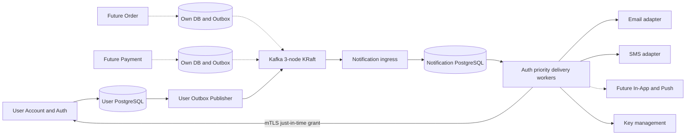
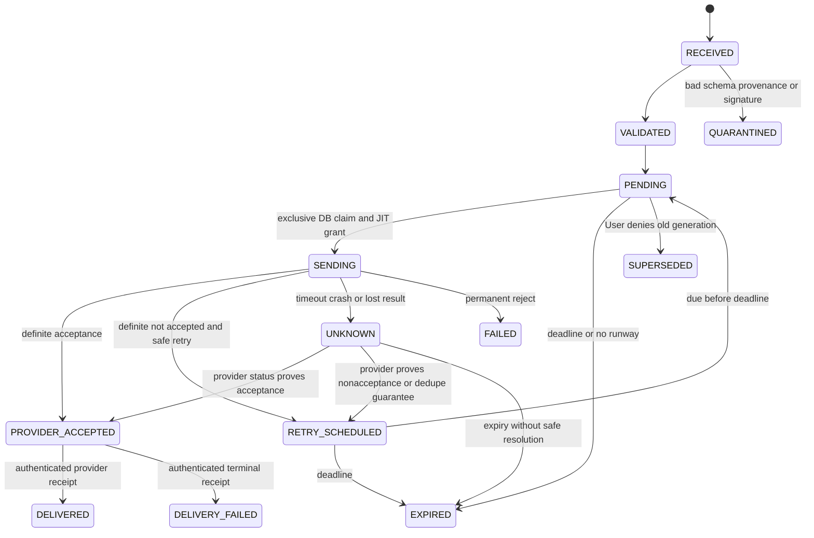
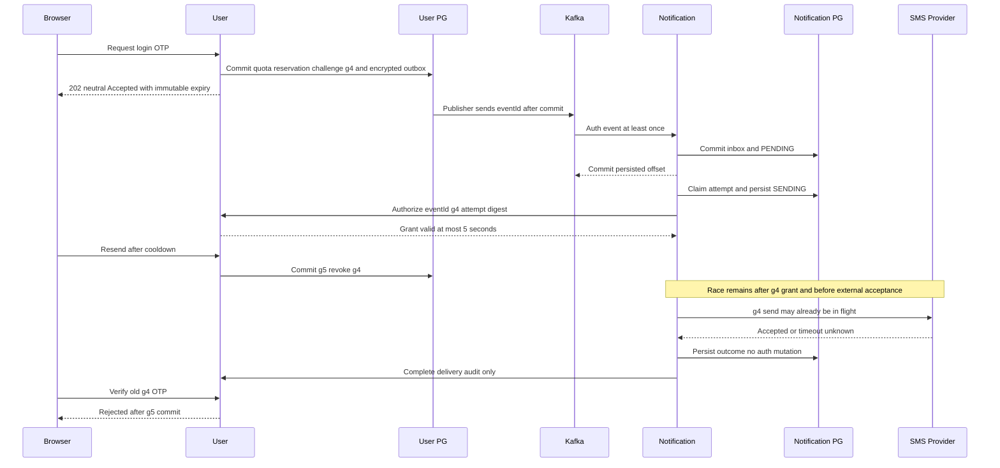

# Shared Notification Service — Technical Design

| Thuộc tính | Giá trị |
|---|---|
| Feature / Issue | MVP-ACC; [#43](https://github.com/duvanan/shopee/issues/43), mở rộng thiết kế theo yêu cầu trực tiếp của chủ dự án ngày 05/11/2026 |
| Status | **Draft / Needs review — chưa Approved, chưa cho phép implementation** |
| Phiên bản | 0.1 — 05/11/2026, Asia/Saigon |
| Đầu vào nghiệp vụ | [BA v1.0 Approved](../features/MVP-ACC/BA_SPEC.md), [UX v1.0 Approved](../features/MVP-ACC/UX_SPEC.md) |
| Thiết kế liên quan | [Auth Technical Design](../features/MVP-ACC/TECHNICAL_DESIGN.md), [Kafka Notification Architecture](KAFKA_NOTIFICATION_ARCHITECTURE.md) |
| Chủ sở hữu tài liệu | Codex architect; quyết định N-D01..N-D10 bên dưới cần chủ dự án review |

Tài liệu thiết kế nền tảng thông báo dùng chung, tích hợp đầu tiên là MVP-ACC. Order, Payment, Shipping, In-App và Push là khả năng tương lai; ví dụ contract không có nghĩa các service/chức năng đó đã tồn tại hoặc được duyệt nghiệp vụ. Chỉ thiết kế tài liệu; không thêm module Maven, migration, Compose, ACL, secret, deployment hay ứng dụng chạy thật.

## 1. Bối cảnh, authority và chênh lệch source

Đã đối chiếu `AGENTS.md`, workflow, SPEC_HANDOFF, ROADMAP_2026_2027, handoff MVP-ACC, BA/UX Approved và Draft Auth 0.1. BA ghi nhận phê duyệt 29 lựa chọn A; UX có xác nhận trực tiếp ngày 05/11/2026. BA/UX không ấn định công nghệ giao thông báo. Yêu cầu mới của chủ dự án cho phép **thiết kế** Notification Service + Kafka, thay lựa chọn User-local delivery trong Draft 0.1. Không coi đây là duyệt Technical Design hoặc tự đổi lịch sprint.

| Bằng chứng source đã kiểm tĩnh | Hiện trạng / tác động |
|---|---|
| `backend/pom.xml` | Java25, Boot4.1.0, Cloud2025.1.2; User/Product/Gateway/Common/Eureka/Config, chưa có notification-service |
| `docker-compose.yml`, `infra/postgres/init-databases.sql` | PG16 có User/Product DB, Redis7 profile cache; chưa Kafka hoặc DB Notification |
| User `PasswordResetService` | Reset TTL30m và log raw token hiện hữu; TTL chưa BA-approved, log secret phải bỏ trong implementation sau này |
| Gateway `JwtAuthenticationFilter`, User/Product header filters | Trust boundary còn thiếu như Auth TD §1.1; không dùng raw X-User-* để cấp quyền delivery |
| Common `ApiResponse`, `ApiMeta`; User Flyway V1..V14 | Giữ envelope lỗi/trace; mỗi service sở hữu migration/DB riêng, không liên kết JPA xuyên service |
| `docs/project-management/ROADMAP_2026_2027.md` | Kafka/Notification ở S7/S8; nếu bắt buộc trước Auth MVP phải replan capacity, không âm thầm kéo cả Beta/ELK vào MVP |

Chưa chạy backend, Kafka, Compose hoặc failure test. Những đặc tính dưới đây là thiết kế và tiêu chí kiểm chứng, không phải chứng nhận production-safe.

## 2. Ranh giới và luồng tổng thể



| Owner | Quyền và dữ liệu | Không được làm |
|---|---|---|
| User Service | Sinh OTP/token; hash/HMAC; challenge purpose/generation/expiry/5 sai; trạng thái account; quota an ninh; reservation; outbox yêu cầu; JIT authorization | Không giao OTP verification/activation/session decision cho Notification; không đọc DB Notification |
| Notification Service | Consume/validate event, durable inbox/idempotency, templates, provider credentials, channel capacity, schedules/attempts/outcomes, delivery audit, retries/DLQ | Không tạo/activate Customer, đổi mật khẩu, sửa User/Order/Payment DB hoặc gia hạn OTP/token |
| Kafka / relay | Vận chuyển bền vững có duplicate; topic ACL; relay có claim/recovery | Không quyết account tồn tại, không cung cấp exactly-once external delivery |
| Future producers | Tự authorize use case, transaction domain+own outbox, event contract và expiry | Không ghi User outbox hoặc cấp quyền giả bằng field producerService |
| Gateway | Browser auth/route permissions, strip headers và trace; các delivery API chỉ nội bộ | Không route public tới JIT/operations endpoints |

User quota: SMS 5 sends/h +10/day mỗi phone (send+resend, chung signup/login), cooldown60s; email max5 **resends**/h, initial không tính resend. Notification chỉ giới hạn TPS/concurrency theo channel/provider và global cost budget; không reset/hoàn lại hoặc tự cấp reservation User. Provider throttled không tạo challenge/generation mới. Tránh tình trạng quota User hợp lệ nhưng worker lách bằng nhiều technical retries: retry unknown chỉ khi provider dedupe cùng key có bảo đảm; nếu không, UNKNOWN và chờ resend mới theo quota.

`shopee_notification` là DB logic độc lập, role riêng; có thể cùng instance PG local nhưng không chung quyền bảng. Account ID/workflow ID trong Notification chỉ opaque reference, không cross-DB FK. Namespace migration độc lập khi triển khai sau; hiện chưa tạo DB/migration. Delivery workers là module của Notification Service, không cần service scheduler riêng.

## 3. Event contract v1 và lựa chọn topics

Chọn topics theo **domain authorization boundary**, tách auth khỏi business traffic bằng consumer group và worker pool. Không topic-per-template/recipient; channel là field routing. `notification.auth.requested.v1` là integration hiện tại; `notification.order.requested.v1` và `notification.payment.requested.v1` chỉ reserve naming tương lai. Topic retry/DLQ là signal đã sanitize, không chuyển toàn event chứa ciphertext đi khắp nơi. Partition/retention/ACL chi tiết nằm trong [Kafka design](KAFKA_NOTIFICATION_ARCHITECTURE.md).

Domain topic thuận ACL và retention, auth không bị Order batch chiếm poll loop. Priority topic cho mọi domain dễ cho producer tự nâng priority và lẫn secret retention. Channel topics tách provider tốt nhưng phải chia business ordering/authorization; defer tới khi có số liệu. `priority=AUTH` chỉ được User principal trên auth topic dùng, không tin field do producer bất kỳ khai.

### 3.1. Envelope chuẩn

| Field | Kiểu / constraint |
|---|---|
| `eventId` | UUID random, sinh một lần trong transaction; không đổi khi publish/retry |
| `eventType`, `schemaVersion` | `notification.delivery.requested`, integer1; major không tương thích chuyển `.v2`, không silently parse unknown version |
| `producerService`, `producerInstance` | Workload ID + instance trace; consumer map topic→allowed producer và kiểm chữ ký, không tin tên tự khai |
| `aggregate` | `{type,id,sequence}`; auth là workflow UUID + generation, không email/phone/raw user data |
| `notificationType`, `template` | Enum allowlist + `{id,version,locale}` immutable; không cho URL/HTML template tùy ý |
| `channel`, `priority` | EMAIL/SMS hiện tại; AUTH/BUSINESS, kiểm producer policy |
| `recipient` | `{kind:"ENCRYPTED",reference:"opaque"}`; destination thật nằm encrypted payload; reference HMAC không raw identity |
| `createdAt`, `expiresAt`, `sendNotAfter` | UTC RFC3339; immutable; expiry theo User issuance, không tính lại khi consume; sendNotAfter<=expiresAt |
| `correlationId`, `traceparent`, `tracestate` | Trace allowlist/size bounded; không secrets/PII; baggage không forward tùy ý |
| `idempotencyKey`, `partitionKey` | Producer-scoped opaque hash/key; auth partition `auth:<HMAC(canonical identity\|purpose)>`; không chia sẻ User HMAC key cho Notification |
| `securityContext` | `{purpose,workflowId,generation,reservationId}` cho auth; reference cho JIT, không phải credential |
| `payload` | `{algorithm,keyId,wrappedDataKey,iv,ciphertext,tag}`; AEAD, base64url; encrypted recipient + template variables + token/link/OTP |
| `signature` | `{algorithm:"Ed25519",keyId,value}` đề xuất; ký RFC8785 canonical envelope trừ signature; verify producer key allowlist |

Envelope JSON schema đặt contract version trong module độc lập về sau, không kéo servlet Common vào Kafka/Gateway một cách vô điều kiện. Size đề xuất tối đa32KiB/event; không attachment/HTML từ producer. Field không biết chỉ được bỏ qua khi schema đã cho phép optional extension; thay semantics field hiện hữu là breaking. Require createdAt<=expiresAt, max lifetime per notification type, channel-template-purpose hợp lệ, UTF8, bounded strings. Add optional fields backward-compatible; producer CI chạy fixtures của consumer N/N-1; song song v1/v2 topic trong migration, không đổi enum làm consumer cũ gửi nhầm.

Canonicalization dùng [RFC8785 JCS](https://www.rfc-editor.org/rfc/rfc8785): reject duplicate object keys/lone surrogates/nonfinite numbers; số nguyên sequence/version trong envelope phải nằm safe integer range của JSON canonicalizer, số lớn tương lai dùng schema string có version rõ. Không Unicode-normalize strings khi tính digest/signature; producer và consumer dùng cùng fixtures byte-level. Signature và hash không dựa pretty-print hoặc thứ tự key serializer tùy máy.

Identity HMAC rotation phải giữ mapping workflow/quota ổn định: pin HMAC key version cho workflow đang sống và tra aliases cũ+mới trong toàn cửa sổ hạn mức trước đổi key. Không để key rotation tạo identity/ledger trống hoặc reset5/h10/day; duy trì khóa canonical identity duy nhất qua mapping có version. Stream/partition key của workflow đang sống không đổi giữa generation; khi cần remap partition, drain/versioned cutover và User generation gate vẫn authoritative. HMAC key bảo vệ quota không chia sẻ với Notification; rotate pseudonym audit riêng không được reset quota.

### 3.2. JSON minh họa

Các giá trị ciphertext/key/signature là **placeholder tài liệu**, không phải secret thật hoặc dữ liệu decrypt được. Cả năm ví dụ dùng recipient nằm encrypted; `payload` chứa nội dung cần gửi, không xuất hiện raw OTP, verify/reset token hoặc URL mang token. TTL reset30m vẫn là recommendation TD-D01, chưa BA-approved. TTL Order/Payment1d chỉ giả định minh họa, phải có approved producer spec trước tích hợp.

Email verification — pending account vẫn do User sở hữu:

```json
{
  "eventId": "ac79bcb4-27ba-4f6d-8de6-0af8e6309881",
  "eventType": "notification.delivery.requested", "schemaVersion": 1,
  "producerService": "user-service", "producerInstance": "user-1",
  "aggregate": {"type": "EMAIL_REGISTRATION", "id": "e5559f0e-2bc0-4980-bc41-72d262446045", "sequence": 2},
  "notificationType": "AUTH_EMAIL_VERIFICATION", "template": {"id": "auth-email-verification", "version": 1, "locale": "vi-VN"},
  "channel": "EMAIL", "priority": "AUTH", "recipient": {"kind": "ENCRYPTED", "reference": "r_hmac_K4zt"},
  "createdAt": "2026-11-05T05:00:00Z", "expiresAt": "2026-11-06T05:00:00Z", "sendNotAfter": "2026-11-06T04:59:30Z",
  "correlationId": "req_7da2", "traceparent": "00-4bf92f3577b34da6a3ce929d0e0e4736-00f067aa0ba902b7-01", "tracestate": "",
  "idempotencyKey": "user:verify:e5559f0e:g2", "partitionKey": "auth:hmac_email_signup_Qc1",
  "securityContext": {"purpose": "EMAIL_VERIFY", "workflowId": "e5559f0e-2bc0-4980-bc41-72d262446045", "generation": 2, "reservationId": "75b5a45b-6fde-46a9-9ed4-455149e68255"},
  "payload": {"algorithm": "A256GCM", "keyId": "local-dev/auth-delivery/k1", "wrappedDataKey": "REDACTED_WRAP", "iv": "REDACTED_IV", "ciphertext": "REDACTED_EMAIL_PAYLOAD", "tag": "REDACTED_TAG"},
  "signature": {"algorithm": "Ed25519", "keyId": "user-signing-k1", "value": "REDACTED_SIGNATURE"}
}
```

SMS OTP login — generation4 của LOGIN, không thể dùng ở SIGNUP:

```json
{
  "eventId": "8ea758bb-fae6-4b81-86d3-ec46cdf01521",
  "eventType": "notification.delivery.requested", "schemaVersion": 1,
  "producerService": "user-service", "producerInstance": "user-2",
  "aggregate": {"type": "PHONE_LOGIN", "id": "bb0146b2-b3c0-4776-8f8e-4ae451175a8b", "sequence": 4},
  "notificationType": "AUTH_SMS_LOGIN_OTP", "template": {"id": "auth-phone-login-otp", "version": 1, "locale": "vi-VN"},
  "channel": "SMS", "priority": "AUTH", "recipient": {"kind": "ENCRYPTED", "reference": "r_hmac_nV9Q"},
  "createdAt": "2026-11-05T05:00:00Z", "expiresAt": "2026-11-05T05:05:00Z", "sendNotAfter": "2026-11-05T05:04:30Z",
  "correlationId": "req_bd10", "traceparent": "00-4bf92f3577b34da6a3ce929d0e0e4736-1af067aa0ba902b7-01", "tracestate": "",
  "idempotencyKey": "user:otp-login:bb0146b2:g4", "partitionKey": "auth:hmac_phone_login_rT2",
  "securityContext": {"purpose": "PHONE_LOGIN", "workflowId": "bb0146b2-b3c0-4776-8f8e-4ae451175a8b", "generation": 4, "reservationId": "4b96d10f-8aac-4ac4-a058-c92bdf054b5e"},
  "payload": {"algorithm": "A256GCM", "keyId": "local-dev/auth-delivery/k1", "wrappedDataKey": "REDACTED_WRAP", "iv": "REDACTED_IV", "ciphertext": "REDACTED_SMS_PAYLOAD", "tag": "REDACTED_TAG"},
  "signature": {"algorithm": "Ed25519", "keyId": "user-signing-k1", "value": "REDACTED_SIGNATURE"}
}
```

Password reset — không phát hành phiên hoặc tự đổi password khi gửi:

```json
{
  "eventId": "cc198df6-edb3-4440-8cce-0520ce6f7310",
  "eventType": "notification.delivery.requested", "schemaVersion": 1,
  "producerService": "user-service", "producerInstance": "user-1",
  "aggregate": {"type": "PASSWORD_RESET", "id": "77a39308-118d-4f44-ae1c-01e9e5c8bdca", "sequence": 1},
  "notificationType": "AUTH_PASSWORD_RESET", "template": {"id": "auth-password-reset", "version": 1, "locale": "vi-VN"},
  "channel": "EMAIL", "priority": "AUTH", "recipient": {"kind": "ENCRYPTED", "reference": "r_hmac_y7d2"},
  "createdAt": "2026-11-05T05:00:00Z", "expiresAt": "2026-11-05T05:30:00Z", "sendNotAfter": "2026-11-05T05:29:30Z",
  "correlationId": "req_1c98", "traceparent": "00-4bf92f3577b34da6a3ce929d0e0e4736-2af067aa0ba902b7-01", "tracestate": "",
  "idempotencyKey": "user:reset:77a39308:g1", "partitionKey": "auth:hmac_email_reset_Dn8",
  "securityContext": {"purpose": "PASSWORD_RESET", "workflowId": "77a39308-118d-4f44-ae1c-01e9e5c8bdca", "generation": 1, "reservationId": "02cf939c-0994-4d41-88d8-e7116a6d5c94"},
  "payload": {"algorithm": "A256GCM", "keyId": "local-dev/auth-delivery/k1", "wrappedDataKey": "REDACTED_WRAP", "iv": "REDACTED_IV", "ciphertext": "REDACTED_RESET_PAYLOAD", "tag": "REDACTED_TAG"},
  "signature": {"algorithm": "Ed25519", "keyId": "user-signing-k1", "value": "REDACTED_SIGNATURE"}
}
```

Future Order confirmation — contract example, chưa thêm topic/producer/consumer nghiệp vụ:

```json
{
  "eventId": "03bf4c23-d002-4fc0-8775-01be918b63c9",
  "eventType": "notification.delivery.requested", "schemaVersion": 1,
  "producerService": "order-service", "producerInstance": "order-future-1",
  "aggregate": {"type": "ORDER", "id": "b4b3fc6c-7d11-44b7-88c7-778a0778361b", "sequence": 1},
  "notificationType": "ORDER_CONFIRMED", "template": {"id": "order-confirmation", "version": 1, "locale": "vi-VN"},
  "channel": "EMAIL", "priority": "BUSINESS", "recipient": {"kind": "ENCRYPTED", "reference": "r_hmac_order_w4"},
  "createdAt": "2026-11-05T05:00:00Z", "expiresAt": "2026-11-06T05:00:00Z", "sendNotAfter": "2026-11-06T04:59:30Z",
  "correlationId": "req_order_future", "traceparent": "00-4bf92f3577b34da6a3ce929d0e0e4736-3af067aa0ba902b7-01", "tracestate": "",
  "idempotencyKey": "order:confirmed:b4b3fc6c:v1", "partitionKey": "order:b4b3fc6c-7d11-44b7-88c7-778a0778361b",
  "securityContext": {"purpose": "ORDER_CONFIRMED", "workflowId": "b4b3fc6c-7d11-44b7-88c7-778a0778361b", "generation": 1, "reservationId": null},
  "payload": {"algorithm": "A256GCM", "keyId": "local-dev/business-delivery/k1", "wrappedDataKey": "REDACTED_WRAP", "iv": "REDACTED_IV", "ciphertext": "REDACTED_ORDER_REFERENCE_AND_VARIABLES", "tag": "REDACTED_TAG"},
  "signature": {"algorithm": "Ed25519", "keyId": "order-signing-future-k1", "value": "REDACTED_SIGNATURE"}
}
```

Future Payment success — không gửi PAN, ngân hàng hoặc full receipt PII:

```json
{
  "eventId": "71c3c411-8e88-465a-b78f-41b8a925d040",
  "eventType": "notification.delivery.requested", "schemaVersion": 1,
  "producerService": "payment-service", "producerInstance": "payment-future-1",
  "aggregate": {"type": "PAYMENT", "id": "6efc3208-28e6-48a1-b47a-c3f3c2f68ab4", "sequence": 2},
  "notificationType": "PAYMENT_SUCCEEDED", "template": {"id": "payment-success", "version": 1, "locale": "vi-VN"},
  "channel": "EMAIL", "priority": "BUSINESS", "recipient": {"kind": "ENCRYPTED", "reference": "r_hmac_payment_k3"},
  "createdAt": "2026-11-05T05:00:00Z", "expiresAt": "2026-11-06T05:00:00Z", "sendNotAfter": "2026-11-06T04:59:30Z",
  "correlationId": "req_payment_future", "traceparent": "00-4bf92f3577b34da6a3ce929d0e0e4736-4af067aa0ba902b7-01", "tracestate": "",
  "idempotencyKey": "payment:succeeded:6efc3208:v2", "partitionKey": "payment:6efc3208-28e6-48a1-b47a-c3f3c2f68ab4",
  "securityContext": {"purpose": "PAYMENT_SUCCEEDED", "workflowId": "6efc3208-28e6-48a1-b47a-c3f3c2f68ab4", "generation": 2, "reservationId": null},
  "payload": {"algorithm": "A256GCM", "keyId": "local-dev/business-delivery/k1", "wrappedDataKey": "REDACTED_WRAP", "iv": "REDACTED_IV", "ciphertext": "REDACTED_MINIMAL_PAYMENT_VARIABLES", "tag": "REDACTED_TAG"},
  "signature": {"algorithm": "Ed25519", "keyId": "payment-signing-future-k1", "value": "REDACTED_SIGNATURE"}
}
```

Template variables sau decrypt chỉ có destination, locale, approved display text và secret/link cần thiết; không có password hoặc refresh/access JWT. Auth link là fixed allowlisted origin + fragment token; Notification không nhận URL tùy ý làm SSRF. Template pack pinned version nằm trong image/registry tin cậy; renderer escape variables, không eval expression, không cho download template từ URL event. Decrypt failure không fallback plaintext.

## 4. Mã hóa, identity và vòng đời secret

N-D02 đề xuất envelope encryption: producer lấy DEK256-bit mới từ key service; AES-256-GCM với nonce96-bit mới cho mỗi payload, không reuse DEK/nonce. Canonical immutable envelope metadata (eventId, producer, aggregate/sequence, type/schema/template/channel, recipient reference, purpose/generation/reservation, deadlines, idempotency/partition keys) là AAD; signature bind toàn envelope gồm ciphertext. Nhận mutation channel/expiry/recipient/ciphertext phải fail trước gửi.

DEK được wrap dưới KEK tách môi trường và auth/business; Kafka/outbox chỉ lưu wrapped DEK+payload. User được generate/encrypt cho auth; Notification auth workload được unwrap qua policy key manager; Order/Payment tương lai không có auth key hoặc auth signing key. Producer signing private key chỉ producer; Notification chỉ verify public key. Key ID là allowlisted reference, không endpoint gọi tùy ý. Kafka TLS+mTLS ACL xác thực kết nối; chữ ký bảo vệ producer provenance khi consumer đọc shared topic/restore/replay. Chữ ký không thay thế việc kiểm User JIT.

Local dev dùng key manager hoặc keystore local có ACL, material inject từ file/env ngoài Git và fake recipients; **chưa chọn triển khai cụ thể**, N-D02 cần duyệt. Public trial cần audited key management, at-rest encryption/backup encryption, workload identities; không có key manager reachable → không decrypt/gửi. Không dùng shared AES key trong repository hoặc Kafka config. Rotate key IDs bằng dual verify/decrypt overlap tối đa retention hợp lệ; producer dùng active new key, không log key bytes. Revoked key→quarantine/no-send, không tự bỏ encryption. KEK rotation không kéo dài token expiry.

Notification unwrap/decrypt chỉ ngay trước JIT/provider, plaintext trong memory theo attempt, không cache plaintext/DEK xuyên request hoặc heap dump. Wipe best effort; JVM/OS có giới hạn, disable diagnostic dump chứa secret và restrict operator access. Payload auth trong User outbox xóa sau Kafka ACK+mark PUBLISHED; Notification encrypted payload xóa sau terminal hoặc expiresAt theo cleanup job, không chờ audit retention. Kafka retention24h không xóa từng OTP đúng5m; vì vậy expiry được enforce **logic** bởi User JIT và verify, không tuyên bố cryptographic TTL hoặc xóa tức thì mọi replica/backup. Một Notification bị compromise có thể đọc secret đang có quyền decrypt; cần trust/least privilege và incident runbook, encryption không che dữ liệu với consumer hợp lệ.

## 5. Transactional Outbox trong từng domain

### 5.1. Polling Publisher được đề xuất

User transaction cùng DB ghi reservation/counter, challenge/token generation, invalidation cũ và outbox row; rollback tất cả nếu insert/encrypt không thành công. Key material retrieval/prepare encryption ngoài DB lock khi có thể, nhưng deadline/generation/AAD cuối phải khớp commit; không provider I/O trong transaction. Public retry dùng idempotency ledger để không double-reserve. Synthetic/no-op requests cũng có ledger và cùng response; chỉ eligible thật có event authorize gửi, không gửi tin nhắn chứng minh tài khoản lạ tồn tại.

| Outbox column / index | Ý nghĩa |
|---|---|
| `id/event_id UUID PK`, `producer_service`, `event_type`, `schema_version` | Immutable event identity; producer-bound |
| `stream_key`, `aggregate_id UUID`, `aggregate_sequence bigint`, `partition_key` | Workflow order; unique `(stream_key,aggregate_sequence,event_type)` khi một delivery/channel mỗi generation |
| `payload_envelope jsonb`, `envelope_hash`, `created_at`, `expires_at`, `send_not_after` | Chỉ ciphertext+safe metadata; hash immutable cho dedupe tampering |
| `status READY/CLAIMED/PUBLISHED/EXPIRED/FAILED`, `available_at`, `attempt_count` | Publisher lifecycle, không provider delivery state |
| `claim_owner`, `claim_token UUID`, `claim_until`, `last_error_code` | Claim fencing cho update DB, không dùng raw exception |
| `published_at`, `kafka_topic`, `kafka_partition`, `kafka_offset` | ACK audit; không chứng minh Notification/provider đã nhận |
| Index `(status,available_at,created_at)`; `(stream_key,aggregate_sequence)` | Ready scans và per-stream barrier; retention index published/expiry |

Publisher poll đề xuất250ms, batch<=20 theo Kafka design; transaction ngắn dùng `FOR UPDATE SKIP LOCKED` claim và commit, **không** giữ DB transaction khi chờ Kafka. Chọn head chưa terminal của mỗi stream, không publish generation sau khi head còn pending, để giảm reorder. Lease30s > Kafka delivery timeout10s, producer request timeout3s; cap in-flight để cả batch không bị chờ tuần tự quá lease, renew an toàn bằng claim token khi cần; update PUBLISHED chỉ khi token hiện tại. Header Kafka mang eventId/schemaVersion/traceparent safe. Producer `acks=all`, idempotent, retry trong timeout; broker ACK rồi mới mark PUBLISHED. Crash sau ACK trước mark dẫn duplicate; Kafka producer idempotence không dedupe across publisher restart/event replay, Notification inbox phải làm việc đó.

Crash trước ACK/timeout không biết commit broker → retry cùng eventId, không event mới. Hết claim mới reclaim; stale worker không được update state khi token khác. Lease/fence DB không ngăn zombie process gửi Kafka trễ; old duplicate có thể đến sau generation mới. Không dựa toàn bộ vào FIFO: consumer kiểm generation qua User JIT. Không công bố total order across topics/partitions; tăng partitions có thể đổi mapping, cần cutover/drain hoặc chấp nhận application generation ordering.

Kafka unavailable: outbox tích lũy, bounded backoff có jitter0.25–5s, không block transaction auth theo broker; có expiry scan, event không được publish để gửi khi quá sendNotAfter. Khi backlog/DB disk high watermark, global admission breaker áp dụng trước identity lookup trả503 đồng nhất, không tạo thêm quota reservations. Đề xuất gate nếu oldest auth outbox>30s hoặc disk free<20%, hysteresis và thresholds chờ owner/load test; đã202 trước outage vẫn không hứa eventual delivery. Pending OTP không extend5m. Backpressure ưu tiên auth stream, cap relay in-flight và DB rows; alerts và quarantine poison schema để không hot-loop.

Sau publish, giữ metadata/hash7d đề xuất, wipe encrypted body; không replay auth từ metadata khi secret hết hiệu lực. Outbox cleanup chỉ terminal + ngoài audit window, không xóa unpublished chưa có quyết định expiry/owner remediation. Cần giữ idempotency receipt đủ replay horizon; retention chờ N-D08. Future Order/Payment transaction own state+own outbox, dùng same envelope/lib contract nhưng không shared DB hoặc chung transaction với User.

### 5.2. Polling so với CDC Debezium

| Lựa chọn | Lợi ích | Chi phí / hạn chế |
|---|---|---|
| Polling SQL + leases | Ít runtime mới, dễ expiry/backpressure, hợp PG hiện có, kiểm được bằng integration test | Poll latency/load, tự làm claim/retry/fencing và order; duplicate sau crash |
| Debezium Outbox Event Router | Relay qua WAL, routing aggregate key, bớt application poller | Connector/replication slot/WAL retention/Connect và restore/schema vận hành; expiry và JIT vẫn cần; không giải quyết provider exactly-once |

Chọn polling cho integration đầu tiên, reevaluate CDC khi số producer/load biện minh chi phí. Contract event/outbox domain vẫn giữ để chuyển relay sau này. Debezium hỗ trợ routing outbox records, nhưng không thay authorization ở consumer. Tham khảo [Debezium Outbox Event Router](https://debezium.io/documentation/reference/stable/transformations/outbox-event-router.html).

Kafka transaction chỉ atomic các record/offset bên Kafka; không commit cùng PostgreSQL business state một cách tự động. Không được update domain rồi gửi broker bằng hai bước không outbox; crash giữa hai hệ sẽ mất event hoặc có phantom send. Không XA/distributed transaction giả định. At-least-once transport + inbox idempotency giữ một logical notification, không phải exactly-once email/SMS.

## 6. Notification Service nội bộ và dữ liệu

| Module | Trách nhiệm |
|---|---|
| Kafka Consumer | Poll bounded, validate envelope trước persist, DB inbox transaction rồi mới ack offset; auth group riêng |
| Validation and Routing | Topic/producer/signature/schema/template/channel allowlists; deadline; limits; không trust user headers |
| Idempotency Handler | Unique producer+eventId và producer+idempotencyKey; cùng ID/hash khác payload→quarantine/tamper alert |
| Template Engine | Pinned template+locale version, escaping, bounded SMS length, không template URL thực thi |
| Delivery Orchestrator | DB claim, provider budget, JIT authorization, decrypt, attempt CAS; auth priority pool |
| Email/SMS Adapters | Provider credentials ngoài repo, bounded timeout, idempotency key/status lookup khi support, sanitize errors |
| Notification Repository | Own PG transactions/locking, no cross-service queries |
| Retry Scheduler | DB `next_attempt_at` authoritative, bounded TTL-aware backoff+jitter; no long sleeps trong Kafka poll |
| DLQ Handler | Quarantine record + sanitized signal, restricted manual replay; auth hết hạn không replay |
| Observability/Audit | Trace continuation, latency/lag/provider outcomes, secret redaction, audit access control |

| Bảng độc lập trong Notification DB | Cột và ràng buộc tối thiểu |
|---|---|
| `notification_inbox` | `(producer_service,event_id)` UNIQUE, envelope_hash, topic/partition/offset, received_at, schema_version; duplicate không tạo delivery thứ2 |
| `notifications` | `id UUID PK`, producer,event_id,idempotency_key UNIQUE theo producer, workflow_ref,generation,type,template_id/version,channel,priority,recipient_ref,ciphertext envelope,created/expires/send_not_after,status,next_attempt_at,attempt_count,version; index `(priority,status,next_attempt_at)`, expiry |
| `delivery_attempts` | attemptId PK, notificationId FK, attemptNo UNIQUE/notif, claimToken, leaseUntil, requestDigest, userGrantId/ref, providerKey, started/finishedAt, outcome,errorCode; không plaintext/body/provider raw exception |
| `provider_references` | notificationId,provider,providerRequestId/status, UNIQUE(provider,providerKey); encrypted reference khi PII; dedupe signed callbacks |
| `template_metadata` | templateId/version/channel/locale checksum, supported variable schema, ACTIVE/RETIRED; artifact thực tế pinned, không admin tự upload unsafe template |
| `notification_signal_outbox` | retry/DLQ signal id, notif/event ref, reasonCode,dueAt,status/claim fencing; emit Kafka signal sau commit local state |
| `provider_rate_buckets` | provider/channel/bucket, shared budget/reservations/version; atomic cap across instances; không thay quota User |

Các FK chỉ trong Notification DB, entity dùng ID phẳng. inbox+notification+signal outbox cùng transaction; nếu DB fail không commit Kafka offset. Poison message không parse được: persist safe digest/topic/partition/offset+reason vào quarantine, không copy raw body/log; chỉ commit offset sau durable quarantine. Không nhận event tùy ý từ public REST.

Ingress không gọi provider. Mỗi partition commit offset chỉ tới **contiguous prefix đã persist/quarantine**, không ack offset vượt record đang fail khi xử lý parallel. Duplicate cùng event/hash nhận lại chỉ ack; cùng event/different hash reject/quarantine. Consumer rebalance đóng nhận mới/flush DB ngắn, chưa commit offset sẽ được đọc lại an toàn. Worker horizontal scale không bị giới hạn Kafka partitions nếu đã vào DB, nhưng DB throughput/provider quota là giới hạn thật.



PROVIDER_ACCEPTED/SENT nghĩa provider nhận lệnh, không đồng nghĩa inbox/handset delivery. Không có delivery receipt thì giữ accepted; không suy delivered từ timeout. Late callback chỉ thay delivery outcome, không activate account hoặc mở lại expiry. Callback signature/dedup/source policy phải được chọn theo provider; nếu cần public callback route, Gateway chỉ mở exact POST adapter route với provider signature verification, không dùng X-User identity. Chưa thêm route/config thực tế.

Workers claim due rows bằng SKIP LOCKED, increment attempt fence/CAS, persist SENDING+attempt trước provider. Một active claim/notification qua unique/CAS. Worker chết với SENDING không được worker khác gửi ngay sau lease expiry: chuyển UNKNOWN, resolve status/dedupe hoặc chờ expire. Fencing token chặn stale DB update, **không fence được provider socket**. Nếu adapter không idempotency/status, không thể bảo đảm external send không lặp khi retry unknown; do đó đề xuất không auto-retry unknown cho auth.

Retry định nghĩa không đổi eventId/providerKey hoặc gia hạn OTP. Đề xuất max3 provider attempts/event, backoff1s/3s/10s+jitter nhưng chỉ retry definite transient nonacceptance hoặc dedup-supported; check JIT/deadline mọi lần. ProviderKey tính một lần bằng `HMAC(provider,producerService,eventId,channel)`, persist theo logical notification/provider và giữ nguyên qua key rotation; attemptId khác nhau cho audit. Không cho SDK/HTTP client hidden retries ngoài policy/budget; disable auto-retry mặc định nếu adapter không chứng minh semantics. UNKNOWN không tự switch provider vì key/idempotency khác vendor không dedupe lẫn nhau; chỉ đổi khi có bằng chứng provider cũ không accepted và policy approved. Global rate bucket cap submissions across instances; budget check trước JIT để grant không hết vì xếp hàng. Hết budget tới quá sendNotAfter→EXPIRED, không kéo hạn. Business retry schedules tương lai có thể dài hơn, phải policy riêng.

## 7. Delivery auth-critical: JIT grant và race

### 7.1. Các invariant giữ nguyên

User sinh OTP6 số, expiry **5m từ lúc issue**, max5 sai/challenge, cooldown60s, SMS5/h10/day; email verify24h và pending7d; email resend5/h không tính initial. Kafka lag/provider latency không đổi `expiresAt`; Notification không tạo OTP mới hoặc tự regenerate link. OTP/signup verification vẫn POST User, chỉ khi đúng User mới tạo phone Customer/auto-login. Email owner vẫn đặt password chính thức, rồi login thủ công. Provider accepted không đánh dấu verified.

Resend transaction ở User tăng generation và invalidate mã/link cũ ngay commit. Topic ordering/cache trong Notification chỉ giảm công việc, không thay User authority. Unknown phone login / existing phone signup synthetic request không được nhận grant gửi; UI vẫn cùng Accepted schema. Delivery state chi tiết không expose publicly theo email/phone.

### 7.2. Hợp đồng API nội bộ

Tất cả dùng `backend/common` envelope `success/code/message/data/errors/meta` và trace header, mTLS identity allowlist **notification-service auth worker**; không browser cookie/JWT, không raw X-User context. Root User DB authoritative, không stale replica/cache. Không publish các route `/internal/**` qua Gateway. Không log request/response body có secret; requests chỉ references/digest.

| Endpoint | Request / response / tính nguyên tử |
|---|---|
| POST `/internal/auth/deliveries/{eventId}/authorize` | `{generation,attemptId,fence,requestDigest}`; User lock workflow+reservation kiểm immutable event/purpose, authorized reservation, eligible state, current generation, nonconsumed token/challenge, expiry và policy; record grant theo event+attempt, trả `{grantId,eventId,attemptId,fence,generation,requestDigest,notBefore,notAfter}` với `notAfter=min(now+5s,sendNotAfter)`; grant metadata không OTP |
| POST `/internal/auth/deliveries/{eventId}/complete` | `{grantId,attemptId,outcome,providerReference?,occurredAt}`; idempotent outcome audit, reject conflicting final outcome nếu không bằng chứng reconciliation; **không** sửa account/token expiry/session/attempts/quota; late callback chỉ audit |

`grantId` là UUID reference lưu cùng record, **không phải bearer credential**; authority là mTLS peer+event+attempt+fence+generation+digest binding. Notification không tự ký authority. `requestDigest = SHA-256(UTF8(RFC8785 canonical envelope excluding signature))`; gồm toàn payload encrypted và immutable metadata, không thêm HTTP headers/offset/provider dynamic. User persist digest tại transaction outbox và đối chiếu; không tin digest caller tự khai. Provider routing dùng allowlist Notification riêng, không thêm dữ liệu mà User không thể đối chiếu vào digest. API timeout1s đề xuất, fail closed, không fallback stale grant. Deny reasons nội bộ: SUPERSEDED/EXPIRED/CONSUMED/NOT_AUTHORIZED; 503 dependency; unauthorized peer403. Idempotent authorize cùng attempt/digest trả cùng original grant và notAfter còn hạn từ record, không extend lease; khác digest409. Original grant hết hạn deny; attempt mới chỉ khi provider policy chứng minh safe-to-retry. Lost grant response→retry same attempt, không provider send nếu không có confirmed grant. Grant5s là giới hạn dispatch attempt, không hứa provider giao trong5s.

User kiểm `now+30s<expiresAt` cho runway còn lại đề xuất; `sendNotAfter=expiresAt-30s` mặc định auth, có thể sớm hơn theo domain, không nới BA. Near-expiry email/reset cũng không gửi link gần hết hạn; owner N-D04 duyệt cutoff. Notification lấy budget/worker trước rồi JIT, recheck monotonic local elapsed+grant deadline ngay sát provider call; network timeout tối đa3s đề xuất và không vượt grant/runway còn lại. Provider vẫn có thể xử lý sau timeout, đó là UNKNOWN.

### 7.3. Race kiểm generation rồi gửi: bảo đảm và giới hạn

Ví dụ: Notification kiểm generation4 tại t0; User commit resend generation5 tại t1; request provider generation4 tới t2 hoặc đã in-flight. **Một generation check không khóa được khoảng t0→t2.** Kiểm thêm ngay trước send, signed grant hoặc delivery lease chỉ thu hẹp khoảng này. DB fence không được SMS/email provider kiểm tra nên không thể ngăn stale message đã ra mạng hoặc provider queue giao muộn. Không giữ User transaction/row lock trong khi provider I/O để làm lời hứa giả về last-mile delivery.

Đề xuất: JIT grant5s + generation binding + no-runway cutoff + User verify-only-current + stable provider idempotency key + UNKNOWN suppression. Grant được cấp sau commit resend luôn deny generation cũ; grant đã cấp trước resend có thể vẫn dẫn tới một stale message. Mã cũ luôn fail User verification sau commit resend, không trở thành credential hợp lệ dù nhận sau mã mới. Worker pause/GC ngay **sau local deadline check cuối cùng** cũng có thể làm provider call thực tế bắt đầu sau grant expiry; không thể atomic hóa đồng hồ User/worker với vendor I/O bằng fence nội bộ. Test bảo đảm deny tại expired checks và đo dispatch timestamp, không tuyên bố zero late physical send khi provider không enforce deadline. UI microcopy yêu cầu dùng mã mới nhất; không claim “tin nhắn cũ không bao giờ đến”. Audit metric stale grant observed, superseded drop và dispatch lag để đo residual.

| Phương án | Đánh giá |
|---|---|
| Chỉ decrypt payload có expiry + generation check local | Ngăn plaintext leak tới Kafka và đa số stale queue, không biết resend sau event, không đủ authorization |
| Authenticated User generation validation | Current source tại check; TOCTOU còn; fail closed khi User down |
| JIT grant có expiry và attempt binding | Chọn cho MVP; audit/quota provenance, giới hạn thời gian và stale worker nội bộ, không fence external provider |
| Lease giữ lock User qua send | Có thể serialize send/resend ở dispatch nhưng chậm/timeout làm block auth; không kiểm soát provider giao trễ; không chọn |
| Provider hỗ trợ fencing/cancel/status+idempotency | Tăng bảo đảm ở boundary provider nếu contract thật; không giả định nhà cung cấp có khả năng đó |
| Sync HTTPS User→Notification OTP dispatch | Có thể giảm Kafka lag nhưng thêm availability coupling, vẫn outbox/inbox/dedupe và race; **không bật fallback tự động**, phải cùng eventId/reservation và review topology để không double send |
| Auth dedicated ingress/workers | Chọn riêng capacity auth; giảm head-of-line blocking, không bảo đảm latency nếu provider/broker down |

Nếu load test không đạt latency thì owner chọn tăng auth capacity/tune relay hoặc thiết kế synchronous dispatch mới qua **Notification**, không trả provider adapter về User và không fallback bỏ quota/JIT. BA TTL giữ nguyên; không mặc nhiên đổi sang OTP có hiệu lực5m sau delivery.



### 7.4. API Accepted và phản hồi lỗi cho người dùng

Auth send endpoints trả202 **sau commit User PostgreSQL**: request/quota/workflow đã ghi nhận và eligible delivery event đã vào outbox, hoặc synthetic/no-op request được ghi nhận tương đương. Không bảo đảm Kafka ACK, Notification consume, provider accepted hoặc người dùng đã nhận. Envelope neutral thống nhất, timing pipeline tương tự; không trả `sent=true`, provider reference, notification status theo identifier.

Nếu Kafka/Notification/provider down sau202, public result vẫn Accepted; UI đếm theo server deadlines, chờ rồi resend theo policy, không “đã đến thiết bị”. Không cập nhật ACTIVE vì delivery. Global outage được phát hiện trước acceptance có thể trả503 giống nhau trước account lookup; never503 chỉ cho email/phone tồn tại. Request-status nếu sau này cần chỉ expose neutral receipt cho holder capability, không real-vs-synthetic/delivery diagnosis; hiện không đề xuất public delivery-status API. Login/verify failure vẫn neutral như BA/UX. Race backlog gate không thể hủy lời Accepted trước đó; expire/drop được audit nội bộ.

## 8. Retry, DLQ và replay

DB `next_attempt_at` là scheduler authoritative; Kafka retry topic chỉ signal giúp vận hành/cross-node wakeup. Signal `{schemaVersion,eventId,notificationId,reasonCode,occurredAt,dueAt?,traceparent}` không recipient/ciphertext/raw exception/OTP/URL. Consumer signal không tự gửi provider; claim DB due notification và kiểm trạng thái/JIT lại. Signal outbox transactional giúp DB decision+signal recoverable; signal duplicate không gây duplicate delivery.

DLQ/quarantine dành malformed/unauthorized/unsupported/permanent poison và exhausted safe retry; expired/superseded auth là terminal audit, không mặc định đẩy vào DLQ để chờ gửi lại. Nếu cần DLQ signal cho visibility chỉ metadata. Operator role riêng; truy cập DB có audit. Replay không republish raw original auth payload: expired/consumed/superseded → deny; current generation còn hạn chỉ resume original logical notification với eventId/providerKey cũ, không tạo quota/mint secret. UNKNOWN không replay nếu provider dedupe/status không đủ. Muốn OTP mới phải đi User resend và quota. Business replay tương lai cần domain authorization, không copy phép auth sang Order/Payment.

Poison message không block partition vô hạn: persist safe quarantine trước offset ACK, signal publisher best effort retry sau. Database down thì pause consumption, không ACK và không drop. Kafka retry/DLQ down không làm mất DB outcome; signal outbox backlog. Consumer lag vượt TTL không là lý do mở token cũ.

## 9. Threat/failure matrix và phân loại bảo đảm

| Tình huống | Cơ chế / expected outcome | Mức bảo đảm / limitation |
|---|---|---|
| Forged producer/service header | Topic mTLS ACL + producer signature + schema/topic policy; reject trước decrypt | Strong dưới giả định key/identity không compromise |
| Unauthorized consumer | Topic read ACL, auth key decrypt role, JIT peer allowlist; no public routes | Strong policy; broker/key admin vẫn trusted |
| Payload mutation/replay | AEAD AAD/signature, inbox unique+hash, expiry/current generation JIT | One logical notification; idempotency record retention phải đủ replay window |
| Kafka outage / minISR fail | User outbox retained, relay backoff, accepted semantics unchanged, expiry drop | Không hứa delivery trong outage; no token extension |
| One broker failure | RF3/minISR2/acksall trong điều kiện ISR còn2, controller majority còn2 | Expected tiếp tục; phải fault-test, một host local mất vẫn down hết |
| Network partition / two broker loss | Không hạ minISR; backpressure và DB outbox | Availability giảm để giữ durability |
| Notification down | Kafka retained, restart ingest inbox; JIT drop expired/superseded | At-least-once processing trước expiry; không lôi lại mã cũ |
| User/JIT DB down | Fail closed, retry khi còn runway; không stale cached grants | Không provider send nếu chưa được authorize |
| Notification DB fail | Không commit Kafka offset; stop workers unable persist SENDING | Restart reprocess; provider accepted trước DB outcome→UNKNOWN |
| Consumer crash/rebalance | Inbox DB commit trước offset; duplicate safe; provider outside poll loop | Không guarantee external exactly-once |
| Duplicate/out-of-order generation | Hash/idempotency + User current generation grant | Stale messages in-flight vẫn có thể đến; stale verify luôn deny |
| Concurrent send/lease expiry | One DB claim; expired SENDING→UNKNOWN, no blind re-send | DB strong; provider process cannot be fenced without support |
| Provider timeout / crash after acceptance | Stable providerKey; lookup/dedupe if real support; otherwise UNKNOWN no auto retry | Provider assistance cần cho safe external retry |
| Provider429/budget | Shared Notification rate bucket, TTL-aware queue, User quota unchanged | Technical queue may expire; không hoàn hoặc vượt reservation |
| Rate-limit bypass event injection | User reservation JIT, purpose/generation binding, no generic public send API | Notification compromised vẫn nguy hiểm provider creds; channel/global limits bổ sung |
| Poison/malicious event | Strict size/schema/templates/key refs; quarantine safe metadata; no HTML eval/SSRF | Alerts và bounded storage, không log raw payload |
| Kafka/retry/DLQ/log secret leak | App encryption, no payload copies to signals, redaction; encrypted DB/backups | Ciphertext metadata vẫn linkable; consumer/key compromise vẫn exposure |
| Clock skew/key rotation | User DB deadline primary; conservative runway; no expiry grace; overlap key IDs bounded | NTP/monitor, fail closed khi integrity/time không rõ |
| Provider receipt spoof | Verify signature/replay key/provider reference; never mutate business state | Provider acceptance khác confirmed delivery |

Strong theo giả định: atomic business+outbox commit trong một PG DB; User-only auth lifecycle/quota; một durable inbox/notification cho cùng ID; deny old generation tại verification; không cấp grant cho expired/superseded sau commit; session PG fence không phụ thuộc Kafka. Best effort: delivery latency, cancel stale in-flight delivery, memory wiping, provider receipts đến đủ. Không thể cam kết bằng Kafka/DB: exactly-once SMS/email, retract message đã accepted/delivered, encrypted ciphertext tự biến mất khỏi mọi backup đúng OTP TTL, hoặc không stale delivery sau resend khi provider không tham gia fencing.

## 10. Acceptance/test plan — tất cả Not Run

Hiện repo chưa có Notification module/test suite; không giả định đã có Kafka Testcontainers. Khi triển khai, tạo test harness riêng theo Issue, dùng PG thực + 3 broker thật/container cho concurrency/quorum/failure; fake provider chỉ cho deterministic I/O, thêm provider sandbox theo contract. Unit/mock không chứng minh quorum/transaction races. Mỗi expected result dưới đây cần run log/versions/seed/time trace, QA và Security owners.

| ID / layer | Setup và fault | Acceptance đo được | BA/UX mapping / owner |
|---|---|---|---|
| N-T01 Contract | Five fixtures+unknown schema/type/template/channel/producer, altered AAD/signature | 100% invalid rejected/quarantined; zero provider call; v1 optional additive compatibility fixtures pass | BR-ACC-28; Backend+Security |
| N-T02 Outbox/PG | Rollback state+outbox, crash before/after commit, Kafka ACK then relay crash | Rollback0 events; committed eligible event recoverable; duplicate same eventId; one logical notification | AC-ACC-21/24/26, UX-ACC-40; Backend+QA |
| N-T03 Publisher concurrency | 3 relays,100 same workflow updates, expiry and claim steal | No lost committed active event before expiry; stale claim cannot mark row; old generation JIT deny even late publish | BR-ACC-37/44, AC-ACC-43/48; Backend+QA |
| N-T04 Inbox/rebalance | 3 ingress instances,100 duplicates, crash after DB commit before offset | Exactly1 inbox+notification per ID; no commit past unpersisted contiguous prefix; no duplicate provider via ingress | AC-ACC-31/33; QA |
| N-T05 Quota | 50 concurrent requests, canonical variants, signup+login, Redis restart, provider429 | User sends<=5/h and10/day/phone, cooldown>=60s; email initial+5 resends allowed, next blocked; no technical retry creating reservation | BR-ACC-37/43, AC-ACC-32/43/47; Backend+QA |
| N-T06 OTP expiry | Lag until>=5m, boundary now==expiresAt, runway<30s; pause after final local check | Expired User verify always reject; no grant at expired User check; local expired check denies dispatch; record possible post-check late I/O without claiming atomic cutoff; no TTL extension | AC-ACC-29/46, UX-ACC-16; QA+Security |
| N-T07 Resend race | Pause worker before grant, after grant, during provider request; issue generation+1 | Before-grant old denied; after-grant stale physical send admitted as residual, old code always rejected; no claim of zero stale receipts | AC-ACC-48/65/66, UX-ACC-17; QA+Security |
| N-T08 Concurrent attempts | Two workers claim same notification; kill one after SENDING and provider acceptance | Single active DB claim; expired claim UNKNOWN; provider dedupe<=1 acceptance if contract supports; otherwise no automatic unknown retry | BR-ACC-17, AC-ACC-31; QA |
| N-T09 Providers | Timeout accepted, timeout notaccepted,429,5xx,permanent4xx; status webhook replay | Correct UNKNOWN vs retry; max3 safe attempts/event before expiry; no account ACTIVE from delivery; no quota bypass | AC-ACC-24/32, UX-ACC-40; Backend+QA |
| N-T10 Kafka quorum | Kill1 broker, then2, restart with durable volumes; outage60s | ISR2 expected ACKs, ISR1 writes fail; no lowering minISR; outbox recovers; expired events denied at subsequent grant/deadline checks, never made valid again | Infrastructure QA; DevOps |
| N-T11 DLQ/replay | Corrupt fixture and expired/superseded/UNKNOWN auth replay | Durable sanitized quarantine; no secret copied DLQ; replay cannot mint secret/reservation or resend expired notification | BR-ACC-28/44; QA+Security |
| N-T12 Identity/crypto | Untrusted mTLS peer, unauthorized topic write/read, wrong KEK, revoked key | 403/ACL deny before delivery; signature/decrypt fails closed; no fallback plaintext; key rotation valid overlap only | Security |
| N-T13 Leakage | Canary OTP/token/recipient through outbox/Kafka/DB retries/DLQ/log/metrics/trace; inspect decrypted provider fake inbox separately | No canary plaintext in transport/storage/log/metric snapshots; only provider plaintext boundary allowed; secrets purged per policy | BR-ACC-28, AC-ACC-61; Security+QA |
| N-T14 Anti-enumeration/UI | Known/unknown/pending/disabled identifiers, provider outage/gate toggles | Same accepted schema/status and no provider-existence detail; statistical timing review; UI no false delivered/verified | AC-ACC-24/50/61, UX-ACC-04/23/40; QA |
| N-T15 Auth regression | Original T01..T12 incl scanner/preregistration,5 wrong,signup/login isolation,session revoke | All original AC/UX evidence required; no activation/session from Notification; JWT revoke still PG live check during Kafka outage | AC-ACC-17..20/27/49/52/53..56/66; QA+Security |
| N-T16 Performance | Provisional local3broker+PG,2 Notification instances với auth ingress/workers,10 eligible auth events/s sustained10min,10% resend trên identities phân bổ để không vượt quota; fake provider ACK<=100ms, future non-auth fixture flood100/s trong1min | Proposed User-commit→inbox p95<=1s/p99<=2s; commit→provider ACK p95<=5s/p99<=15s;0 approvals at expired checks, observed late physical dispatch reported separately; auth không starvation, latency/lag/memory recorded, not delivery SLA | N-D04 pending; QA+DevOps |

Latency gate measured from User commit tới provider ACK, không chỉ Kafka consume/dispatch; provider handset receipt excluded. Above load does not override per-phone quotas: use distinct synthetic phones/fake accounts. Future traffic flood dùng test-topic fixture, không live Order/Payment service. If fails, measure relay/Kafka/DB/JIT/provider stages before selecting sync path; do not lengthen5m or remove security. Broker recovery test records acknowledged events/durability, not merely process healthy. N-T05 rolling windows/reservation failure counting still TD-D06 owner decision; test chosen policy explicitly.

## 11. Operations, retention, rollout và rollback

Metrics: User outbox age/rows/expired, Kafka lag in seconds and records per auth partition, inbox insert/dedupe/quarantine, queue age, JIT allow/deny/latency, grant→dispatch latency, provider accepted/unknown/retry/fail, auth TTL remaining, shared TPS/cost budget, DLQ signals, DB lock/lease conflicts/key manager failures. Alert proposed auth queue oldest>5s and no progress10s; admission gate high watermark per §5.1. No labels raw phone/email/event UUID or secret; bounded reason/channel/provider labels. Trace propagation User request→outbox relay→Kafka consumer→worker→JIT→provider metadata, no baggage PII.

Retention proposal N-D08: auth Kafka24h delete; retry/DLQ signals7d; Notification inbox/idempotency receipts30d (>=topic retention+allowed replay horizon), provider/audit metadata30d masked; encrypted auth payload wipe terminal or expiresAt, cleanup at least every minute; backups separately protected/expired, no immediate physical erase promise. User outbox metadata7d and no post-ACK ciphertext. Future business retention must be approved per feature. Operator replay window<=7d for safe non-auth candidates, auth remains bounded by live expiry and grant regardless receipt age. On Notification restore, disable dispatch until inbox/outcome consistency audited; SENDING becomes UNKNOWN, never blanket resend old rows.

Rollout đề xuất: approve decisions+estimates→contract fixtures/crypto keys→Kafka profile and ACL staged by DevOps→independent Notification DB/migrations→inbox only dry-run fake providers→User outbox relay+JIT→provider sandbox→fault/performance/security tests→controlled demo. Feature flags per producer/channel; exactly one delivery path active per event. Drain/mark old local outbox before switch, never run User provider worker and Notification worker cùng eligible event without shared idempotency proof. Readiness distinguishes consume/persist vs provider dependency; process healthy không có nghĩa auth delivery ready.

Rollback: gate new send requests globally neutral503 if no safe path, stop relay/dispatch flags and retain DB/outbox, keep session APIs/PG revocation and public browsing functioning. Do not rollback to raw-token log or JWT-only Gateway. Schema expand giữ dữ liệu; no destructive down migration. Do not automatically invoke old synchronous provider path for accepted auth events; if owner chooses such fallback, common eventId/providerKey and UNKNOWN reconciliation must pass tests first. Key compromise→revoke workload/signing/decrypt keys, pause send, invalidate affected User challenges/tokens qua trusted User procedure, audit recipients without logging secrets. Kafka/Notification restore never reactivates expired token/session.

## 12. Quyết định kiến trúc, dependencies và effort

Tất cả lựa chọn dưới đây **Pending**. Chủ dự án đã yêu cầu thiết kế platform mới; chưa duyệt chi phí triển khai, config hoặc thay roadmap. Auth TD-D01..12 vẫn giữ trạng thái chờ duyệt.

| ID | Recommendation / alternative | Tradeoff / scope chờ duyệt |
|---|---|---|
| N-D01 Boundary/transport | Shared Notification private service; User owns auth; domain outbox→Kafka→Notification DB | Thêm service/DB/Kafka dependency sớm hơn S7/S8; cần replan trước code |
| N-D02 Crypto/keys | AEAD envelope+producer signing, per-domain/environment keys, key manager outside repo | Chọn local/prod mechanism, rotation/backup/access budget; không secret plaintext Kafka |
| N-D03 Relay/inbox | Poll250ms+claims+PG durable inbox before offsets; DB retries authoritative | CDC alternative nhiều ops; tune polling/load và retention trước implementation |
| N-D04 OTP delivery | Dedicated auth workers+JIT5s/runway30s; commit→provider ACK p95<=5s/p99<=15s theo N-T16 | Residual stale in-flight delivery rõ; nếu không đạt cần owner chọn capacity/sync topology, không nới BA |
| N-D05 Provider unknown | Same providerKey, retry only safe proof/dedupe; unknown without support không auto resend | Chọn provider/support contract, trade availability/duplicate risk; không claim exactly-once |
| N-D06 Internal grants | mTLS peer-scoped User authorize/complete, audit only, no public status revealing identity | Added User availability coupling at dispatch; grant không fence external provider |
| N-D07 Templates/channels | Pinned versioned vi-VN email/SMS initial; future channels/Order/Payment deferred | Template ownership/review/locales and consent/future producer BA pending |
| N-D08 Retention/replay | Auth encrypted body expiry cleanup; metadata/inbox30d; topic24h/signals7d; no expired auth replay | PII/backup/legal/cost review required, no immediate cryptographic TTL promise |
| N-D09 Operational thresholds | Max3 safe attempts, provider HTTP timeout3s; relay poll250ms/batch20/Kafka delivery10s/request3s/lease30s theo Kafka design, alerts/load target | Benchmarks chưa chạy; budget/capacity/global gate thresholds cần chốt |
| N-D10 Roadmap/ownership | Split narrowly scoped issues<=8–10h, independent tests/security before rollout | Không tự sửa sprint deadline hoặc coi design là implementable trước owner review |

Estimate **phần tăng thêm 48–72h**, ngoài Auth baseline90–130h và ngoài Kafka infra estimate ở tài liệu Kafka; không tính hai lần baseline A4 business quota/outbox cơ bản. Phần tăng thêm cụ thể:

| Work package tương lai | Owner / dependency | Extra effort |
|---|---|---:|
| Event fixtures, encryption/signature/key policy | Architect contract→Backend+Security | 8–12h |
| Notification module/DB/inbox/idempotency | Backend; contract+independent DB approved | 8–12h |
| Templates/provider adapters/retry/UNKNOWN | Backend; provider sandbox and budget | 8–12h |
| User outbox Kafka relay extension+JIT grants | Backend User; baseline quota/schema+Kafka ready | 8–12h |
| Concurrency/crash/security/latency suites | QA+Security; real PG/Kafka, fake+provider sandbox | 12–16h |
| Cutover/retention/restore operations | DevOps+Backend; test evidence+owner review | 4–8h |

Các package>10h phải tách Issue, không là một PR triển khai toàn nền tảng. Dependencies: baseline auth legacy audit and session fence, approved reset TTL/revoke/quota semantics, Kafka trust/ports/persistence, key manager, provider sender/domain/SMS contract, resources máy local, QA environment. Demo chỉ dùng fake recipients khi provider/support chưa duyệt; không public-ready với rủi ro SIM/recovery/privacy còn mở.

Tài liệu áp dụng skills microservice-design/security-review/testing-strategy, đã kiểm source tĩnh và thiết kế; không có runtime Pass hoặc independent Security sign-off. Owner review cả ba tài liệu trước giao Backend/Frontend/DevOps implementation. Không merge/close Issue/mark Approved trong task này.
