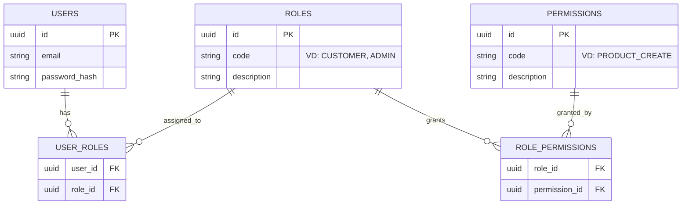
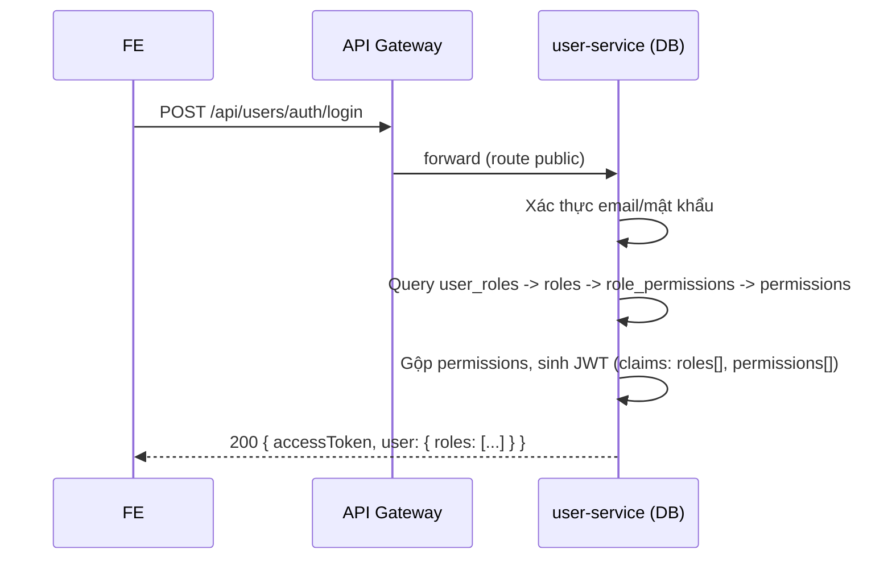

# Kiến trúc phân quyền — RBAC (Role-Based Access Control)

> ✅ **Đã implement** (không còn là thiết kế thuần tuý). `user-service` có bảng `roles`/`permissions`/`user_roles`/`role_permissions` (Flyway V2/V3), JWT mang `roles[]`/`permissions[]`, `api-gateway` chặn theo permission (`config-repo/api-gateway.yml` + `JwtAuthenticationFilter`), `product-service` không còn `@PreAuthorize`. Verify bằng Playwright + test API trực tiếp: 401 khi chưa đăng nhập, 403 khi thiếu quyền, CUSTOMER/ADMIN hoạt động đúng, dữ liệu user cũ tự động migrate sang role mới không mất dữ liệu.
>
> Tài liệu kiến trúc dùng chung cho toàn dự án (không phải doc của riêng 1 chức năng). Thay thế mô hình `role` đơn (enum `CUSTOMER`/`ADMIN` cố định trên `User`) bằng RBAC đầy đủ: Role gồm tập Permission, lưu trong DB, không cần sửa code khi thêm quyền/vai trò mới. Việc **kiểm tra quyền được tập trung tại API Gateway**, không rải rác `@PreAuthorize` ở từng service.

## 1. Mục tiêu

- Cho phép thêm vai trò mới trong tương lai (VD: `STAFF`, `SELLER` khi mở rộng thành multi-vendor giống Shopee thật) **chỉ bằng cách thêm dữ liệu**, không sửa/deploy lại code.
- 1 user có thể giữ **nhiều role cùng lúc** (VD: vừa `CUSTOMER` vừa `ADMIN`).
- Việc "route này cần quyền gì" được khai báo **một chỗ duy nhất ở Gateway**, thay vì rải `@PreAuthorize` ở từng microservice — dễ audit, dễ đổi mà không đụng vào business code.
- Vẫn phân biệt rõ 2 khái niệm hay bị nhầm: **quyền theo vai trò** (RBAC — "Admin được tạo sản phẩm") khác với **quyền theo dữ liệu** (ownership — "User chỉ xem được đơn hàng của chính mình"). RBAC chỉ giải quyết vế đầu; vế sau vẫn phải tự kiểm tra trong service.

## 2. Mô hình dữ liệu (trong `user-service`)

Thay cột `role` (enum) trên bảng `users` bằng 4 bảng:



- `roles` và `permissions` là dữ liệu cấu hình (seed sẵn + admin có thể thêm mới qua Admin Panel sau này), **không phải enum trong code**.
- `user_roles`, `role_permissions` là bảng many-to-many thuần tuý (composite PK).
- Thêm vai trò mới (VD: `SELLER`) = thêm 1 dòng vào `roles` + gán permission phù hợp vào `role_permissions` — không đụng code.

### Quy ước quan trọng: KHÔNG dùng JPA relationship (`@ManyToMany`/`@OneToMany`/`@ManyToOne`)

Quyết định có chủ đích, áp dụng cho **toàn bộ dự án**, không riêng RBAC: entity chỉ là các cột phẳng ánh xạ 1-1 với bảng, không có field quan hệ nào (`Set<Role> roles` trên `User`, `Category category` trên `Product`...). Lý do: hệ thống càng lớn, object graph của JPA càng khó kiểm soát (N+1, lazy loading, cascade khó lường — đã gặp thật ở bug `LazyInitializationException` khi làm `product-service`).

Thay vào đó:
- **Bảng nhiều-nhiều thuần tuý** (`user_roles`, `role_permissions`): dùng **native SQL query** trực tiếp trong repository (`@Query(nativeQuery = true)`), trả về danh sách phẳng (`List<String>` code) hoặc dùng `@Modifying` để insert — không tạo entity đại diện cho bảng trung gian.
- **Quan hệ 1-nhiều đơn giản** (VD `Product` → `Category`): entity chỉ giữ FK phẳng (`UUID categoryId`), không `@ManyToOne`. Khi cần tên category để trả về response, **batch-fetch thủ công** ở tầng service (`categoryRepository.findAllById(...)` một lần cho cả trang) rồi tự ghép vào DTO — không dựa vào `@EntityGraph`/lazy loading của Hibernate.
- Vì có dùng `@Modifying` native query, method gọi nó **bắt buộc phải nằm trong `@Transactional`** (native update/delete query cần transaction đang mở, khác với native SELECT).

Xem ví dụ cụ thể ở `RoleRepository` (native query cho `user_roles`/`role_permissions`) và `ProductService.fetchCategoriesFor()` (batch-fetch cho `Product`/`Category`).

## 3. Danh sách khởi tạo (seed)

### Roles

| Code | Mô tả |
|---|---|
| `CUSTOMER` | Vai trò mặc định khi đăng ký |
| `ADMIN` | Toàn quyền quản trị hệ thống |

*(`STAFF`, `SELLER`... để dành thêm sau bằng data, không seed ngay vì chưa có yêu cầu nghiệp vụ cụ thể cho chúng.)*

### Permissions (nhóm theo resource, ánh xạ tới các chức năng trong `docs/ROADMAP.md`)

| Permission code | Ý nghĩa | Gán cho role |
|---|---|---|
| `PRODUCT_CREATE` | Tạo sản phẩm | ADMIN |
| `PRODUCT_UPDATE` | Sửa sản phẩm | ADMIN |
| `PRODUCT_DELETE` | Xoá sản phẩm | ADMIN |
| `CATEGORY_MANAGE` | Tạo/sửa/xoá danh mục | ADMIN |
| `ORDER_VIEW_ALL` | Xem toàn bộ đơn hàng (không chỉ đơn của mình) | ADMIN |
| `ORDER_UPDATE_STATUS` | Cập nhật trạng thái đơn (xác nhận, giao hàng...) | ADMIN |
| `REVIEW_DELETE_ANY` | Xoá review của bất kỳ ai (kiểm duyệt) | ADMIN |
| `USER_MANAGE` | Xem/khoá tài khoản người dùng khác | ADMIN |
| `ROLE_MANAGE` | Tạo role mới, gán permission cho role, gán role cho user | ADMIN |

`CUSTOMER` không cần permission đặc biệt nào — mọi hành động của Customer (xem giỏ hàng, đặt hàng, viết review...) đều là **hành động trên dữ liệu của chính mình**, kiểm tra bằng `X-User-Id` chứ không phải bằng permission.

## 4. JWT claims — thay đổi so với hiện tại

Hiện tại (`JwtService.generateToken`) chỉ có 1 claim `roles` dạng string đơn. Thiết kế mới:

```json
{
  "sub": "8f14e...uuid",
  "email": "user@example.com",
  "roles": ["CUSTOMER"],
  "permissions": ["ORDER_VIEW_OWN_IMPLICIT"],
  "iat": 1234567890,
  "exp": 1234571490
}
```

- `roles`: mảng code role user đang giữ (để hiển thị UI, không dùng để check quyền chi tiết).
- `permissions`: **mảng phẳng, đã gộp & khử trùng lặp** toàn bộ permission từ tất cả role của user — đây là claim mà Gateway thực sự dùng để so khớp.
- Sinh ra tại `user-service` lúc `/register` và `/login` (join `user_roles` → `role_permissions` → `permissions`, gộp lại).

## 5. Luồng cấp quyền lúc đăng nhập



## 6. Gateway thực hiện Authorization (thay đổi lớn nhất)

Hiện tại `JwtAuthenticationFilter` ở Gateway **chỉ xác thực** (verify chữ ký JWT) rồi forward kèm header `X-User-Id`/`X-User-Roles`; việc "ai được làm gì" nằm rải rác ở từng service (`@PreAuthorize("hasRole('ADMIN')")` trong `ProductController`...).

Thiết kế mới: Gateway giữ một **bảng ánh xạ route → permission yêu cầu**, khai báo tĩnh trong `config-repo` (Spring Cloud Config, reload được mà không cần build lại image):

```yaml
# config-repo/api-gateway.yml (ví dụ)
authorization:
  public:                     # không cần token
    - path: /api/users/auth/register
    - path: /api/users/auth/login
    - path: /api/products
      method: GET
    - path: /actuator/health
  authenticated-only:         # cần token hợp lệ, không cần permission cụ thể
    - path: /api/users/me
    - path: /api/cart/**
    - path: /api/orders/me/**
  permission-required:        # cần token + đúng permission
    - path: /api/products
      method: POST
      permission: PRODUCT_CREATE
    - path: /api/products/**
      method: PUT
      permission: PRODUCT_UPDATE
    - path: /api/products/**
      method: DELETE
      permission: PRODUCT_DELETE
    - path: /api/categories/**
      method: [POST, PUT, DELETE]
      permission: CATEGORY_MANAGE
    - path: /api/orders/admin/**
      permission: ORDER_VIEW_ALL
    - path: /api/orders/*/status
      method: PATCH
      permission: ORDER_UPDATE_STATUS
```

**Thuật toán tại `JwtAuthenticationFilter` (mở rộng) — thứ tự khớp ưu tiên từ chặt đến lỏng, tránh 1 path khớp nhiều nhóm gây mơ hồ:**
1. Khớp `permission-required` trước (chặt nhất). Nếu khớp path+method → bắt buộc có token hợp lệ; giải mã claim `permissions`, thiếu permission yêu cầu → `403` ngay tại Gateway.
2. Không khớp (1) → thử khớp `public`. Nếu khớp → cho qua, không cần token.
3. Không khớp (1)(2) → thử khớp `authenticated-only`. Nếu khớp → chỉ cần token hợp lệ (không cần permission cụ thể).
4. Không khớp cả 3 nhóm → **mặc định coi như `authenticated-only`** (an toàn hơn mặc định public — route mới thêm mà quên khai báo sẽ bị chặn thay vì lộ ra ngoài).
5. Ở bước cần token (2 nhóm sau + permission-required khi đủ quyền): giải mã JWT, forward `X-User-Id`, `X-User-Roles` (comma-separated, VD `CUSTOMER,ADMIN`), và `X-User-Permissions` (comma-separated, VD `PRODUCT_CREATE,PRODUCT_UPDATE`) — service dùng để lọc dữ liệu theo ownership hoặc hiển thị UI, không dùng để tự quyết "được phép gọi API hay không" (việc đó Gateway đã làm xong).
6. Thiếu/sai token ở các bước cần xác thực → `401` (không phải `403` — phân biệt "chưa đăng nhập" và "đăng nhập rồi nhưng thiếu quyền").

**Downstream service (`product-service`, `order-service`...) thay đổi tương ứng:** bỏ dần `@PreAuthorize("hasRole('ADMIN')")` cho các endpoint đã được Gateway chặn theo permission — service chỉ còn tin tưởng header `X-User-Id` để lọc dữ liệu theo chủ sở hữu (ownership), không tự quyết "ai được phép" nữa. Đây là điểm khác với `HeaderAuthenticationFilter` hiện tại (nó dựng lại `SecurityContext` để service tự check role) — vai trò đó chuyển phần lớn sang Gateway.

> **Đã implement đúng thiết kế 3 nhóm này** trong `JwtAuthenticationFilter` (`api-gateway`), đọc từ `AuthorizationProperties` (`config-repo/api-gateway.yml`). `product-service` đã bỏ `@PreAuthorize("hasRole('ADMIN')")`, tin tưởng hoàn toàn quyết định của Gateway.

## 7. Ranh giới RBAC vs Ownership (rất quan trọng, tránh nhầm)

| Câu hỏi | Trả lời bằng | Nơi kiểm tra |
|---|---|---|
| "User này có được **tạo sản phẩm** không?" | Permission (`PRODUCT_CREATE`) | Gateway |
| "User này có được xem **đơn hàng #123** không?" | Ownership (đơn đó có `user_id` = X-User-Id không, hoặc user có `ORDER_VIEW_ALL`?) | order-service (kết hợp: nếu có `X-User-Permissions` chứa `ORDER_VIEW_ALL` thì cho xem mọi đơn, ngược lại chỉ cho xem đơn của chính mình) |
| "User này có được xoá **review của chính mình** không?" | Ownership (mọi user tự xoá review của mình, không cần permission đặc biệt) | review-service |
| "User này có được xoá **review của người khác** không?" | Permission (`REVIEW_DELETE_ANY`) | Gateway chặn nếu thiếu permission |

Kết luận: Gateway lo phần "loại request nào được phép chạm vào hệ thống" (permission theo role); service lo phần "trong dữ liệu được phép truy cập, được thao tác trên bản ghi cụ thể nào" (ownership) — 2 lớp bổ sung nhau, không thay thế nhau.

## 8. Quản trị Role & Permission (thuộc `09-admin-panel.md`, làm sau)

Admin Panel (chức năng #9 trong roadmap) sẽ cần thêm màn hình:
- Danh sách Role, tạo Role mới, gán/bỏ Permission cho Role.
- Danh sách User, gán/bỏ Role cho User (multi-select vì multi-role).
- Yêu cầu permission `ROLE_MANAGE` để truy cập các màn hình này.

## 9. Hạn chế đã biết (trade-off, ghi nhận backlog)

- JWT là stateless: nếu admin **thu hồi** permission của 1 role, những token đã phát hành trước đó **vẫn còn hiệu lực tới khi hết hạn** (mặc định 60 phút) — không có cơ chế revoke tức thời. Chấp nhận được cho dự án học tập; nếu cần chặt hơn thì thêm token blacklist hoặc rút ngắn thời hạn token + refresh token (đã nằm trong backlog của `01-auth.md`).
- Route-permission mapping ở Gateway là cấu hình tĩnh (dù reload được qua Config Server) — không có UI để sửa mapping này trực tiếp (khác với Role/Permission data, vốn sửa được qua Admin Panel). Đây là lựa chọn có chủ đích: mapping route↔permission là quyết định kỹ thuật (đi cùng lúc code từng endpoint ra đời), còn permission nào thuộc role nào mới là quyết định nghiệp vụ (đổi thường xuyên hơn, nên để admin tự cấu hình).

## 10. Việc đã cập nhật khi implement (tham khảo, đã xong)

- `user-service`:
  1. Flyway migration mới (V2) tạo 4 bảng `roles`/`permissions`/`user_roles`/`role_permissions`, seed data mục 3.
  2. **Migrate dữ liệu cũ**: trong cùng migration V2, chạy `INSERT INTO user_roles (user_id, role_id) SELECT id, (SELECT id FROM roles WHERE code = users.role) FROM users` để mọi user đã đăng ký từ trước (dựa theo cột `role` cũ) tự động có đúng role tương ứng trong bảng mới — không mất dữ liệu, không cần user đăng ký lại.
  3. Sau khi migrate xong, drop cột `role` khỏi `users` (migration V3, tách riêng để dễ rollback nếu V2 có vấn đề).
  4. Sửa `AuthService`/`JwtService` để join `user_roles → roles → role_permissions → permissions`, nhúng `roles[]`/`permissions[]` vào token. `User`/`Role` **không có field quan hệ nào** (`@ManyToMany`) — join qua native query trong `RoleRepository` (`findRoleCodesByUserId`, `findPermissionCodesByUserId`, `assignRoleToUser`), trả thẳng `List<String>`/insert trực tiếp.
  5. Sửa `UserResponse` trả `roles: string[]` thay vì `role: string`; `UserResponse.from(user, roles)` nhận `roles` từ ngoài truyền vào (không tự đọc qua object graph).
  6. `AuthService.register()` cần `@Transactional` vì gọi `@Modifying` native query (`assignRoleToUser`) — native update/insert query bắt buộc có transaction đang mở, khác native SELECT.
- `api-gateway`: mở rộng `JwtAuthenticationFilter` theo thuật toán mục 6 (3 nhóm + thứ tự ưu tiên), thêm cấu hình `authorization.*` vào `config-repo` (thay cho `PUBLIC_PATHS`/`PUBLIC_GET_PREFIXES` cứng trong code hiện tại).
- `product-service` (và các service admin-gated sau này): bỏ `@PreAuthorize("hasRole('ADMIN')")`, bỏ luôn `HeaderAuthenticationFilter`/`SecurityConfig` phần dựng `SecurityContext` theo role (không cần nữa vì Gateway đã chặn xong) — chỉ giữ lại việc đọc `X-User-Id` cho ownership nếu cần.
- **Frontend**: `src/types/auth.ts` đổi `role: Role` → `roles: Role[]`; `stores/auth.ts` (`isAdmin`) đổi từ `user.role === "ADMIN"` sang `user.roles.includes("ADMIN")`; `views/AccountView.vue` hiển thị danh sách roles thay vì 1 role. Đây là **breaking change** với `01-auth.md` đã code — cần sửa đồng bộ cả 2 phía, không thể chỉ đổi backend.
