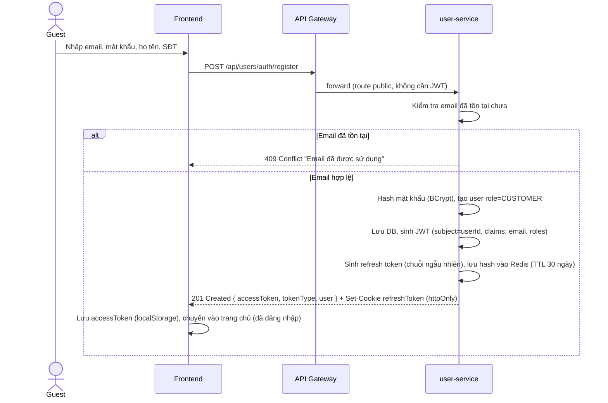
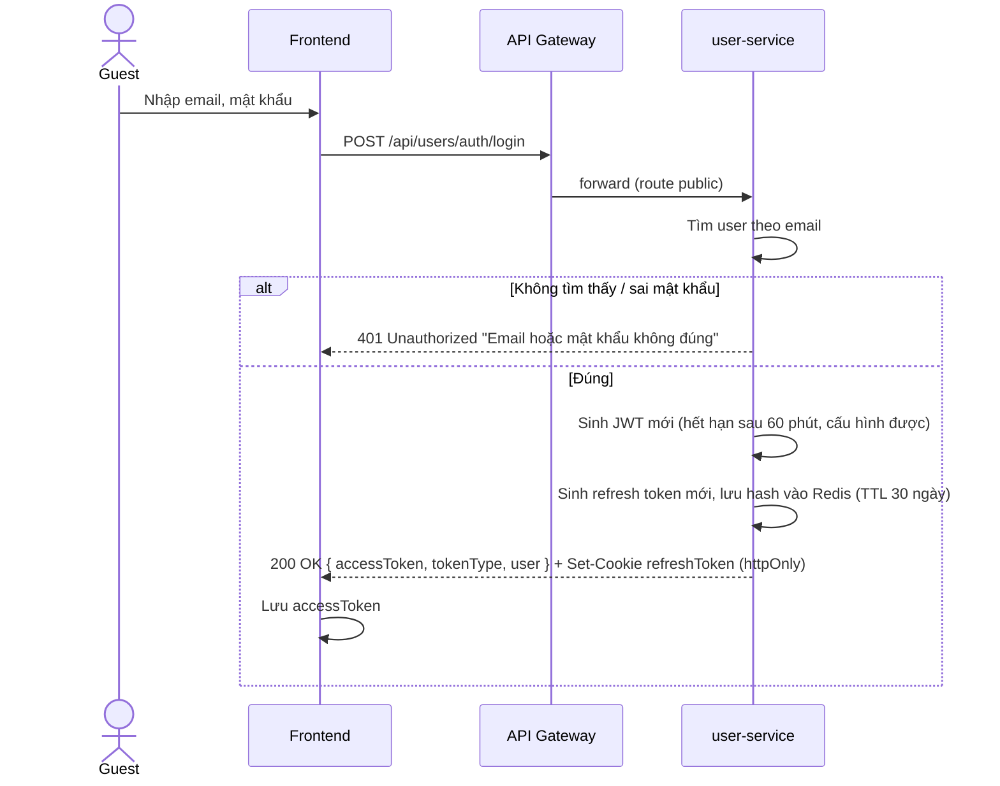
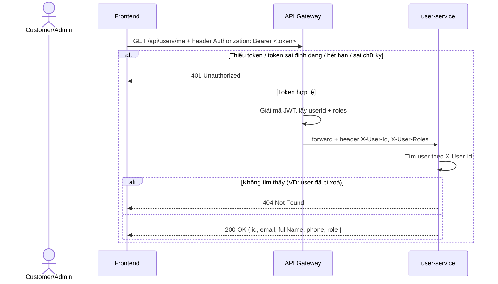
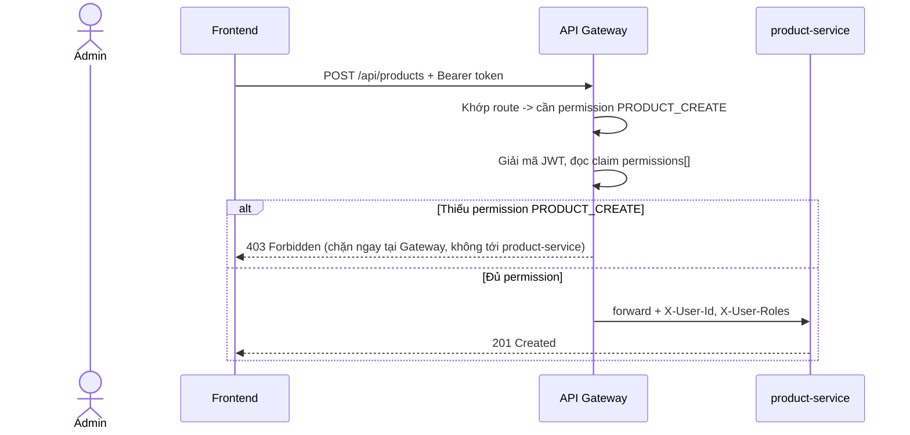
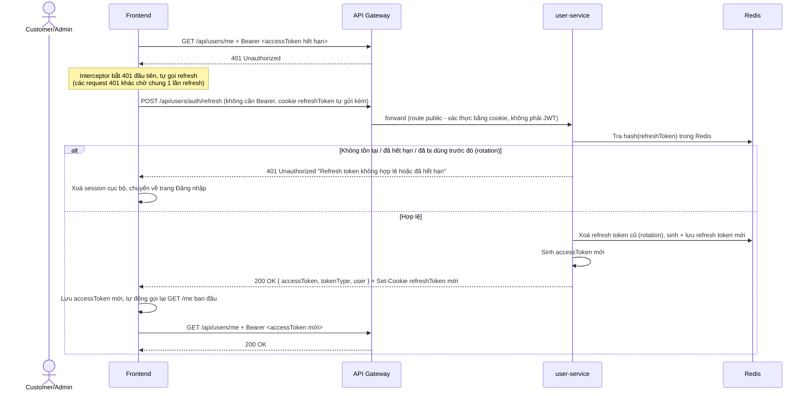
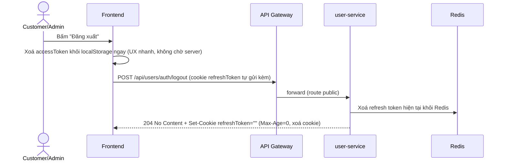

# 01 — Đăng ký / Đăng nhập (Auth)

> Tài liệu hồi tố: chức năng này đã có code trong `backend/user-service`. Nội dung dưới đây mô tả đúng những gì đã cài đặt, không thêm quyết định nghiệp vụ mới — **ngoại trừ phần phân quyền**, đã được thiết kế lại sang RBAC (xem [`docs/architecture/rbac.md`](../architecture/rbac.md)) và được phản ánh vào các mục Actor, Business rules, API contract bên dưới. Phần RBAC này **chưa code**, thuộc việc cần làm khi bước sang giai đoạn implement. Các mục còn thiếu khác được ghi ở phần **Ngoài phạm vi hiện tại**.
>
> **Cập nhật:** đã bổ sung **refresh token** (mục 4.5, 4.6) để khắc phục trải nghiệm bị đăng xuất giữa phiên khi access token hết hạn (~60 phút) — trước đây chỉ có access token, không có cách nào gia hạn phiên mà không đăng nhập lại.

## 1. Tổng quan / Mục tiêu

Cho phép người dùng tạo tài khoản và đăng nhập vào hệ thống để có thể mua hàng, xem lịch sử đơn hàng, và (với tài khoản Admin) quản trị sản phẩm/đơn hàng. Đây là chức năng nền tảng — mọi chức năng khác (giỏ hàng, đặt hàng, đánh giá...) đều cần biết "ai đang thao tác" thông qua token do chức năng này phát hành.

## 2. Actor / Vai trò

| Actor | Mô tả |
|---|---|
| **Guest** | Người dùng chưa đăng nhập, chỉ xem được sản phẩm công khai |
| **Customer** | Vai trò (role) mặc định được gán sau khi đăng ký, được mua hàng |
| **Admin** | Vai trò quản trị, sở hữu toàn bộ permission quản lý hệ thống (xem `docs/architecture/rbac.md` §3). Không có luồng tự đăng ký thành Admin — phải seed/gán thủ công |
| **API Gateway** | Không phải actor nghiệp vụ, nhưng chịu trách nhiệm cả **xác thực (AuthN)** lẫn **phân quyền (AuthZ)** — xem mục 4 |

> Từ khi áp dụng RBAC: 1 user có thể giữ **nhiều role cùng lúc** (VD: vừa Customer vừa Admin). Role không còn là 1 cột cố định trên `User` mà là dữ liệu trong bảng `roles`/`user_roles`, cho phép thêm role mới (VD: `STAFF`, `SELLER` sau này) mà không cần sửa code.

## 3. User story

- Là **Guest**, tôi muốn **đăng ký tài khoản bằng email/mật khẩu** để có thể mua hàng trên hệ thống.
- Là **Guest** đã có tài khoản, tôi muốn **đăng nhập** để nhận được phiên làm việc (token) và truy cập các chức năng cần xác thực.
- Là **Customer/Admin** đã đăng nhập, tôi muốn **xem thông tin tài khoản của mình** (`/me`) để xác nhận đang đăng nhập đúng.

## 4. Luồng nghiệp vụ chính

### 4.1 Đăng ký



### 4.2 Đăng nhập



### 4.3 Gọi API cần xác thực (ví dụ `/me`)



### 4.4 Gọi API cần permission cụ thể (VD: Admin tạo sản phẩm)



### 4.5 Làm mới access token khi hết hạn (refresh)



Người dùng **không nhận biết được** việc này xảy ra — không có màn hình/loading riêng, chỉ có độ trễ rất nhỏ trước khi dữ liệu hiển thị.

### 4.6 Đăng xuất (thu hồi refresh token)



Đây là **đăng xuất phía server thật sự** cho refresh token (khác với trước đây khi chưa có refresh token — đăng xuất chỉ là xoá token ở client). Access token đã phát hành trước đó vẫn còn hiệu lực tới khi hết hạn tự nhiên (JWT stateless, xem trade-off ở mục 6).

**Lưu ý kỹ thuật quan trọng**: `user-service` (và mọi service phía sau Gateway) **không tự parse JWT** — chỉ tin vào header `X-User-Id` / `X-User-Roles` do Gateway gắn vào sau khi xác thực (`HeaderAuthenticationFilter`). Nếu gọi thẳng vào service mà bỏ qua Gateway, request sẽ bị coi là ẩn danh (anonymous). Với thiết kế RBAC mới, **Gateway còn đảm nhiệm luôn việc phân quyền** (permission theo route) — chi tiết cơ chế, bảng route→permission, và ranh giới với ownership-check nằm trong service xem tại `docs/architecture/rbac.md` §6-7.

## 5. Luồng ngoại lệ / Edge case

| Tình huống | Hành vi hiện tại |
|---|---|
| Đăng ký với email đã tồn tại | `409 Conflict` — "Email đã được sử dụng" |
| Đăng ký với mật khẩu < 6 ký tự | `400 Bad Request` (validation lỗi field `password`) |
| Đăng ký thiếu email/mật khẩu/họ tên | `400 Bad Request` (validation `@NotBlank`/`@Email`) |
| Đăng nhập sai email hoặc sai mật khẩu | `401 Unauthorized` — thông báo **gộp chung** "Email hoặc mật khẩu không đúng" (không tiết lộ email có tồn tại hay không — tốt cho bảo mật) |
| Gọi API cần xác thực mà không có token / token hết hạn / sai chữ ký | `401 Unauthorized` tại tầng Gateway, request không tới được service |
| Token hợp lệ nhưng user đã bị xoá khỏi DB | `404 Not Found` tại `/me` |
| Gọi thẳng vào `user-service` bỏ qua Gateway | Bị coi là anonymous → các endpoint yêu cầu xác thực sẽ trả `401`/`403` tuỳ cấu hình Spring Security |
| Gọi `/refresh` không có cookie `refreshToken` (VD: xoá cookie thủ công, trình duyệt chặn cookie bên thứ 3) | `401 Unauthorized` "Thiếu refresh token" |
| Gọi `/refresh` với refresh token đã hết hạn (>30 ngày), đã bị thu hồi (logout), hoặc **đã dùng rồi** (rotation - mỗi token chỉ dùng được 1 lần) | `401 Unauthorized` "Refresh token không hợp lệ hoặc đã hết hạn" → FE xoá session, chuyển về Đăng nhập |
| Redis không kết nối được khi gọi `/refresh`/`/logout` | `500 Internal Server Error` (chưa có fallback riêng — xem Ngoài phạm vi) |

## 6. Business rules & validation

- Email là định danh duy nhất (`UNIQUE` trong DB) — không cho phép 2 tài khoản cùng email.
- Mật khẩu tối thiểu 6 ký tự, được hash bằng **BCrypt** trước khi lưu, không bao giờ lưu/trả plaintext.
- Vai trò mặc định khi đăng ký luôn là `CUSTOMER` (gán 1 dòng vào `user_roles`) — **không có tham số nào từ client có thể tự gán role `ADMIN`**.
- *(RBAC — thiết kế mới, xem `docs/architecture/rbac.md`)* Role không còn là cột enum cố định mà là dữ liệu (`roles`, `permissions`, `user_roles`, `role_permissions`); 1 user có thể giữ nhiều role cùng lúc.
- Token JWT: thuật toán HMAC-SHA, chứa `subject` = user ID, claim `email`, claim `roles` (**mảng** code role), claim `permissions` (**mảng phẳng** đã gộp toàn bộ permission từ các role của user), thời hạn mặc định **60 phút** (cấu hình qua `JWT_EXPIRATION_MINUTES`).
- *(RBAC)* Việc kiểm tra "được phép gọi API nào" (permission theo route) diễn ra **tại API Gateway**, dựa trên claim `permissions` — không còn nằm rải rác ở từng service dạng `@PreAuthorize`. Service chỉ còn tự kiểm tra ownership (dữ liệu của ai) khi cần.
- **Refresh token**: chuỗi ngẫu nhiên 256-bit (opaque, không phải JWT — để có thể thu hồi trước hạn), lưu **hash SHA-256** của nó trong **Redis** (key `refresh:<hash>` → `userId`, TTL 30 ngày, cấu hình qua `JWT_REFRESH_EXPIRATION_DAYS`). Không bao giờ nằm trong JSON response, chỉ gửi qua `Set-Cookie` **httpOnly** (JS không đọc được, chống XSS đánh cắp), `SameSite=Lax`, `Path=/api/users/auth` (chỉ gửi kèm khi gọi đúng nhóm endpoint auth), `Secure` bật/tắt qua `COOKIE_SECURE` (tắt cho dev local http, bật bắt buộc khi có HTTPS).
- **Rotation**: mỗi lần `/refresh` được gọi, token cũ bị xoá khỏi Redis ngay lập tức và một token mới được phát hành — 1 refresh token chỉ dùng được đúng 1 lần. Dùng lại token cũ (replay) sau khi đã rotate sẽ bị từ chối `401` vì không còn tồn tại trong Redis.
- **Đăng xuất phía server**: `/logout` xoá refresh token hiện tại khỏi Redis ngay lập tức (thu hồi thật, không chỉ xoá phía client như trước). Access token JWT vẫn stateless — access token đã phát hành trước đó **vẫn còn hiệu lực tới khi hết hạn tự nhiên** (tối đa 60 phút) dù đã logout, đây là trade-off được chấp nhận (biên độ rủi ro nhỏ, đổi lại Gateway không cần tra cứu DB/Redis trên mỗi request).
- *(RBAC)* Thu hồi permission của 1 role **không** làm mất hiệu lực ngay các token đã phát hành trước đó (token vẫn đúng tới khi hết hạn) — trade-off đã ghi nhận trong `docs/architecture/rbac.md` §9. Đây là hạn chế khác với refresh-token revocation ở trên: refresh token thu hồi được ngay, còn access token/permission thì không.
- Các route public (không cần token) hiện tại: `register`, `login`, danh sách sản phẩm (`GET /api/products`), health check.

## 7. API contract sơ bộ

Base path qua Gateway: tất cả request đi qua `api-gateway`, không gọi thẳng `user-service`.

### POST `/api/users/auth/register`
Request:
```json
{
  "email": "user@example.com",
  "password": "matkhau123",
  "fullName": "Nguyen Van A",
  "phone": "0900000000"
}
```
Response `201 Created`:
```json
{
  "accessToken": "eyJhbGciOi...",
  "tokenType": "Bearer",
  "user": {
    "id": "8f14e...uuid",
    "email": "user@example.com",
    "fullName": "Nguyen Van A",
    "phone": "0900000000",
    "roles": ["CUSTOMER"]
  }
}
```
> `role: string` (cũ) → `roles: string[]` (mới, theo RBAC). JWT trong `accessToken` mang thêm claim `permissions: string[]` (rỗng với Customer mặc định — xem `docs/architecture/rbac.md` §3). Response còn kèm header `Set-Cookie: refreshToken=...; HttpOnly; SameSite=Lax; Path=/api/users/auth` (không xuất hiện trong body JSON).

Lỗi: `409` (email trùng), `400` (validation).

### POST `/api/users/auth/login`
Request:
```json
{ "email": "user@example.com", "password": "matkhau123" }
```
Response `200 OK`: giống cấu trúc `AuthResponse` ở trên (kèm `Set-Cookie refreshToken`).
Lỗi: `401` (sai email/mật khẩu).

### POST `/api/users/auth/refresh`
Không cần body, không cần header `Authorization` — xác thực bằng cookie `refreshToken` (trình duyệt tự gửi kèm vì `withCredentials`/cùng site).
Response `200 OK`: giống cấu trúc `AuthResponse` (accessToken mới + user), kèm `Set-Cookie refreshToken` **mới** (rotation).
Lỗi: `401` (thiếu cookie, hoặc token không hợp lệ/hết hạn/đã dùng rồi).

### POST `/api/users/auth/logout`
Không cần body. Xác thực bằng cookie `refreshToken` (nếu có thì thu hồi trong Redis; nếu không có cũng trả về bình thường).
Response `204 No Content`, kèm `Set-Cookie refreshToken=""; Max-Age=0` để trình duyệt xoá cookie.

### GET `/api/users/me`
Header bắt buộc (do Gateway tự gắn, FE không cần set thủ công ngoài `Authorization: Bearer <token>`): `X-User-Id`.
Response `200 OK`:
```json
{
  "id": "8f14e...uuid",
  "email": "user@example.com",
  "fullName": "Nguyen Van A",
  "phone": "0900000000",
  "roles": ["CUSTOMER"]
}
```
Lỗi: `401` (chưa đăng nhập / token hết hạn), `404` (user không tồn tại).

## 8. Wireframe

Mockup trực quan: [`docs/mockups/01-auth.html`](../mockups/01-auth.html)

| Màn hình | Thành phần chính | Trạng thái cần xử lý |
|---|---|---|
| **Đăng nhập** | Logo/tên shop, input Email, input Mật khẩu, nút "Đăng nhập", link "Chưa có tài khoản? Đăng ký" | loading (đang gọi API), error (banner đỏ hiển thị message 401), disabled nút khi đang submit |
| **Đăng ký** | Input Họ tên, Email, Số điện thoại (không bắt buộc), Mật khẩu, nút "Đăng ký", link "Đã có tài khoản? Đăng nhập" | loading, error (409 email trùng / 400 validation từng field), success → tự động đăng nhập và chuyển trang chủ |

## 9. Acceptance criteria

- [ ] Given Guest chưa có tài khoản, When nhập email/mật khẩu hợp lệ (≥6 ký tự) và họ tên rồi bấm Đăng ký, Then tài khoản được tạo với role CUSTOMER và người dùng được đăng nhập ngay (nhận accessToken).
- [ ] Given Guest nhập email đã tồn tại khi đăng ký, When bấm Đăng ký, Then hiển thị lỗi "Email đã được sử dụng" và không tạo tài khoản mới.
- [ ] Given Guest nhập mật khẩu dưới 6 ký tự, When bấm Đăng ký, Then form báo lỗi validation, không gọi được API thành công.
- [ ] Given User đã có tài khoản, When đăng nhập đúng email/mật khẩu, Then nhận được accessToken và thông tin user, được điều hướng vào trang đã đăng nhập.
- [ ] Given User nhập sai email hoặc sai mật khẩu, When bấm Đăng nhập, Then hiển thị lỗi chung "Email hoặc mật khẩu không đúng" (không phân biệt rõ sai email hay sai mật khẩu).
- [ ] Given User đã đăng nhập, When gọi `GET /me` với token hợp lệ, Then nhận đúng thông tin tài khoản của chính mình.
- [ ] Given token hết hạn hoặc không có token, When gọi bất kỳ API cần xác thực nào, Then bị chặn ở Gateway với `401` trước khi tới service nghiệp vụ.
- [ ] Given User đã đăng nhập và access token vừa hết hạn nhưng refresh token (cookie) còn hiệu lực, When gọi bất kỳ API cần xác thực nào, Then hệ thống tự động làm mới access token và trả kết quả bình thường, **không** bắt đăng nhập lại và không có thao tác thủ công nào từ người dùng.
- [ ] Given refresh token đã được dùng để làm mới 1 lần, When dùng lại đúng refresh token đó lần nữa (replay), Then bị từ chối `401`.
- [ ] Given User bấm Đăng xuất, When kiểm tra lại, Then refresh token bị xoá khỏi Redis (không gọi `/refresh` bằng token cũ được nữa) và cookie `refreshToken` bị xoá khỏi trình duyệt.

## Ngoài phạm vi hiện tại (chưa cài đặt, ghi nhận cho backlog)

- Quên mật khẩu / đặt lại mật khẩu qua email.
- Xác minh email khi đăng ký (email OTP/link kích hoạt).
- Đăng nhập bằng mạng xã hội (Google/Facebook).
- Xem danh sách thiết bị/phiên đang đăng nhập và đăng xuất từ xa (hiện tại mỗi refresh token là 1 key Redis độc lập, không có index theo user để liệt kê/thu hồi hàng loạt).
- Dọn refresh token hết hạn/mồ côi bằng job riêng — không cần thiết vì Redis tự hết hạn key theo TTL.
- Luồng tạo tài khoản Admin / gán role qua giao diện — **đã có thiết kế** ở `docs/architecture/rbac.md` §8, sẽ làm UI thật trong `09-admin-panel.md`; hiện tại (seed data) vẫn phải gán thủ công trong DB.
- Khoá tài khoản sau nhiều lần đăng nhập sai (rate limiting/lockout).
- Thu hồi (revoke) quyền của token đã phát hành trước khi hết hạn (token blacklist) — xem trade-off tại `docs/architecture/rbac.md` §9.
