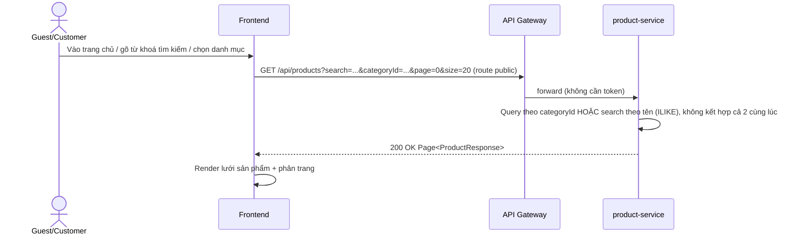
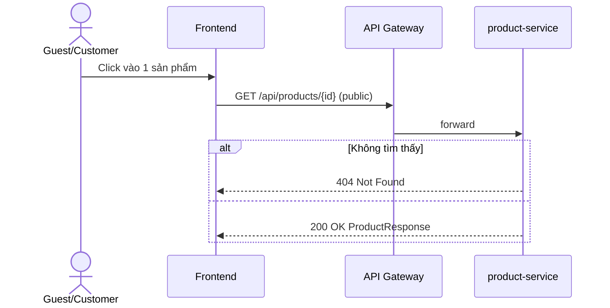
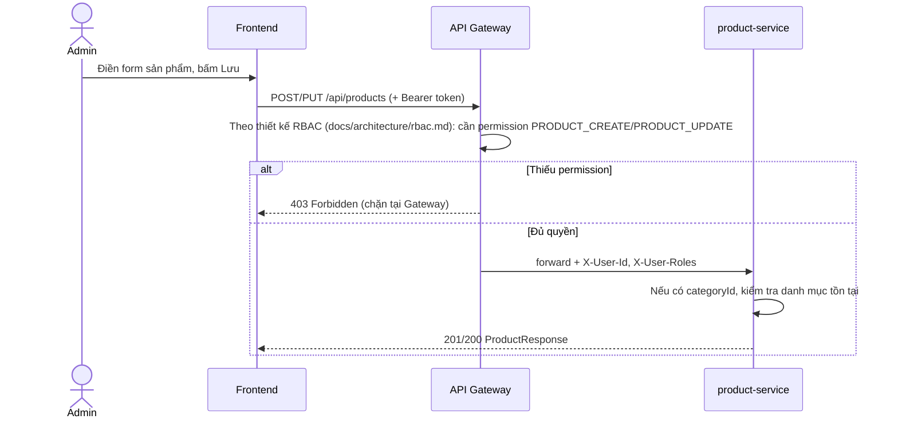

# 02 — Danh mục & Sản phẩm (Product Catalog)

> Tài liệu hồi tố: phần lớn logic nghiệp vụ đã có code trong `backend/product-service` (entity, controller, service, repository). Tuy nhiên **service này chưa chạy được** — thiếu `application.yml`, `Dockerfile`, và Flyway migration (thư mục `db/migration` đang trống, chưa có bảng `products`/`categories` trong DB). Đây là việc kỹ thuật đã ghi ở `docs/ROADMAP.md` bước 1, sẽ làm ở bước code sau khi doc này được duyệt.

## 1. Tổng quan / Mục tiêu

Cho phép Guest/Customer duyệt danh sách sản phẩm, tìm kiếm, lọc theo danh mục, xem chi tiết 1 sản phẩm — đây là màn hình đầu tiên người dùng thấy sau khi vào web. Admin quản lý (tạo/sửa/xoá) sản phẩm và danh mục.

## 2. Actor / Vai trò

| Actor | Mô tả |
|---|---|
| **Guest** | Xem danh sách/chi tiết sản phẩm mà không cần đăng nhập |
| **Customer** | Giống Guest ở chức năng này (chưa có tính năng riêng cho Customer ở đây — "thêm vào giỏ" thuộc chức năng 03) |
| **Admin** | Toàn quyền tạo/sửa/xoá sản phẩm và danh mục |

## 3. User story

- Là **Guest**, tôi muốn **xem danh sách sản phẩm có phân trang** để duyệt hàng hoá mà không cần đăng nhập.
- Là **Guest**, tôi muốn **lọc sản phẩm theo danh mục** hoặc **tìm theo tên** để nhanh chóng tìm được thứ mình cần.
- Là **Guest**, tôi muốn **xem chi tiết 1 sản phẩm** (giá, mô tả, tồn kho, hình ảnh) trước khi quyết định mua.
- Là **Admin**, tôi muốn **tạo/sửa/xoá sản phẩm và danh mục** để quản lý gian hàng.

## 4. Luồng nghiệp vụ chính

### 4.1 Xem danh sách sản phẩm (có filter/search/phân trang)



### 4.2 Xem chi tiết sản phẩm



### 4.3 Admin tạo/sửa/xoá sản phẩm (cần permission)



> Lưu ý: code hiện tại (`@PreAuthorize("hasRole('ADMIN')")` trong `ProductController`) đang dùng cơ chế role đơn giản, **chưa áp dụng thiết kế RBAC mới**. Khi implement, cần đổi endpoint create/update/delete sang chịu sự kiểm soát của Gateway theo permission `PRODUCT_CREATE`/`PRODUCT_UPDATE`/`PRODUCT_DELETE`/`CATEGORY_MANAGE` như đã thiết kế, thay vì check role trực tiếp trong service.

## 5. Luồng ngoại lệ / Edge case

| Tình huống | Hành vi hiện tại |
|---|---|
| Xem chi tiết sản phẩm với id không tồn tại | `404 Not Found` — "Khong tim thay san pham" (cần sửa dấu, xem mục Business rules) |
| Tạo/sửa sản phẩm với `categoryId` không tồn tại | `400 Bad Request` — "Danh muc khong ton tai" |
| Tạo sản phẩm thiếu `name` hoặc `price` âm | `400 Bad Request` (validation `@NotBlank`/`@DecimalMin`) |
| Guest/Customer gọi POST/PUT/DELETE | Bị chặn (403 — theo RBAC mới sẽ chặn ngay ở Gateway thay vì tới service) |
| Vừa truyền `categoryId` vừa truyền `search` | Code hiện tại **chỉ ưu tiên `categoryId`**, bỏ qua `search` nếu cả 2 cùng có mặt (xem `ProductService.list`) — cần quyết định lại ở mục 6 |
| Xoá category đang có sản phẩm gắn vào | Code hiện tại **không kiểm tra** — xoá thẳng, sản phẩm liên quan sẽ có `category_id` bị lỗi tham chiếu (FK constraint sẽ chặn ở DB nếu migration định nghĩa đúng, hoặc lỗi 500 nếu không) — cần xử lý khi code |

## 6. Business rules & validation

- Sản phẩm: `name` bắt buộc, `price` bắt buộc và ≥ 0, `stockQuantity` bắt buộc và ≥ 0, `imageUrl`/`description`/`categoryId` không bắt buộc.
- Danh mục: `name` bắt buộc và **duy nhất** (`UNIQUE` trong DB).
- Tồn kho (`stockQuantity`) được lưu trực tiếp trên `Product`, không tách bảng inventory riêng (quyết định đã chốt trong `docs/ROADMAP.md`).
- Danh sách sản phẩm hỗ trợ phân trang chuẩn Spring (`page`, `size`, `sort` qua `Pageable`), lọc theo `categoryId` HOẶC tìm theo `search` (không hỗ trợ kết hợp đồng thời ở bản hiện tại — **cần quyết định** có nên hỗ trợ kết hợp cả 2 khi code hay giữ nguyên).
- Tìm kiếm theo tên: so khớp không phân biệt hoa/thường, dạng "chứa chuỗi" (`ILIKE %...%`), chưa phải full-text search (search nâng cao thuộc chức năng 08 — search-service/Elasticsearch).
- Route `GET /api/products` và `GET /api/products/{id}` là **public** (đã khai báo trong `PUBLIC_PATHS` của Gateway) — không cần đăng nhập.
- Route ghi (POST/PUT/DELETE sản phẩm và danh mục) cần quyền Admin — sẽ chuyển sang kiểm tra permission tại Gateway theo `docs/architecture/rbac.md` khi code.

## 7. API contract sơ bộ

### GET `/api/products?categoryId=&search=&page=0&size=20&sort=createdAt,desc`
Response `200 OK`:
```json
{
  "content": [
    {
      "id": "uuid",
      "name": "Áo thun nam",
      "description": "Chất liệu cotton...",
      "price": 150000,
      "stockQuantity": 42,
      "imageUrl": "https://...",
      "categoryId": "uuid",
      "categoryName": "Thời trang nam",
      "createdAt": "2026-07-01T00:00:00Z"
    }
  ],
  "totalElements": 120,
  "totalPages": 6,
  "number": 0,
  "size": 20
}
```

### GET `/api/products/{id}`
Response `200 OK`: 1 object `ProductResponse` như trên. Lỗi: `404`.

### POST `/api/products` *(Admin, permission `PRODUCT_CREATE`)*
Request:
```json
{
  "name": "Áo thun nam",
  "description": "Chất liệu cotton...",
  "price": 150000,
  "stockQuantity": 100,
  "imageUrl": "https://...",
  "categoryId": "uuid"
}
```
Response `201 Created`: `ProductResponse`. Lỗi: `400` (validation / danh mục không tồn tại), `403` (thiếu quyền).

### PUT `/api/products/{id}` *(Admin, permission `PRODUCT_UPDATE`)* — cùng body với POST, trả `200 OK`.

### DELETE `/api/products/{id}` *(Admin, permission `PRODUCT_DELETE`)* — trả `204 No Content`. Lỗi: `404`.

### GET `/api/categories`
Response `200 OK`: mảng `{ "id": "uuid", "name": "...", "slug": "..." }`.

### POST `/api/categories` *(Admin, permission `CATEGORY_MANAGE`)*
Request: `{ "name": "...", "slug": "..." }` → `201 Created`.

### DELETE `/api/categories/{id}` *(Admin, permission `CATEGORY_MANAGE`)* → `204 No Content`.

## 8. Wireframe

Mockup trực quan: [`docs/mockups/02-product-catalog.html`](../mockups/02-product-catalog.html)

| Màn hình | Thành phần chính | Trạng thái cần xử lý |
|---|---|---|
| **Danh sách sản phẩm** | Thanh tìm kiếm, sidebar/dropdown lọc danh mục, lưới ProductCard (ảnh, tên, giá), phân trang | loading (skeleton lưới), empty (không có sản phẩm khớp filter), error (không gọi được API) |
| **Chi tiết sản phẩm** | Ảnh lớn, tên, giá, mô tả, tồn kho, nút "Thêm vào giỏ" (disabled ở chức năng này, kích hoạt thật ở chức năng 03) | loading, 404 (sản phẩm không tồn tại → hiện trang "không tìm thấy") |

## 9. Acceptance criteria

- [ ] Given Guest vào trang chủ, When trang tải xong, Then thấy danh sách sản phẩm dạng lưới có phân trang, không cần đăng nhập.
- [ ] Given danh sách sản phẩm, When chọn 1 danh mục, Then chỉ hiện sản phẩm thuộc danh mục đó.
- [ ] Given danh sách sản phẩm, When gõ từ khoá tìm kiếm, Then chỉ hiện sản phẩm có tên chứa từ khoá (không phân biệt hoa/thường).
- [ ] Given Guest click vào 1 sản phẩm, When trang chi tiết tải xong, Then thấy đầy đủ tên/giá/mô tả/tồn kho/hình ảnh.
- [ ] Given id sản phẩm không tồn tại, When vào trang chi tiết, Then hiện thông báo "không tìm thấy sản phẩm", không crash trang.
- [ ] Given Admin đã đăng nhập với đủ permission, When tạo sản phẩm mới với dữ liệu hợp lệ, Then sản phẩm xuất hiện trong danh sách ngay sau đó.
- [ ] Given Customer (không phải Admin) cố gọi API tạo/sửa/xoá sản phẩm, When gửi request, Then bị chặn với `403` mà không sản phẩm nào bị thay đổi.

## Ngoài phạm vi hiện tại / cần quyết định khi code

- **Kết hợp filter categoryId + search cùng lúc**: giữ nguyên hành vi hiện tại (ưu tiên categoryId, bỏ qua search) hay sửa để kết hợp cả 2 điều kiện? *(đề xuất: sửa để kết hợp, trải nghiệm tốt hơn, chi phí thấp)*.
- **Xoá danh mục đang có sản phẩm**: chặn xoá (trả lỗi rõ ràng) hay cho phép xoá và gán `category_id = NULL` cho sản phẩm liên quan? *(đề xuất: chặn xoá nếu còn sản phẩm, an toàn hơn)*.
- Quản lý ảnh sản phẩm hiện chỉ nhận `imageUrl` (link ngoài) — chưa có upload ảnh trực tiếp (thuộc backlog kỹ thuật, có thể cần MinIO/S3 sau này).
- Đánh giá/rating sản phẩm thuộc chức năng riêng (07 — Review), không nằm trong tài liệu này dù cùng hiển thị trên trang chi tiết sản phẩm.
- Sửa 2 message tiếng Việt bị thiếu dấu trong `ProductService.java` ("Khong tim thay san pham", "Danh muc khong ton tai") cho khớp chuẩn có dấu, giống đã làm với `user-service`.
