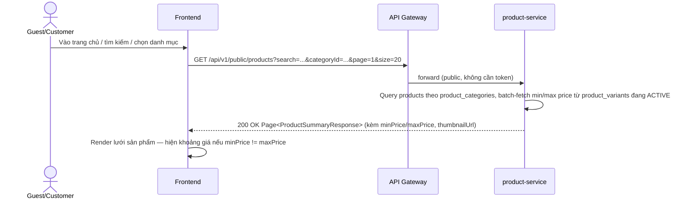
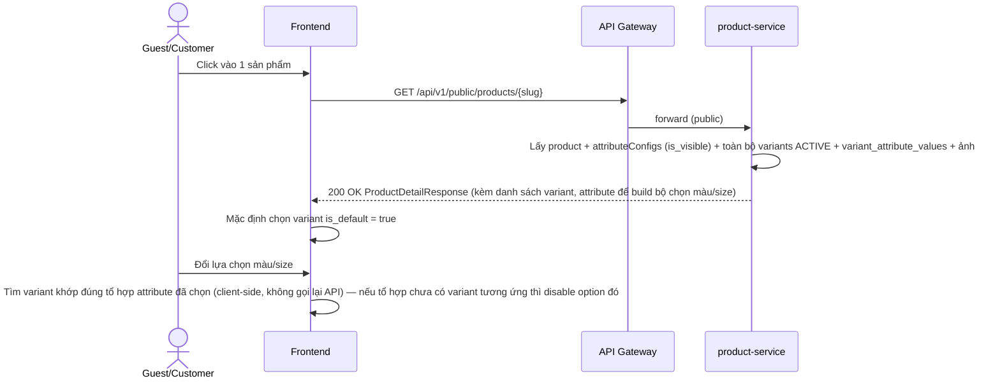
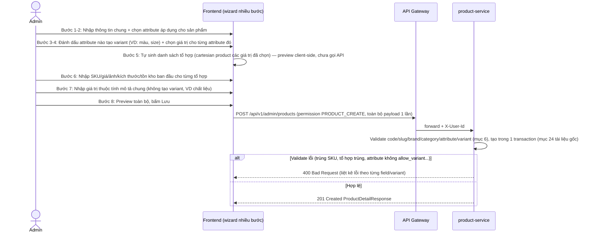
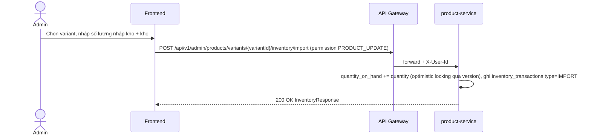

# 03 — Product Catalog Động (Variant, Thuộc tính động, Tồn kho theo kho)

> Tài liệu này **nâng cấp/thay thế phần data model** của [`02-product-catalog.md`](02-product-catalog.md). Nguồn thiết kế gốc: [`docs/architecture/dynamic-product-module-database-design.md`](../architecture/dynamic-product-module-database-design.md) (đầy đủ SQL/enum/API mẫu cho 14 bảng — tài liệu này chỉ tham chiếu, không lặp lại toàn bộ SQL). Khi 2 tài liệu lệch nhau, tài liệu này (đã "dịch" theo quy ước dự án) là bản chốt để code theo.
>
> **Quyết định đã chốt khi dịch sang quy ước dự án** (xem hỏi-đáp trong phiên làm việc):
> - Dùng **Flyway** (không dùng Liquibase) — khớp với `user-service`/`product-service` hiện tại.
> - **Không dùng `@ManyToOne`/`@OneToMany`/`@JoinColumn`** — entity chỉ có field ID thô (`categoryId`, `brandId`...), join dữ liệu bằng native query + batch-fetch trong Service, giống `ProductService.fetchCategoriesFor()` hiện tại.
> - Dữ liệu `products`/`categories` cũ (từ `V1`/`V2` hiện có) là dữ liệu dev, **không cần giữ** — migration mới sẽ tạo lại toàn bộ schema, không viết script chuyển đổi dữ liệu cũ.

## 1. Tổng quan / Mục tiêu

Thay model sản phẩm đơn giản (1 giá, 1 tồn kho, 1 category/sản phẩm) bằng model động hỗ trợ:

- Sản phẩm có nhiều biến thể (variant) — mỗi variant có SKU/giá/ảnh/tồn kho riêng (VD: áo có màu × size).
- Thuộc tính (attribute) khai báo động theo từng loại sản phẩm, không cần sửa code khi thêm loại sản phẩm mới (quần áo, điện thoại, mỹ phẩm... dùng chung 1 schema).
- Sản phẩm thuộc nhiều danh mục, danh mục có cấu trúc cha-con.
- Thương hiệu (brand).
- Tồn kho theo từng kho (warehouse), có transaction log.
- SEO, sản phẩm nổi bật/mới/bán chạy.

## 2. Actor / Vai trò

| Actor | Mô tả |
|---|---|
| **Guest/Customer** | Xem danh sách/chi tiết sản phẩm, chọn variant (màu/size) trước khi mua — không đổi so với 02, chỉ đổi nguồn dữ liệu |
| **Admin** | Quản lý brand, category, attribute, tạo/sửa sản phẩm kèm variant, quản lý tồn kho theo kho |

## 3. User story

- Là **Admin**, tôi muốn **khai báo thuộc tính (màu sắc, size, RAM...) một lần** và tái sử dụng cho nhiều loại sản phẩm khác nhau.
- Là **Admin**, tôi muốn **tạo 1 sản phẩm với nhiều biến thể** (VD: 4 tổ hợp màu × size) trong 1 luồng, không phải tạo thủ công từng sản phẩm riêng lẻ.
- Là **Admin**, tôi muốn **theo dõi tồn kho theo từng kho** và xem lịch sử nhập/xuất.
- Là **Guest**, tôi muốn **chọn màu/size trên trang chi tiết sản phẩm** và thấy giá/ảnh/tồn kho cập nhật theo đúng biến thể đã chọn.
- Là **Guest**, tôi muốn **thấy khoảng giá** (VD: "150.000₫ - 250.000₫") trên danh sách sản phẩm khi sản phẩm có nhiều variant giá khác nhau.

## 4. Luồng nghiệp vụ chính

### 4.1 Xem danh sách sản phẩm (customer-facing — gần như không đổi so với 02, chỉ đổi nguồn giá)



### 4.2 Xem chi tiết sản phẩm + chọn variant



### 4.3 Admin tạo sản phẩm động (luồng chính, nhiều bước)



### 4.4 Admin quản lý tồn kho



## 5. Luồng ngoại lệ / Edge case

| Tình huống | Hành vi |
|---|---|
| Tạo sản phẩm với `code`/`slug` trùng | `409 Conflict` |
| Tạo sản phẩm với `brandId`/`categoryId` không tồn tại | `400 Bad Request` |
| Attribute không có `allow_variant = true` nhưng được dùng để tạo variant | `400 Bad Request` |
| 2 variant trong cùng request có tổ hợp attribute giống hệt nhau | `400 Bad Request` — liệt kê rõ variant nào trùng |
| SKU trùng với variant đã tồn tại (kể cả của sản phẩm khác) | `409 Conflict` |
| `salePrice > listPrice` | `400 Bad Request` |
| Xoá variant đã phát sinh đơn hàng | Chặn — chỉ cho đổi `status = INACTIVE` (xoá cứng dành cho chức năng 07/order sau này kiểm tra) |
| Nhập kho làm `quantity_reserved > quantity_on_hand` | Chặn ở tầng service, `400 Bad Request` |
| 2 admin cùng sửa tồn kho 1 variant đồng thời | Optimistic locking (`version`) — request đến sau nhận `409 Conflict`, yêu cầu tải lại |
| Khách xem sản phẩm có tất cả variant đều `OUT_OF_STOCK`/`INACTIVE` | Trang chi tiết vẫn hiện, nút mua bị disable, hiện "Hết hàng" |

## 6. Business rules & validation

Áp dụng nguyên vẹn mục 23 của tài liệu thiết kế gốc — tóm tắt các quy tắc chính:

- `products.code`, `products.slug`, `product_variants.sku` duy nhất toàn hệ thống.
- Không lưu tồn kho/giá/màu/size trực tiếp trong `products` — toàn bộ nằm ở `product_variants` + bảng thuộc tính.
- SIMPLE product (không có biến thể lựa chọn) vẫn luôn có đúng 1 `product_variants` mặc định (`is_default = true`) để thống nhất luồng giá/tồn kho với VARIABLE product.
- Một variant không được có 2 giá trị của cùng 1 attribute (`variant_attribute_values` unique theo `variant_id + attribute_id`).
- Chỉ attribute có `allow_variant = true` mới được dùng tạo tổ hợp variant.
- Giá và tồn kho không âm; `quantity_reserved <= quantity_on_hand`.
- Mỗi sản phẩm tối đa 1 danh mục chính (`is_primary`), tối đa 1 variant mặc định.
- Giới hạn tối đa 100–200 variant/sản phẩm (validate ở service, không chặn ở DB).
- Sản phẩm/variant đã phát sinh đơn hàng chỉ được xoá mềm (soft delete qua `deleted_at`), không xoá cứng — quan trọng vì `order-service` (chưa xây) sẽ tham chiếu `variant_id` sau này.
- Mọi thay đổi tồn kho phải ghi `inventory_transactions` — không update trực tiếp `inventories` mà không có log kèm theo.

## 7. Data model

Toàn bộ 14 bảng, field chi tiết, SQL, enum: xem [`dynamic-product-module-database-design.md`](../architecture/dynamic-product-module-database-design.md) mục 3–18.

**Điểm chỉnh sửa khi triển khai thật** (khác với bản gốc để khớp quy ước dự án):

| Bản gốc | Triển khai thật trong `product-service` |
|---|---|
| `CHAR(36)` cho UUID (mẫu MariaDB) | `UUID` native type (Postgres — dự án dùng Postgres, xem `docs/ROADMAP.md`) |
| Liquibase changelog | Flyway `V3__...sql`, `V4__...sql`... nối tiếp `V1`/`V2` hiện có trong `product-service` |
| Không nêu rõ chiến lược ORM | Entity JPA **không khai báo `@ManyToOne`/`@OneToMany`** — chỉ field `UUID xxxId`, mọi JOIN thực hiện bằng `@Query native = true` trong Repository + ghép tay trong Service (đúng pattern `RoleRepository`/`ProductService` hiện tại) |
| `warehouses` nhiều kho | Giai đoạn đầu chỉ seed **1 kho mặc định** (`is_default = true`) — UI admin chưa cần chọn kho, nhưng bảng vẫn tồn tại sẵn cho multi-warehouse sau này |

## 8. API đề xuất (rút gọn — đầy đủ xem tài liệu gốc mục 21)

```text
GET    /api/v1/public/products?search=&categoryId=&page=&size=
GET    /api/v1/public/products/{slug}

GET    /api/v1/admin/products
POST   /api/v1/admin/products                     (permission PRODUCT_CREATE)
PUT    /api/v1/admin/products/{id}                 (permission PRODUCT_UPDATE)
DELETE /api/v1/admin/products/{id}                  (permission PRODUCT_DELETE — soft delete)

GET    /api/v1/admin/brands
POST   /api/v1/admin/brands                        (permission PRODUCT_CREATE — dùng chung nhóm quyền sản phẩm, không tách permission riêng)
GET    /api/v1/admin/categories
POST   /api/v1/admin/categories                    (permission CATEGORY_MANAGE)

GET    /api/v1/admin/product-attributes
POST   /api/v1/admin/product-attributes             (permission PRODUCT_CREATE)
GET    /api/v1/admin/product-attributes/{id}/values
POST   /api/v1/admin/product-attributes/{id}/values

POST   /api/v1/admin/products/variants/generate-preview   (không lưu DB, chỉ tính cartesian product để FE preview bước 5)
POST   /api/v1/admin/products/variants/{variantId}/inventory/import   (permission PRODUCT_UPDATE)
```

Toàn bộ endpoint mới dùng prefix `/api/v1/...` (khác `/api/products` cũ) — Gateway (`api-gateway.yml`) cần thêm rule mới cho `permission-required`/`public-routes` khi code.

## 9. Migration path

1. Migration Flyway mới (`V3__...`) **DROP** `products`/`categories` cũ, tạo lại toàn bộ 14 bảng theo thiết kế đã dịch (mục 7). Chấp nhận mất dữ liệu dev hiện có (không có dữ liệu production).
2. Seed lại: 1 warehouse mặc định, vài attribute mẫu (Màu sắc, Kích thước) để có dữ liệu test ngay.
3. `ProductController`/`CategoryController`/`ProductService`/`CategoryService` hiện tại (`/api/products`, `/api/categories`) sẽ được **viết lại hoàn toàn**, không giữ song song 2 API.
4. Frontend: các view đang gọi API cũ (nếu đã có) cần cập nhật theo API mới ở mục 8.

## 10. Wireframe

Mockup: [`docs/mockups/03-dynamic-product-catalog.html`](../mockups/03-dynamic-product-catalog.html)

| Màn hình | Thành phần chính | Trạng thái cần xử lý |
|---|---|---|
| **Chi tiết sản phẩm (customer)** | Ảnh theo variant, bộ chọn màu/size dạng swatch/chip, giá đổi theo variant chọn, disable tổ hợp không tồn tại | loading, hết hàng (toàn bộ variant OUT_OF_STOCK) |
| **Admin — Wizard tạo sản phẩm** | Stepper 9 bước (mục 4.3), bảng preview tổ hợp variant sinh tự động, form nhập SKU/giá/tồn kho theo từng dòng | loading khi generate preview, lỗi validate hiện theo từng dòng variant |
| **Admin — Quản lý tồn kho** | Danh sách variant kèm tồn kho hiện tại, nút nhập kho, lịch sử transaction | optimistic-lock conflict (409) khi 2 người sửa cùng lúc |

## 11. Acceptance criteria

- [ ] Given Admin đã khai báo attribute "Màu sắc" (Đen, Trắng) và "Kích thước" (M, L) với `allow_variant = true`, When tạo sản phẩm chọn cả 2 attribute này để tạo variant, Then hệ thống sinh đúng 4 tổ hợp preview trước khi lưu.
- [ ] Given Admin nhập SKU trùng với 1 variant đã tồn tại, When bấm lưu, Then nhận lỗi `409` và không tạo sản phẩm nào.
- [ ] Given sản phẩm có 4 variant với giá 199.000₫-250.000₫, When Guest xem danh sách sản phẩm, Then thấy hiển thị "199.000₫ - 250.000₫".
- [ ] Given Guest vào trang chi tiết sản phẩm có variant, When chọn màu Đen + size L, Then giá/ảnh/tồn kho hiển thị đúng theo variant đó; nếu tổ hợp Đen+L không tồn tại thì size L bị disable khi đã chọn Đen.
- [ ] Given Admin nhập kho thêm 50 sản phẩm cho 1 variant, When lưu, Then `quantity_on_hand` tăng đúng 50 và có 1 dòng mới trong lịch sử transaction loại IMPORT.
- [ ] Given 2 admin cùng sửa tồn kho 1 variant gần như đồng thời, When cả 2 cùng lưu, Then người lưu sau nhận lỗi conflict thay vì ghi đè âm thầm.
- [ ] Given sản phẩm đã có trong 1 đơn hàng (giả lập/mock ở giai đoạn chưa có order-service), When Admin xoá sản phẩm, Then chỉ soft-delete, dữ liệu vẫn còn trong DB.

## Ngoài phạm vi hiện tại / cần quyết định khi code

- **Ảnh theo variant vs ảnh chung**: giữ đúng quy ước tài liệu gốc (`variant_id = null` → ảnh chung, có giá trị → ảnh riêng) — cần UI riêng cho việc gán ảnh vào từng variant, khá phức tạp, có thể làm phiên bản đầu chỉ hỗ trợ ảnh chung + ảnh theo variant tối giản (1 ảnh/variant thay vì gallery).
- **Warehouse UI**: chưa cần chọn kho ở bản đầu (chỉ 1 kho mặc định) — mở UI chọn kho khi thực sự có nhu cầu multi-warehouse.
- **Rating/sales_count**: cột đã có trong schema nhưng logic tính (từ review-service/order-service) chưa tồn tại — để `0`/mặc định cho tới khi 2 service đó được xây (roadmap bước 7, 12).
- **`product_attribute_configs.valueIds` vs giá trị nhập tự do**: tài liệu gốc hỗ trợ cả 2 (SELECT từ `attribute_values` hoặc nhập `value_text` tự do) — cần chốt UI cụ thể cho từng `input_type` khi thiết kế form, wireframe hiện tại mới cover trường hợp SELECT.
- Không nằm trong phạm vi: tích hợp file/upload ảnh thật (vẫn dùng `imageUrl` dạng link ngoài như 02), tìm kiếm nâng cao theo attribute (thuộc search-service — roadmap bước 15).
