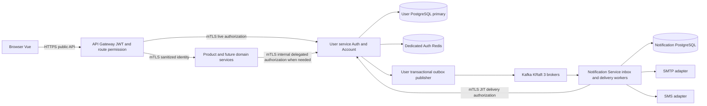
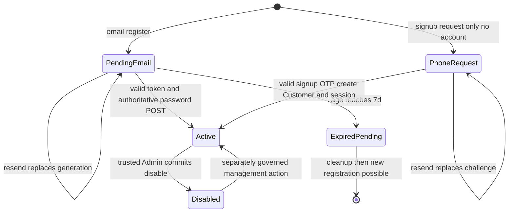
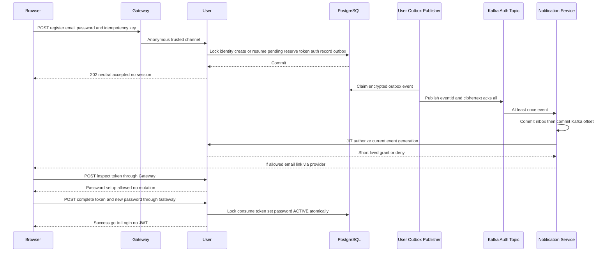
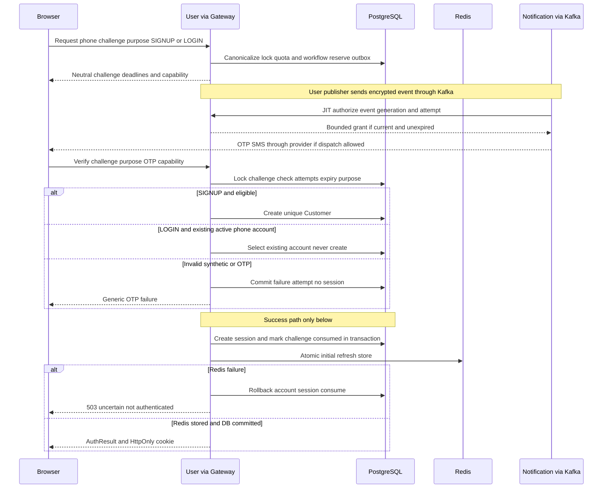
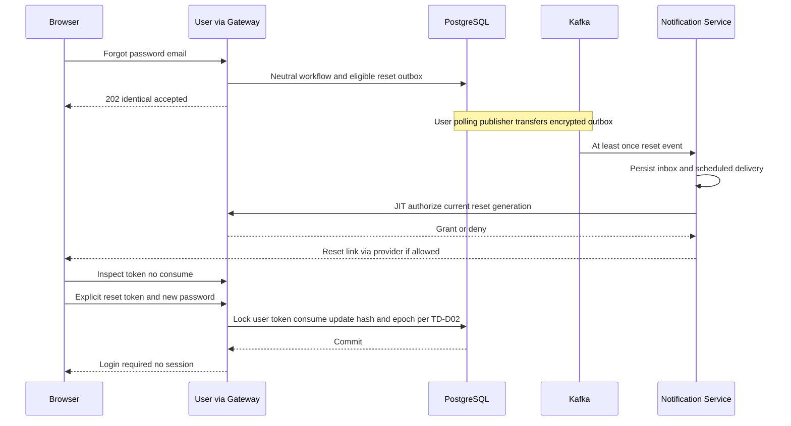
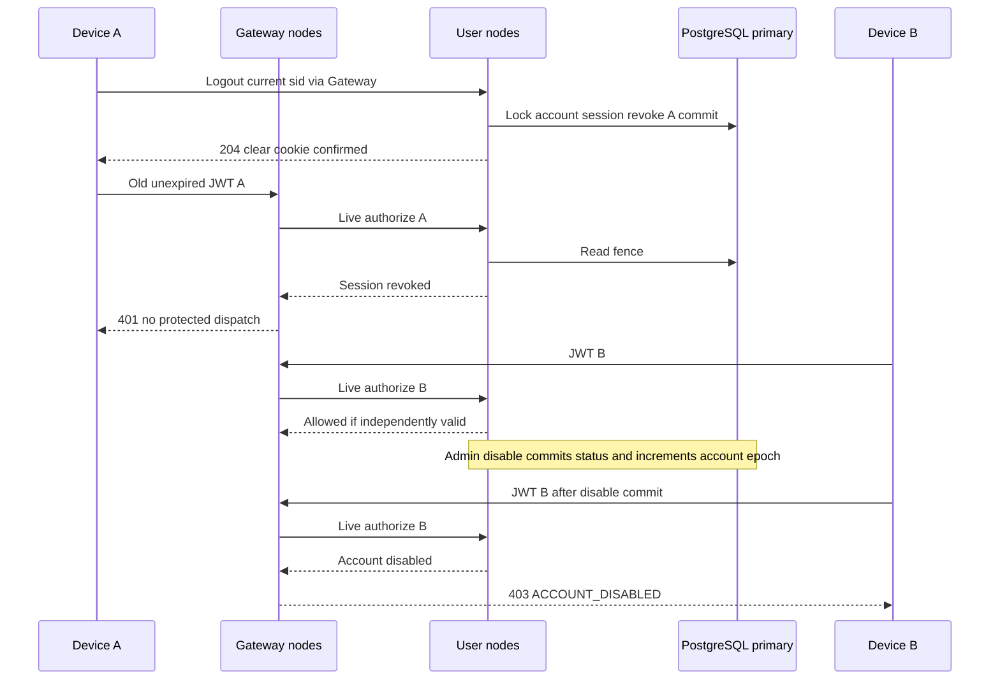
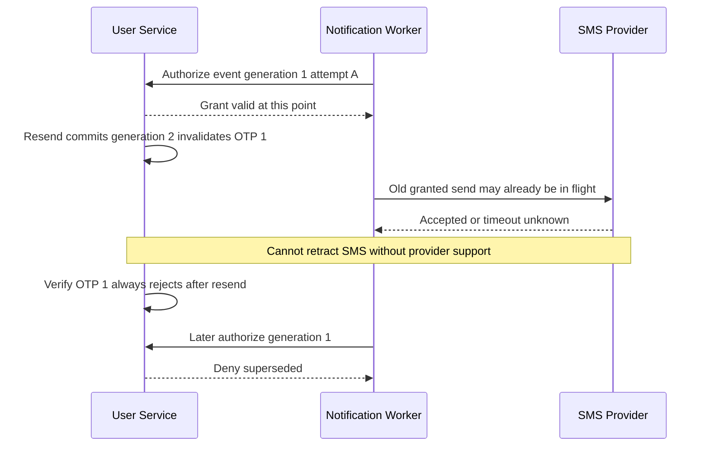

# MVP-ACC — Technical Design: Account & Authentication

| Thuộc tính | Giá trị |
|---|---|
| Issue | [#43 — Architect only](https://github.com/duvanan/shopee/issues/43) |
| Status | **Draft / Needs review — CHƯA ĐƯỢC CHỦ DỰ ÁN PHÊ DUYỆT** |
| Phiên bản / ngày | 0.2 / 05/11/2026 (Asia/Saigon); thay thế draft 0.1 về đường gửi thông báo |
| Nhánh / baseline | `chore/MVP-ACC-approved-specs-architect-handoff` / `fef345d` |
| Tác giả | Codex `architect`, theo phân công Coordinator |
| Đầu vào | [BA v1.0 Approved](BA_SPEC.md), [UX v1.0 Approved](UX_SPEC.md), [handoff](CODEX_ARCHITECT_HANDOFF.md) |
| Phê duyệt thiết kế | Chưa có; TD-D01..TD-D12 tại §12, N-D01..10 của Notification và KN-D01..08 của Kafka vẫn Pending |

BA ghi nhận chủ dự án duyệt 29 phương án A và các quyết định trước đó; UX ghi nhận xác nhận ngày 05/11/2026: “tôi thấy phần UX Spec ổn rồi, hãy thực hiện các bước tiếp theo cho tôi”. Đây là bằng chứng phê duyệt **đầu vào**, không phải phê duyệt tài liệu này. Không sửa BA/UX, không triển khai Backend/Frontend, không chạy migration, không merge hoặc đóng Issue trong công việc #43.

### Thay đổi từ draft 0.1 và nguồn yêu cầu mở rộng

Chủ dự án yêu cầu trong lượt làm việc ngày 05/11/2026: **“Redesign MVP-ACC Authentication & Design Shared Notification Service with Kafka”**. Yêu cầu này cho phép **thiết kế** Notification Service dùng chung và Kafka 3 node; không phải phê duyệt lựa chọn kỹ thuật hoặc đưa implementation vào sprint. Issue #43 vẫn là nguồn BA/UX của Auth; phạm vi kiến trúc được mở rộng theo yêu cầu trực tiếp này. Không coi comment bên thứ ba trên Issue là quyết định của chủ dự án.

| Phần | Draft 0.1 | Draft 0.2 / tài liệu chuẩn |
|---|---|---|
| §1–2 boundaries/trust | User chứa cả worker/provider; không Kafka/service mới | User outbox → Kafka → Notification Service; DB và workload identity riêng |
| §3 session security | PG durable session fence + Redis refresh + Gateway live check | **Giữ nguyên**, delivery failure không tự revoke/login/activate |
| §4 API/UX | 202 trung tính, gửi bất đồng bộ nội bộ | Làm rõ 202 chỉ tiếp nhận bền vững; thêm private JIT delivery authorization, không lộ trạng thái gửi theo account |
| §5 data/outbox | User outbox chứa provider retry/reference | User chỉ outbox publish + authorization record; Notification sở hữu delivery/attempt/provider/retry DB |
| §6–8 lifecycle/sequence/security | User worker kiểm generation trước provider | Poll publisher + encrypted event + Notification inbox + JIT grant; phân tích khoảng race check/send không thể xóa bằng check đơn |
| §9–10 test/rollout/estimate | PG/Redis/provider test; 90–130h | Thêm Kafka3/Notification đa instance, lag/lease/DLQ/failure gates; estimate tăng tại §10 |
| §11–12 evidence/decisions | TD-D01..09 Pending | Giữ Pending; thêm TD-D10..12 và ADR nền tảng, không đổi BA/UX |

Hợp đồng đầy đủ: [Notification Service Technical Design](../../architecture/NOTIFICATION_SERVICE_TECHNICAL_DESIGN.md) (event schema, năm JSON examples, DB, JIT, worker/provider) và [Kafka Notification Architecture](../../architecture/KAFKA_NOTIFICATION_ARCHITECTURE.md) (topology, ACL, topics, outbox relay, vận hành). Các link này là thiết kế cần duyệt, không phải module đã tồn tại.

## 1. Phạm vi và yêu cầu nền

Thiết kế tám tính năng MVP-ACC-01..08: email signup/verify/password setup, phone signup/login OTP, email login/recovery, session/logout, profile chỉ sửa tên, Customer/Admin và disable. Giữ nguyên các ngưỡng BA: verify 24h, pending email 7 ngày; password 12–128 ký tự; OTP 6 số/5 phút/5 lần sai; cooldown 60s; SMS 5 lượt gửi/giờ và 10/ngày mỗi số; email 5 **resends**/giờ, không tính lượt đầu; session idle 7 ngày/absolute 30 ngày. Thời gian máy chủ UTC; hết hạn khi `now >= expiresAt`.

Đề xuất thêm **notification-service** và Kafka KRaft 3 node phục vụ Auth trước; không thêm auth-service, Elasticsearch, K8s, Seller, OAuth, account linking, phone password, đổi định danh, self-delete hoặc tự phục hồi SIM. Account/Auth vẫn là hai module logic trong **user-service**, cùng transaction PostgreSQL. Cart/Order/Address chỉ nhận UUID account, không suy ra danh tính từ dữ liệu liên hệ. Order/Payment/Shipping/In-App/Push là extension tương lai, không có implementation hay nghiệp vụ mới trong lượt này.

Nguồn hiện trạng là source, không phải lời khẳng định “hoàn chỉnh” trong tài liệu cũ. `docs/ROADMAP.md` mô tả frontend trống, product thiếu cấu hình và định hướng K8s/full scope đã lạc hậu so với source. Kế hoạch hiện hành là `docs/project-management/ROADMAP_2026_2027.md`: 32h committed/sprint, MVP 17/01/2027, Beta 28/02/2027; thay đổi Auth này cần re-estimate, không mặc nhiên nhét vào sprint.

**Xung đột kế hoạch cần chủ dự án duyệt:** WORKFLOW/roadmap hiện để Kafka và notification ở Beta, không chặn MVP; handoff cũ chỉ một tài liệu. Lượt yêu cầu mới thay thế giới hạn **thiết kế** đó bằng ba artifact. Để chọn Kafka làm delivery path bắt buộc cho Auth MVP, chủ dự án phải chốt replan/capacity theo TD-D10; chưa sửa roadmap, chưa tự đổi deadline. Không có xung đột cần sửa BR/AC/UX nếu giữ nguyên lifecycle và các ngưỡng BA.

### 1.1. Audit tĩnh source hiện tại

Các đường dẫn dưới đây tính từ repo root. Chưa chạy ứng dụng, chưa xác nhận exploit hoặc test runtime.

| Source đã đọc | Hiện trạng có bằng chứng | Tác động thiết kế |
|---|---|---|
| `backend/pom.xml` | Java 25, Boot 4.1.0, Cloud 2025.1.2; Common/Gateway/User/Product/Eureka/Config | Giữ module và phiên bản nền |
| `backend/api-gateway/src/main/java/com/shopee/gateway/filter/JwtAuthenticationFilter.java` | Chỉ kiểm chữ ký/expiry và permission trong JWT; public route đi thẳng; chưa kiểm session/account live | JWT còn hạn vẫn có thể qua Gateway sau refresh revoke; thêm kiểm tra live §3 |
| `backend/config-server/src/main/resources/config-repo/api-gateway.yml` | Route public theo method; admin dùng permissions; mặc định authenticated | Mở đúng từng endpoint mới, không wildcard auth public |
| `backend/user-service/src/main/java/com/shopee/user/service/AuthService.java` | Register tạo token ngay; exact-email lookup; lock 5 lần/15 phút; refresh không check account status | Thay signup; canonical identity; serialize credential/session changes; lock cũ cần quyết định TD-D08 |
| `backend/user-service/src/main/java/com/shopee/user/security/RefreshTokenService.java` | Redis session/lookup/user-set; rotation get/delete/set rời; refresh đẩy expiresAt thêm 30 ngày | Không atomic, không absolute cap; cần durable generation/fence và lock |
| `backend/user-service/src/main/java/com/shopee/user/security/JwtService.java` | Token có email, roles, permissions, chưa có sid; default 60 phút | Token mới sid/issuer/audience; đề xuất 5 phút, bỏ email khỏi JWT |
| `backend/user-service/src/main/java/com/shopee/user/service/PasswordResetService.java` | TTL 30 phút, log raw reset token; reset revoke refresh; kiểm token rồi save chưa lock | TTL hiện hữu không phải BA-approved; bỏ log secret; atomic consume |
| `backend/user-service/src/main/java/com/shopee/user/security/HeaderAuthenticationFilter.java`; file cùng tên trong `backend/product-service/.../security/` | Chấp nhận X-User-Id không chứng thực nguồn, ghép roles thành một authority | P0 trust boundary; verify mTLS peer, sanitize headers, parse role list |
| `backend/user-service/src/main/java/com/shopee/user/security/SecurityConfig.java` | Permit toàn bộ auth/**, csrf disabled, BCrypt | Thu hẹp public endpoints, CSRF cookie endpoints; encoder phải xử lý đủ 128 ký tự |
| `backend/user-service/src/main/java/com/shopee/user/entity/User.java`; migrations V1..V14 | Email/password NOT NULL, phone chưa là login identity; ACTIVE/LOCKED; flat IDs | Mở rộng schema; không dùng phone liên hệ để backfill phone login |
| `backend/user-service/src/main/java/com/shopee/user/service/AdminUserService.java` | Lock DB rồi revoke Redis; role change không có live fence; có provision user/admin | Disable phải atomic DB; phân tách account kind; khóa đường gán Customer cho Admin |
| `backend/user-service/src/main/java/com/shopee/user/controller/UserController.java` | GET /me; chưa có self patch tên | Thêm DTO allowlist chỉ fullName |
| `backend/common/.../response/ApiResponse.java`, `ApiMeta.java`, `PageData.java`; `exception/ErrorCode.java` | Envelope success/code/message/data/errors/meta; page 1-based; mã lỗi tập trung | Giữ format; mã mới cần bổ sung common, Gateway WebFlux tự serialize tương đương |
| `frontend/src/api/authApi.ts`, `stores/auth.ts`, `api/http.ts`, `router/index.ts` | Register tạo session; logout fire-and-forget nuốt lỗi; token localStorage; một refresh promise trong mỗi tab; 403 redirect home/dashboard | Tách register result/auth result; awaited logout; token memory; 401 reason handling; 403 riêng; multi-tab refresh |
| `docker-compose.yml` | PG16 local, Redis7 AOF profile cache; port loopback | Không phải bằng chứng channel Gateway→service đã trusted hoặc HA |
| `backend/pom.xml`, `infra/postgres/init-databases.sql`, `.github/workflows/ci.yml` | Chưa có Notification module, Kafka dependency/config hay Kafka integration job; init chỉ tạo thêm DB Product | Notification DB/module/cluster/test harness là thay đổi tương lai, chưa có trong repo; PostgreSQL cùng instance local được nhưng DB/credentials phải riêng |

## 2. Ownership và trust boundary



| Owner | Dữ liệu/trách nhiệm |
|---|---|
| User Account | UUID, login identity, verified state, account kind CUSTOMER/ADMIN, profile, account status, auth epoch, RBAC; migrations riêng |
| User Auth | challenge/token lifecycle, durable session fence, refresh Redis rotation, business send quota, notification authorization, transactional outbox + Kafka publisher, audit |
| Notification Service | Private DB inbox/notifications/attempts/provider refs, template rendering, SMTP/SMS adapters, scheduling/retry/DLQ, channel/provider capacity, operational audit; không tạo OTP, verify token, activate hoặc đổi account/session |
| Kafka | Durable transport/partition log; không là nguồn xác thực hay scheduler chính xác theo thời gian |
| Gateway | JWT signature/iss/aud/exp, live session check, route method/permission, Customer-vs-Admin gate, CORS/Origin/CSRF edge policy, strip headers |
| Domain service | Chỉ nhận channel trusted; ownership bằng authenticated account UUID; không đọc/ghi DB User; không tự quyết permission route thay Gateway |
| Frontend | Trạng thái UI, server deadlines, safe redirect; không tự tính thành công xác minh hoặc thu hồi |

Đề xuất TD-D03: mTLS giữa Gateway và service, certificate identity allowlist cho từng caller; private network là lớp bổ sung. Public client không được gọi service trực tiếp. Mọi request, **kể cả public route**, Gateway xóa toàn bộ `X-User-*`, `X-Auth-*`, header nội bộ và các bản trùng/case variants trước routing. Chỉ sau auth mới gán `X-User-Id`, `X-Session-Id`, `X-Account-Kind`, roles/permissions và trace. Service chỉ dựng SecurityContext khi peer certificate đúng Gateway; raw headers trên kết nối khác bị từ chối. Public route qua mTLS Gateway có anonymous context, không kế thừa identity client gửi.

Internal caller dùng workload identity riêng và allowlist endpoint; thao tác thay người dùng phải mang session ID và được live-check tại User, không tự gửi UUID để mạo danh. Không publish `/internal/**` qua Gateway. User introspection dùng service authentication, không chạy vòng lặp qua public Gateway. Không nhúng servlet `common` vào WebFlux Gateway; dùng contract fixtures để kiểm hai envelope giống nhau.

Notification có workload identity chỉ được gọi JIT authorize/complete của User và provider được phép. Không được gọi introspection thay browser hoặc ghi DB User. Kafka ACL theo principal producer, topic, group; `producer` trong JSON không tự chứng minh danh tính. Publisher/consumer dùng TLS và xác thực; envelope origin phải được ràng buộc với domain được phép như hai tài liệu nền tảng. Notification DB không có cross-service FK/SQL query tới User DB.

## 3. Phiên: durable fence, immediate revocation, outage

### 3.1. Lựa chọn đề xuất TD-D03

Giữ opaque refresh **trong Redis** và access JWT ngắn; thêm `auth_sessions` PostgreSQL để làm **nguồn chặn thu hồi bền vững**. Gateway gọi User `/internal/auth/authorize` cho **mỗi** protected request; User đọc primary DB, không replica, không positive cache. Redis còn dữ liệu cũ sau restart không thể hồi sinh session đã revoke trong DB. Không chọn JWT-only hoặc Redis eventual-invalidation vì không đáp ứng BA thu hồi ngay.

JWT đề xuất `{sub:uuid,sid:uuid,iss:"shopee-user",aud:"shopee-api",iat,exp,jti}`; access TTL 5 phút (TD-D09), exp không vượt absolute deadline. roles/permissions nếu giữ trong token chỉ là snapshot phục vụ UI; quyết định route lấy **live permissions** từ introspection. Không đưa PII vào token. Legacy JWT không sid không hợp lệ sau cutover; ép đăng nhập lại có kế hoạch §10.

Introspection input `{userId,sessionId,requestId}` từ Gateway đã verify JWT; output nội bộ `{active,reason,accountKind,roles,permissions,absoluteExpiresAt,idleExpiresAt}`. User khóa theo thứ tự account→session, kiểm account ACTIVE, session ACTIVE, authEpoch bằng epoch tại phát hành, deadline; cập nhật `lastActivityAt` và `idleExpiresAt=min(now+7d,absoluteExpiresAt)` trong transaction. Hoạt động là protected request đã được xác thực hoặc refresh chủ động hợp lệ; background timer không tự refresh để kéo dài idle. Failed/anonymous calls không gia hạn. Tất cả session của một account serialize qua row account; chấp nhận chi phí này trong demo, đo trước khi tối ưu.

**Điểm hiệu lực:** logout/disable trả success sau commit DB primary. Bất kỳ authorization check bắt đầu sau commit đều từ chối session bị thu hồi, trên mọi node. Request đã được cấp quyền trước commit có thể hoàn tất; không tuyên bố hủy tác vụ đã in-flight. Nếu yêu cầu nghiệp vụ đòi cả hủy transaction đang chạy, đó là TD-D04 cần quyết định và thiết kế domain fencing bổ sung; không thể bảo đảm bằng JWT/mTLS đơn thuần. Internal queue/delayed request không tái dùng kết quả positive cũ; reauthorize lúc bắt đầu xử lý bảo vệ. HTTP connection reuse không tái dùng quyết định auth.

### 3.2. Phát hành/refresh/logout và cross-store ordering

1. Login: validate credential; transaction lock account, kiểm ACTIVE/verified/kind; tạo session UUID, epoch và refresh generation 1; ghi refresh hash lookup/session Redis bằng Lua; nếu Redis lỗi rollback DB, không trả token/cookie. Commit DB rồi mới trả cookie + JWT. Redis ghi xong nhưng DB rollback để lại orphan bị DB deny và TTL dọn.
2. Refresh: cookie chứa opaque random 256-bit, lookup SHA-256→sid. Lock account→session, kiểm epoch/status/deadlines và generation; Lua compare hash+generation và thay token **atomic**, có tombstone token cũ. Update durable generation và activity, commit; chỉ trả cookie sau commit. Nếu Lua thành công nhưng DB commit fail, Redis generation lệch DB → deny, yêu cầu login; không phục hồi bằng cách chấp nhận token cũ. Không có distributed transaction giả định.
3. Logout: xác định sid bằng bearer hợp lệ hoặc cookie lookup (kể cả token vừa rotate có tombstone). Lock account→session; update status REVOKED và revokedAt, commit; sau đó best-effort xóa Redis. DB fail → 503 và UI “chưa xác nhận”, không success. Redis lỗi nhưng sid từ bearer và DB commit được → vẫn thu hồi thành công; cookie-only không resolve được → 503, không xóa bằng chứng cần retry. Already revoked/expired hoặc thiếu mọi credential → 204 idempotent, không tuyên bố đã thu hồi một sid không xác định.
4. Disable: transaction lock account, set DISABLED, increment authEpoch, audit cùng transaction; DB commit là fence cho **mọi session**, không cần duyệt Redis set để bảo đảm. Cleanup Redis best-effort. Re-enable (không xây UI trong scope này) không làm session cũ sống lại vì epoch đã tăng.
5. Role/permission changes: introspection đọc RBAC hiện hành; mọi phép ghi RBAC khóa account/role theo thứ tự thống nhất. Bulk role changes không dựa JWT cache; concurrent check được định nghĩa trước/sau commit như trên. Customer/ADMIN kind invariant không thể bỏ qua bằng role assignment.

Refresh replay ngoài request retry đã nhận diện → revoke **session đó**, không tự revoke mọi thiết bị. Multi-tab dùng Web Locks/BroadcastChannel single-flight; fallback server conflict `409 REFRESH_CONFLICT` cho request đang xử lý, không trả token mới cho người chỉ có refresh cũ. Mất response sau rotation có thể yêu cầu login lại; không nới replay window để đổi lấy UX. Logout racing refresh khóa cùng account/session: refresh trước thì logout vẫn revoke sid; logout trước thì refresh deny; không resurrect.

### 3.3. Failure policy

| Sự cố | Hành vi bắt buộc |
|---|---|
| User/PG unavailable, timeout hoặc circuit open | Protected API 503 `AUTH_DEPENDENCY_UNAVAILABLE`, fail closed; public catalog vẫn dùng được; không fallback JWT-only |
| Redis unavailable | Không tạo/refresh session; existing bearer request vẫn được PG authorize; thu hồi bearer session/disable vẫn dùng PG. Send quota/outbox nay dựa PG nên không mất quota vì Redis; phone verify chưa thể auto-login phải503/rollback như §6.1; admission gate có thể tạm đóng phone flow toàn cục, không tùy account |
| Kafka/Notification/provider unavailable | Không ảnh hưởng quyết định session/OTP verify đã có. Send request vẫn có thể202 sau commit outbox trong giới hạn backlog; trả503 trung tính khi admission gate toàn cục đóng. Không gửi thẳng User→provider làm fallback ngầm |
| Redis loss/restart/stale snapshot | Không tự rebuild refresh từ JWT; mất token → login; snapshot cũ generation/epoch không khớp → deny |
| PG failover/restore | Chỉ primary đã fenced old writer; không đọc stale replica; nếu restore backup có thể mất revoke, ngừng protected API và rotate global auth epoch/force logout toàn bộ trước mở lại |
| Cache/network partition | Không positive auth cache; Gateway không tới User → 503; User không tới primary → 503 |
| Clock lệch | Session/OTP/token deadline dùng DB clock, không browser; theo dõi NTP; JWT skew tối đa đề xuất 30s, không cộng grace vào deadline BA |

Timeout đề xuất: connect 300ms, introspection tổng 1s, fail closed sau timeout; không retry tự động thao tác mutation. Đây là config ban đầu cần load test, không phải SLA đã chứng minh.

## 4. API contract đề xuất

Prefix Auth giữ `/api/users/auth`. JSON UTF-8, `Cache-Control: no-store`; credentials/OTP/link không vào URL API query hoặc log. Ngày giờ ISO-8601 UTC, IDs UUID; `retryAfterSeconds` nguyên không âm, HTTP `Retry-After` cho 429/503. Server cung cấp `serverTime`, `expiresAt`, `resendAvailableAt`; browser countdown chỉ trình bày.

### 4.1. Envelope và schema dùng lại

Theo source `backend/common`: null fields được bỏ; success meta có timestamp/traceId; error meta thêm path (không query token). Không thêm lỗi tùy tiện vào data. Mã mới đăng ký trong `ErrorCode`, handler thêm `Retry-After`; field errors `{field,message}` đúng source `FieldErrorDetail`.

```json
{"success":true,"code":"REQUEST_ACCEPTED","message":"Nếu yêu cầu hợp lệ, chúng tôi sẽ gửi hướng dẫn.","data":{"requestId":"uuid","serverTime":"2026-11-05T05:00:00Z","resendAvailableAt":"2026-11-05T05:01:00Z"},"meta":{"timestamp":"2026-11-05T05:00:00Z","traceId":"opaque-correlation-id"}}
```

```json
{"success":false,"code":"VALIDATION_ERROR","message":"Dữ liệu đầu vào không hợp lệ","errors":[{"field":"password","message":"Mật khẩu cần từ 12 đến 128 ký tự"}],"meta":{"timestamp":"2026-11-05T05:00:00Z","traceId":"opaque-correlation-id","path":"/api/users/auth/register"}}
```

`AuthResult={accessToken,tokenType:"Bearer",expiresIn:seconds,user:Profile}` + Set-Cookie refresh; **không có refresh trong JSON**. `Profile={id,accountKind,fullName?,loginMethod:"EMAIL"|"PHONE",loginIdentifier,roles:[],permissions:[]}` chỉ trả cho chính chủ. Contact khác không là loginIdentifier. `Accepted={requestId,serverTime,resendAvailableAt}`; `OtpAccepted=Accepted+{challengeId,purpose:"SIGNUP"|"LOGIN",expiresAt,verificationCapability}`. IDs opaque kể cả synthetic/no-op request, không mã hóa trạng thái tồn tại tài khoản. `verificationCapability` là secret 256-bit chỉ trả lúc issue/resend, browser giữ memory, gửi bằng `X-Verification-Capability`, không log/persist; resend tạo capability mới, cũ vô hiệu. Mất memory/reload bắt đầu request mới chịu cùng ledger/cooldown, không bỏ quota.

### 4.2. Endpoint matrix

Tất cả public mutations cần Origin allowlist + JSON + CSRF header như §8; “Public” không có nghĩa được bỏ rate limiting. Các field ngoài allowlist bị 400, không mass assignment. `P` là public, `S` là live session, `A` là Admin kind + live `USER_MANAGE`.

| Method / path | Auth; request | Success | Failure quan trọng |
|---|---|---|---|
| GET `/csrf` | P; Origin allowlist hoặc same-origin navigation, không mutate account/session | 200 `{csrfToken,expiresAt}` + CSRF nonce cookie theo §8; no-store | 403 origin; 429 abuse; không refresh cookie/session |
| POST `/register` | P; `{email,password}` | 202 Accepted; tạo/tiếp tục pending; không cookie/JWT | 400 format/length; 429 throttle; 503 hạ tầng toàn cục |
| POST `/email/resend` | P; `{email}` | 202 Accepted giống unknown/active/pending | 429 theo ledger áp dụng cả synthetic; không 404 email |
| POST `/email/verification/inspect` | P; `{token}` | 200 `{state:"PASSWORD_REQUIRED",expiresAt}`; không consume | 400 `VERIFICATION_LINK_INVALID` (expired/used/replaced); capability hợp lệ có pending quá hạn → `REGISTRATION_EXPIRED` |
| POST `/email/verification/complete` | P; `{token,newPassword}` | 200 `EMAIL_VERIFIED`, `{nextAction:"LOGIN"}`; không session | 400 link/password; replay không kích hoạt; concurrent loser trả invalid |
| POST `/phone/signup/challenges` | P; `{phone}` | 202 OtpAccepted; chưa account | 400 phone; 429 giới hạn chung theo phone |
| POST `/phone/login/challenges` | P; `{phone}` | 202 OtpAccepted kể cả unknown; không auto-register | Như signup; response không expose existence |
| POST `/phone/challenges/{id}/resend` | P; `{purpose}` + request capability header | 202 OtpAccepted challenge mới; cũ invalid | 400 invalid capability; 429 cooldown/quota |
| POST `/phone/challenges/{id}/verify` | P; `{purpose,otp}` + request capability | 200 AuthResult; signup tạo account rồi auto login | 400 `OTP_INVALID`, `OTP_EXPIRED`, `OTP_ATTEMPTS_EXHAUSTED`; wrong-purpose invalid; 503 session issue chưa hoàn tất |
| POST `/login` | P; `{email,password}` | 200 AuthResult; đúng account | 401 `INVALID_CREDENTIALS`; chung cả unknown/pending, có CTA verify cho mọi login fail; disabled chỉ chi tiết sau chứng minh credential |
| POST `/forgot-password` | P; `{email}` | 202 Accepted, message điều kiện; không hứa đã gửi | 400 format; 429; không expose verified/existence |
| POST `/password-reset/inspect` | P; `{token}` | 200 `{state:"PASSWORD_REQUIRED",expiresAt}` | 400 `RESET_TOKEN_INVALID`; không consume |
| POST `/reset-password` | P; `{token,newPassword}` | 200 `PASSWORD_RESET`, `{nextAction:"LOGIN"}` | 400 invalid/used/expired; không cấp session |
| POST `/refresh` | P transport; opaque cookie + CSRF | 200 AuthResult + rotated cookie | 401 `REFRESH_TOKEN_INVALID`; 409 conflict; 503 dependency |
| POST `/logout` | P transport; bearer sid hoặc refresh cookie + CSRF | 204 + cookie expired sau durable revoke | 503 nếu không xác nhận; không silent success |
| GET `/api/users/me` | S; không userId từ client | 200 Profile | 401/403 disabled/503 |
| PATCH `/api/users/me` | S Customer; `{fullName}` | 200 Profile; name nonblank/trim, đề xuất max255 | 400 field ngoài allowlist; 403 Admin Customer flow |
| POST `/api/users/admin/users/{id}/lock` | A; giữ route `AdminUserController` hiện hữu | 200 `{id,status:"DISABLED"}` sau commit | 401/403; 404 target; 503 commit unknown; idempotent lock |

Giữ các endpoint cũ sessions/logout-all/change-password dưới policy protected/ownership; không tạo màn mới hoặc mở rộng nghiệp vụ trong #43. Kiểm kê để chúng không trở thành bypass auth, contact mutation hoặc revoke. `/internal/auth/authorize` và workload endpoints chỉ mTLS nội bộ; không public-list.

`fullName` max255/trim và account display fallback cần duyệt trong TD-D09, không coi là BA đã chốt. Mật khẩu count Unicode code points 12..128 ở browser/server, không trim/normalize/truncate; proposal encoder Argon2id có version prefix, legacy BCrypt verify rồi rehash sau login; verify benchmark/memory trước release. Tránh silently cắt 128 ký tự bằng encoder không tương thích.

### 4.3. HTTP và UX states

| HTTP/code | UI action |
|---|---|
| 400 validation | Inline field error, giữ định danh, xóa secret hợp lý; không submit lặp |
| 400 OTP invalid/expired/exhausted | UX-S07/S12: error gần OTP; hết 5 sai thì khóa challenge, resend theo server; trả attemptsRemaining chỉ cho holder capability, synthetic cũng cùng logic |
| 401 `ACCESS_TOKEN_EXPIRED` | Một refresh single-flight; retry request an toàn một lần; không tự retry purchase mutation nếu kết quả trước không rõ |
| 401 `SESSION_REVOKED` / `SESSION_EXPIRED` | Dọn local auth, UX-S11, không refresh loop |
| 401 login invalid | Trung tính; chung đường “đăng ký / gửi lại xác minh / quên mật khẩu” cho tất cả |
| 403 `ACCESS_DENIED` | UX-S14; không xóa session hợp lệ |
| 403 `ACCOUNT_DISABLED` | Chỉ khi credential/session chứng minh identity; UX-S15, ngừng refresh, khóa protected UI, hỗ trợ trung thực |
| 429 `RATE_LIMITED` | Dựa Retry-After, không giả vờ gửi; browser không suy quota |
| 503 `AUTH_DEPENDENCY_UNAVAILABLE` / `DELIVERY_UNAVAILABLE` | Không nói logged out/verified/delivered; retry có kiểm soát, dùng requestId/traceId, public browsing còn hoạt động |

Authenticated Admin list giữ `PageData={items,page,size,totalElements,totalPages,first,last}`, page bắt đầu 1, size max100 như source. Không trả list cho Guest. Trace ID được validate length/charset hoặc phát sinh tại Gateway, truyền User/outbox/provider metadata qua header không chứa PII; không dùng traceId làm authorization/idempotency key.

### 4.4. Anti-enumeration và idempotency

Public request accepted giống shape/status cho identity có/không/active/disabled; lập synthetic challenge/ledger cùng policy, không chỉ thay message. Login unknown dùng dummy password hash cùng cost; scheduling gửi bất đồng bộ để không lộ SMTP timing. Không expose provider messageId hoặc send status theo identity công khai. Lỗi provider chỉ phản ánh outage toàn cục trước lookup, hoặc failure notice trung tính giống nhau; không trả 503 riêng cho email có thật. Rate responses dựa submitted canonical identity kể cả unknown; không dùng account existence làm nhánh lộ thông tin. Statistical timing test cần làm; không tuyên bố constant time qua mạng.

**202 Accepted** chỉ chứng minh User đã commit yêu cầu/workflow, reservation và outbox nếu đủ điều kiện; nhánh synthetic/no-op có durable receipt tương đương, không hàm ý có account hay có thông báo thật. 202 không chứng minh Kafka ACK, Notification đã nhận, provider accepted hay SMS/email đến. Expiry tính ngay tại phát hành challenge/token, không tại consumer nhận; tuyệt đối không gia hạn OTP5m vì queue lag. Trường `resendAvailableAt`/`expiresAt` vẫn do User cấp. Không có API công khai trả SENT/UNKNOWN/provider status theo email/phone/capability chưa chứng minh sở hữu để tránh enumeration. Lỗi cục bộ được theo dõi nội bộ; UI dùng COPY-01/07/13/19 và đường resend theo quota, không hứa đã gửi. Gate admission dựa dependency/backlog toàn cục theo loại luồng, kiểm trước lookup identity; các replica có thể khác readiness tạm thời nhưng không phụ thuộc tồn tại account. Nếu outbox không commit được →503, không trả202.

Mutations dùng `Idempotency-Key` random 128-bit trở lên, scope endpoint+caller capability/identity HMAC; ledger unique scope+key, request payload fingerprint bằng keyed HMAC (không plaintext password/OTP). Same key/same body → cùng business outcome; khác body →409 `IDEMPOTENCY_CONFLICT`; key không tự là credential. Accepted send retry không tạo send thứ hai; email complete/reset replay cùng key chỉ trả receipt thành công tối giản nếu exact token hash + payload fingerprint khớp outcome đã commit, không đổi lần hai, không cấp quyền mới hoặc trả thông tin account; không làm token hết hạn/revoked trở lại hợp lệ. Không có receipt commit thì token expired/revoked luôn bị từ chối. AuthResult replay không mint session mới hoặc trả raw token qua ledger: nếu response đã mất, trả 409 `AUTH_RESULT_UNAVAILABLE` và hướng login/OTP mới; giữ bảo mật hơn UX mượt. Không ghi JWT/refresh vào ledger.

### 4.5. Internal delivery authorization — đề xuất mới

Chỉ Notification workload được mTLS allowlist, không public Gateway route, không nhận `X-User-*` từ Kafka làm authority. Dùng envelope `ApiResponse` như User hiện tại; chi tiết JSON và grant binding chuẩn ở [Notification §JIT](../../architecture/NOTIFICATION_SERVICE_TECHNICAL_DESIGN.md). `requestDigest=SHA-256(UTF8(RFC8785-JCS(envelope bỏ field signature)))` của **event gốc immutable**, gồm ciphertext và template/channel/expiry đã được ghi trong outbox, được đối chiếu với User-owned authorization record. Không đưa routing/provider decision do Notification chọn lúc chạy vào digest đã lưu ở producer; không hash raw OTP để lộ brute force. Purpose được User lấy từ signed original/authorization record, không cho caller tự đổi.

| Method/path | Request và kiểm tra | Response / giới hạn |
|---|---|---|
| POST `/internal/auth/deliveries/{eventId}/authorize` | `{generation,attemptId,fence,requestDigest}`; User lookup event/reservation, kiểm producer/purpose/channel/recipient binding, current generation, token/challenge chưa consume/lock/expire và account state phù hợp | `data={grantId,eventId,attemptId,fence,generation,requestDigest,notBefore,notAfter}`; tối đa5s và `notAfter=min(now+5s,sendNotAfter)`, bound Notification principal; hoặc deny EXPIRED/SUPERSEDED/NOT_AUTHORIZED; không trả secret/credential hay đổi verification state |
| POST `/internal/auth/deliveries/{eventId}/complete` | `{grantId,attemptId,outcome,providerReference?,occurredAt}`; idempotent audit outcome có mapping grant/principal/fence đã lưu | Receipt chỉ ghi delivery audit, không tạo user/session, không giảm quota, không consume OTP/token, không reset expiry; retry callback phải có giới hạn |

Retry authorize chỉ cho attempt do Notification quản lý duy nhất; User lưu unique grant/attempt binding để retry cùng request trả **cùng grant và notAfter gốc**, không kéo dài5s hoặc cấp lần gửi mới. `grantId` là UUID reference lưu bền vững, không phải bearer credential; authority đến từ mTLS principal và binding/expiry, biết UUID không đủ được gửi. Original grant đã hết hạn phải deny; retry attempt mới chỉ được khi Notification xác định safe-to-retry theo provider policy và có grant mới, không tái sử dụng attempt cũ để renew vô hạn. Fence tăng chỉ chặn stale update trong DB, **provider chưa hỗ trợ fence không bị chặn bởi số này**. Không giữ User transaction/row lock qua provider I/O. Notification DB quyết định lease worker; User quyết định **được phép gửi theo nghiệp vụ**, hai quyền không thay thế nhau. Bảng grant lưu TTL/outcome reference chứ không raw secret. Thất bại User API/deadline → không gọi provider, defer trong TTL hoặc EXPIRED; sai workload→403. Đây là private dependency mới cần TD-D11/12 và N-D decisions được duyệt.

## 5. PostgreSQL và migration plan (chỉ thiết kế)

Tất cả thuộc DB User; entity dùng UUID phẳng, FK SQL được phép trong cùng DB; không JPA graph/cross-service FK.

| Bảng | Cột/constraint/index đề xuất |
|---|---|
| `users` mở rộng | `account_kind CUSTOMER/ADMIN`, `login_method EMAIL/PHONE`, `email_normalized nullable`, `login_phone nullable`, `email_verified_at`, `phone_verified_at`, `pending_expires_at`, `auth_epoch bigint default0`, `version bigint`; password nullable cho phone/pending; status PENDING_EMAIL/ACTIVE/DISABLED (map LOCKED cũ); unique partial email_normalized, login_phone; check đúng một identity theo method; ACTIVE email cần verified+password, ACTIVE phone cần verified; contact phone cũ tách khỏi login_phone |
| `auth_sessions` | `id PK,user_id FK,status,issued_at,last_activity_at,idle_expires_at,absolute_expires_at,auth_epoch,refresh_generation,revoked_at`; index `(user_id,status)`, expiry; absolute=issued+30d immutable; không raw refresh; check idle<=absolute |
| `email_verification_tokens` | `id,user_id FK,token_hash UNIQUE,generation,expires_at,consumed_at,revoked_at`; index `(user_id,generation)`; active generation trên account workflow; 24h không vượt pending7d |
| `password_reset_tokens` mở rộng V10 | Giữ hash unique; thêm generation/revoked_at; lock user+token khi consume; invalidate generation cũ khi issue mới (TD-D09); TTL TD-D01 |
| `auth_challenges` | `id,purpose,identity_hmac,phone_encrypted,otp_hmac,key_version,generation,expires_at,wrong_attempts,status,capability_hash,completion_user_id?,completion_session_id?`; unique active head `(identity_hmac,purpose)` qua workflow row; không user cho pending signup; index expiry |
| `auth_workflows` | `identity_hmac,purpose` composite PK, active challenge/token generation, created/expiry; locking point khi chưa user; purpose SIGNUP/LOGIN tách biệt |
| `auth_send_ledger` | `identity_hmac,channel,purpose,event_id UNIQUE,kind INITIAL/RESEND,reserved_at,status`; index `(identity_hmac,channel,reserved_at)`; shared phone ledger cross-purpose; lock identity rate row để concurrent không vượt quota |
| `auth_rate_locks` | `(channel,identity_hmac) PK`, last_reserved_at; synthetic cả unknown; giữ tối thiểu cửa sổ rate sau cleanup pending |
| `auth_delivery_outbox` | `id PK,event_id UNIQUE,aggregate_id,aggregate_sequence,topic,partition_key,event_type,schema_version,channel,encrypted_payload,key_version,payload_digest,created_at,expires_at,publish_status,publish_attempts,next_publish_at,lease_owner,lease_until,claim_token,published_at`; transaction cùng workflow/reservation; **chỉ Kafka relay**, không provider_reference/retry delivery; unique workflow+sequence, pending/next_publish_at index |
| `auth_delivery_authorizations` | `event_id PK,workflow_id,generation,purpose,channel,recipient_binding,request_digest,reservation_id,expires_at,status`; giữ ánh xạ authoritative để JIT; không Kafka metadata tự cấp quyền |
| `auth_delivery_grants` | `grant_id,event_id,attempt_id,fence,notification_principal,request_digest,issued_at,not_after,outcome`; unique event+attempt, append audit, TTL/retention Pending; không cross-service FK/secret |
| `auth_idempotency` | scope_hash,key_hash composite UNIQUE,payload_hmac,outcome_ref,status,expires_at`; không secrets; đề xuất retention24h |

Email canonical: trim whitespace quanh địa chỉ, lowercase nhất quán, giữ dots/plus tags nguyên; không provider-specific alias folding. Validate format/length theo DTO thống nhất, không Unicode normalization tùy tiện. Phone canonical parse VN, chấp nhận domestic `0...` và `+84...` tương đương, reject extension/non-VN/invalid; xác thực cú pháp không phải bằng chứng thuê bao thuộc ai. Không dùng contact email/phone để điền login columns.

Migration dự kiến sau V14: **V15** add nullable columns/tables, không sửa historical migrations; **V16** backfill đã được duyệt và duplicate report, unique/check constraints sau data audit; **V17** contract cleanup chỉ sau rollback window. Số thực tế kiểm tra lại khi implementation. Preflight report email case collisions, missing identities, mixed Customer+Admin, ACTIVE chưa có proof verified; không tự chọn winner hoặc gắn verifiedAt=now cho toàn bộ legacy users. TD-D05 quyết định preserve verified bằng evidence, hoặc ép verify/reset và tách mixed account; mặc định **chặn cutover dữ liệu chưa phân loại**, không xóa/gộp UUID/giỏ/đơn. Admin provision qua kênh quản trị tin cậy, không public bootstrap password trong migration.

Notification có database logic **`shopee_notification`**, user/password DB riêng và lịch Flyway riêng bắt đầu V1; chưa tạo DB hay migration. Có thể dùng chung Postgres container local nhưng quyền truy cập tách, không shared tables/DB writes. Schema notifications/attempts/inbox/templates/provider refs và retry-signal outbox nằm ở tài liệu Notification. Publisher/User chỉ nhận status audit qua API nếu cần, không đọc trực tiếp các bảng này.

Cleanup pending: job khóa row, `pending_expires_at<=now`, account còn PENDING_EMAIL, không session; revoke tokens/outbox rồi purge dữ liệu pending theo retention được duyệt. Khi link mở sau7d nhưng row chưa xóa trả expired, không nói “đã xóa”. Race cleanup/complete serialize cùng account lock. Đăng ký mới sau cleanup vẫn chịu resend ledger cũ; không lách quota bằng xóa pending. Không xóa audit/domain customer data theo job này.

## 6. Token, OTP, Redis và gửi thông báo

### 6.1. Lifecycle

Random secrets 256-bit bằng CSPRNG cho verify/reset/refresh/capability; SHA-256 hash cho secret entropy cao. OTP sinh CSPRNG đều `000000..999999`, giữ leading zeros; lưu HMAC(pepper,challengeId+purpose+canonical phone+otp), compare constant-time; không hash không-keyed OTP vì không gian chỉ một triệu. Key version và rotation có overlap tới expiry; secrets quản lý ngoài repo.

Email GET link chỉ tải SPA, **không consume hoặc ACTIVE**. Link dùng fragment token, SPA đọc vào memory rồi replaceState xóa fragment, `Referrer-Policy:no-referrer`, không third-party analytics/assets trên trang token. Inspect read-only không consume; chỉ POST complete với password mới, explicit user action và token active mới atomically consume+set authoritative hash+verify+ACTIVE. Link scanner GET/inspect không làm mất link. Resend tăng generation, revoke link cũ ngay tại commit kể cả worker chưa gửi; mật khẩu ban đầu chỉ validate, không lưu thành password active (không cần lưu hash ban đầu). Đăng ký lại không ghi đè password/name, không kéo dài pending7d vô hạn.

Reset tương tự inspect/explicit POST, lock user→token, validate email verified active và generation, consume token+set hash+epoch theo TD-D02 trong **một** transaction. Không auto-login; invalidate sibling reset links đề xuất. Quên password không active pending email, không tác động phone accounts.

Phone challenge mới thay cũ theo `(phone,purpose)` trong transaction; verify phải kèm purpose và capability random do request đầu cấp, không chỉ challenge UUID. Atomic lock workflow→account (nếu có)→challenge với thứ tự implementation thống nhất; các flow tạo workflow và account cần tránh thứ tự đảo, retry deadlock giới hạn trước external I/O. Wrong OTP tăng attempts trong transaction **được commit cả khi trả lỗi**, không throw rồi rollback bộ đếm; lần thứ5 trạng thái LOCKED. Expiry so DB clock. Signup thành công tạo duy nhất Customer và session với unique phone; login không bao giờ đi nhánh create. Số existing trong signup hoặc unknown trong login dùng synthetic challenge; không gửi SMS tiết lộ sai luồng, verify luôn generic failure, không auto-login account existing từ signup.

Nếu signup OTP đúng nhưng Redis không thể tạo session: DB transaction create account/session/consume challenge rollback; challenge vẫn còn hiệu lực tới5m, trả503 và retry cùng key; không thông báo đã đăng nhập. Nếu DB commit thành công nhưng response mất: completion reference ngăn tạo user/session thứ2; không replay raw AuthResult; hướng login bằng OTP mới. Đây là trạng thái bất định UX-ACC-40, không phải lý do bỏ unique/one-time.

### 6.2. Redis keys / TTL

Redis Auth tách namespace/instance với cart; **không eviction cho auth**, memory alert và persistence bảo vệ availability; DB fence mới bảo vệ revoke correctness. Không Redis key chứa email/phone/raw token.

| Key đề xuất | Value | TTL/authority |
|---|---|---|
| `acc:v1:rt:lookup:<sha256>` | sid + userId + generation | `min(idleExpiresAt,absoluteExpiresAt)-now`; chỉ resolve, phải check DB |
| `acc:v1:rt:{sid}:session` | userId,currentHash,generation,issuedAt,absoluteExpiresAt | Cùng deadline; Lua atomic session/lookup cần lưu ý Cluster §dưới |
| `acc:v1:rt:{sid}:used:<hash>` | generation/rotatedAt | Đến absoluteExpiresAt; phát hiện replay, không cung cấp credential mới |
| `acc:v1:user:<uid>:sessions` | sid set | Đến max absolute của members; chỉ index cleanup, không source revoke |
| `acc:v1:rate:<identity-hmac>` | cache retry deadline | Tối đa24h; PG ledger authoritative, cache mất không reset quota |
| `acc:v1:challenge:<id>` | optional cache không secret plaintext | Tới5m; PG authoritative, không chấp nhận từ cache stale |

Đề xuất MVP Redis single primary, không Cluster; current compose Redis7 single node. Nếu dùng Cluster, Lua đa-key lookup/session khác hash slot không atomic: phải thiết kế token selector+hash-tag cùng sid và giữ selector opaque/no authority, rồi review lại trước deploy; không giả định Lua tự atomic across slots. Network partition Redis primary cũ không authorize được vì DB generation/fence; lock account/session đảm bảo một writer orchestration.

### 6.3. Throttle và delivery

PG ledger bền vững chọn làm authoritative cho approved send limits để Redis reset không xóa hạn mức. Transaction khóa canonical identity rate row trước kiểm cửa sổ trượt `(now-1h,now]`, `(now-24h,now]`. SMS đếm reservation send+resend **chung SIGNUP/LOGIN**: tối đa5/h,10/24h và khoảng cách60s. Email initial chỉ một INITIAL mỗi pending; mọi register/resend tiếp theo có thể phát link phải đếm RESEND, max5/h +60s; public re-register không reset pending age/quota. Cửa sổ ngày chọn rolling24h bảo vệ cost, TD-D06 vì BA chưa định nghĩa calendar-vs-rolling.

Reservation+new generation+authorization record+encrypted outbox commit cùng User DB. Poll publisher chỉ chuyển tới Kafka, không gọi SMTP/SMS. Một reservation là một lượt phát hành dù provider fail/unknown, không hoàn quota khi timeout để tránh vượt send limit; TD-D06 cần duyệt cách đếm thất bại. Notification chỉ gửi sau JIT authorization và deadline checks; providerKey dẫn xuất từ logical eventId được persist một lần, **cùng bytes và cùng provider** qua mọi retry/key rotation nếu provider hỗ trợ. Provider ACK chỉ “accepted”, không chứng minh inbox/handset delivery. UNKNOWN không tự failover sang provider khác vì dedupe không xuyên nhà cung cấp; SDK auto-retry không được bypass policy/max attempts. Retry cùng event không tạo reservation mới hoặc bypass max sends; resend mới luôn qua User và tăng generation.

Notification sở hữu provider retry/backoff/quota, không đổi business quota của User. Nếu provider hỗ trợ idempotency, retry cùng eventId trong **cả TTL secret lẫn dedupe retention của provider**, không phát OTP/link mới. Nếu SMTP/SMS không dedupe/status đáng tin và response unknown, không blind retry: đánh dấu UNKNOWN, chờ user resend theo quota; không bảo đảm exactly-once SMTP/SMS. Provider chưa chọn là TD-D07. SMTP/SMS fake adapter chỉ local test, không log secret để “gửi”. Payload encrypted có thời hạn; xóa/crypto-erasure theo policy trong Notification/Kafka docs; Kafka retention không phải hard deletion deadline.

Additional IP/device/cost budgets là TD-D08, cần chọn ngưỡng thực tế trước public trial; không âm thầm giảm quota phone đã duyệt. Device fingerprint không là identity proof; dùng trusted proxy IP chain, không tin X-Forwarded-For do client đặt.

### 6.4. Outbox → Kafka → Notification

Chọn **polling publisher** thay Debezium cho bước đầu: ít thành phần hơn, dễ đặt expiry/backpressure; CDC là lựa chọn sau khi có volume/đội vận hành, không đổi event contract. PostgreSQL transaction atomically ghi domain+outbox; Kafka transaction chỉ bao phủ Kafka, không atomically commit PostgreSQL. Relay claim batch `FOR UPDATE SKIP LOCKED`, commit lease/claimToken, publish ngoài transaction với `acks=all`+idempotent producer, chỉ đánh dấu PUBLISHED khi ACK và claimToken còn khớp. Crash sau ACK trước mark → có thể publish trùng; crash trước ACK → retry eventId cũ. Claim fencing không ngăn stale publisher append duplicate/reorder, nên không hứa strict outbox order qua nhiều relay. Partition key opaque workflow cố định giữ Kafka append order, receiver vẫn kiểm generation/JIT. Notification commit inbox+notification transaction trước commit offset; replay eventId không tạo delivery thứ hai. Delivery worker riêng với DB lease/attempt, không giữ Kafka poll trong provider I/O.

Payload envelope encrypt tại User trước commit; recipient+OTP/link+template variables nằm trong AEAD ciphertext, metadata immutable được authenticated AAD, domain signing identity không cho caller tự đổi routing/template/generation. Không plaintext secret/PII trong Kafka headers/key/value/log/DLQ. Notification decrypt với quyền key theo purpose và hạn; User không chuyển password/hash/refresh vào event. Decrypt không cho phép Notification verify OTP/account: chỉ User kiểm credential. Key rotation, retention, KMS outage và realistic JSON examples được định nghĩa tại tài liệu nền tảng; trước release phải chọn key manager thực, không coi ciphertext tự có expiry cưỡng chế.

### 6.5. Race giữa resend, authorize và provider send

1. User lock workflow, kiểm current generation+expiry/reservation và cấp grant tối đa5s cho một event/attempt/fence. Notification đã persist SENDING trước provider call, kiểm grant/deadline sát lúc dispatch; không cache grant cho event khác.
2. Resend transaction tăng generation và làm OTP/link cũ không thể verify **ngay khi commit**. JIT check bắt đầu sau commit sẽ deny event cũ. Event tới trễ/out-of-order không được tạo lại challenge hay kéo dài5m.
3. **Khoảng race còn tồn tại:** grant đã cấp trước resend; worker có thể bị pause, hoặc provider đã nhận request. Resend commit sau check không thu hồi được bytes đã rời process. Process cũng có thể pause **sau local deadline check cuối**, rồi khởi tạo socket khi grant đã hết5s: local check không fence được provider nếu provider không kiểm grant/deadline. Grant/lease/fence làm hẹp cửa sổ và ngăn phần lớn stale work, không bảo đảm0 physical dispatch sau expiry hay “không bao giờ nhận SMS cũ”. Không giữ khóa User qua mạng và không trì hoãn việc invalidation BA. SMS cũ có thể đến sau SMS mới nhưng luôn bị User từ chối.
4. Mất worker/lease khi SENDING không chứng minh chưa gửi. Worker thay thế chuyển UNKNOWN, chỉ query/retry cùng provider dedupe key nếu adapter bảo đảm; không tự lấy lease rồi gửi lại qua SMTP. Callback lỗi chỉ mất audit tạm thời, không cấp lại OTP hoặc revoke session.
5. Đề xuất auth lane riêng, polling ≤250ms, mục tiêu p95 commit→provider acceptance ≤5s, p99≤15s ở workload test; không bắt đầu send OTP khi còn dưới30s TTL; toàn bộ giá trị là **mục tiêu cần duyệt/đo**, không phải SLA hiện có. Consumer lag/queue age vượt gate không gia hạn OTP. Full outage vẫn có thể202 cho backlog đã chấp nhận hoặc503 khi gate đóng như §4.4.

Alternatives: chỉ event encrypted+expiry loại stale theo thời gian nhưng không ngăn resend; generation-check đơn có TOCTOU; JIT+lease giảm race nhưng provider phải hỗ trợ fencing/idempotency để mạnh hơn; synchronous User→Notification có thể giảm Kafka lag nhưng thêm dependency/timeout và vẫn có check/send race. **Khuyến nghị** giữ Kafka primary+JIT+bounded retry; nếu perf gates không đạt thì block demo nghiệm thu Auth delivery, xin duyệt đường sync riêng dùng cùng eventId/reservation và consumer dedupe (TD-D12), không bật fallback tự phát hoặc gửi song song hai đường.

## 7. State và sequence diagrams



Re-enable không revive old sessions; ExpiredPending không có Customer rights. Token/challenge state: `ISSUED→CONSUMED | REPLACED | EXPIRED`; OTP thêm `LOCKED` ở 5 sai. Session `ACTIVE→REVOKED | IDLE_EXPIRED | ABSOLUTE_EXPIRED`; terminal không quay về ACTIVE. Email activation không tự tạo session.











Guest cart flow: product “add”→Login với allowlisted route name `product-detail`+validated slug→auth→product detail; không enqueue/replay cart mutation. Admin lock flow: confirmation UX-S16→POST lock→loading→DB commit success→UI updated; timeout→uncertain retry same idempotency key, không success giả. Notification không nằm trên đường quyết định disable/logout.

## 8. Threat và failure matrix

Refresh cookie giữ `HttpOnly; Secure` trên HTTPS; `SameSite=Lax; Path=/api/users/auth`, host-only không Domain; logout expiry **cùng attributes/path**. Local HTTP secure=false chỉ explicit local config, không phát hành công khai. Browser không đọc refresh. Đề xuất token access chỉ memory, bootstrap refresh khi cần; xóa legacy localStorage tại cutover, XSS vẫn là rủi ro với memory token nên CSP/input escaping/dependency review vẫn cần.

CSRF: cookie mutations kiểm exact Origin allowlist, content-type JSON, custom `X-CSRF-Token` do same-origin bootstrap cấp (`GET /api/users/auth/csrf`, no-store). Response `{csrfToken,expiresAt}`: token có nonce256-bit, expiry và server HMAC bound nonce cookie; nonce cookie host-only `Secure; SameSite=Lax; Path=/api/users/auth`, readable vì không phải refresh, TTL đề xuất1h; nonce cookie và token header phải khớp, signature/expiry hợp lệ. Không chấp nhận header do client tự ký; không dùng refresh làm CSRF token. GET bootstrap không thay account/session/refresh, CORS không cho origin ngoài đọc; reload/expiry xin bootstrap mới. Verify source Origin/Referer fallback chỉ same-origin; không Origin/Referer hợp lệ cũng bị từ chối cho browser cookie endpoints. CORS credentials explicit origins, không wildcard. CSRF không chỉ dựa SameSite. Login/register cũng có Origin/custom-header để ngăn login-CSRF. Internal workloads dùng authentication riêng, không nới browser policy. Token links load GET không mutate.

| Priority / tình huống | Control / kết quả / planned proof |
|---|---|
| P0 preregister email | Password ban đầu không active; owner POST chọn password; test attacker signup→owner verify→attacker old password401 |
| P0 link scanner/replay/race | GET/inspect read-only; CAS generation+consume dưới row lock; parallel complete chỉ1 activation; resend race có ordering |
| P0 stale JWT after logout/disable | Live PG fence mỗi protected request; multi-node test A revoke, B independent; disable tất cả deny |
| P0 header spoof/direct backend | mTLS peer allowlist, strip inbound identity even public; test direct curl headers denied, duplicated headers denied; không chỉ UI hide |
| P0 OTP guessing/purpose/reuse | HMAC pepper, capability, purpose binding, commit wrong attempts, DB lock; exactly one consume under parallel valid OTP |
| P0 multi-node bombing | Canonical identity lock+durable shared send ledger, rolling windows; 50 concurrent sends vẫn <=quota |
| P0 Kafka lag/expired/out-of-order | Immutable expiry, auth consumer/worker capacity riêng, JIT generation check, minimum TTL runway; không renew challenge từ event |
| P0 check/send race | Grant ngắn + durable SENDING attempt; stale already-authorized send có thể đến, OTP/link cũ luôn invalid sau resend; deterministic paused-worker test |
| P0 consumer crash/rebalance | Commit Notification DB inbox trước offset; DB unique eventId và delivery idempotency; worker lease khác Kafka group, SENDING crash→UNKNOWN nếu provider không dedupe |
| P0 topic injection/replay/secret leak | TLS workload principal+topic ACL+signed encrypted event, canonical digest, allowlist template/domain, expired replay deny; retry/DLQ chỉ sanitized signal, no ciphertext/recipient/OTP |
| P0 crash between DB/Redis | Generation/fence mismatch deny, orphan cleanup; crash injection trước/sau each write/commit không resurrect |
| P0 email/SMS outage/timeout | Outbox reserve, bounded retry only dedupe; state UNKNOWN; không active hoặc nói delivered; expired message không gửi |
| P0 refresh race/replay | Account/session locks + Redis Lua + durable generation; old token cannot mint JWT; logout wins terminal |
| P0 enumeration | Same status/schema synthetic challenges/throttle; dummy password cost, async scheduling; compare timing distributions, errors, retryAfter, quota footprints |
| P0 identity isolation / IDOR | All domain queries scoped trusted account UUID; contact does not link; Customer cannot admin and Admin cannot cart even role mixed |
| P0 SIM recycled/swapped | SMS chứng minh possession hiện tại, không chứng minh chủ cũ; demo only, no self-recovery; public release blocked until verified support/recovery design |
| P1 clock/pending cleanup | Server deadlines strict at boundary; cleanup lock; no extend pending indefinitely; test at exactly24h/7d/5m/7d idle/30d |
| P1 redirect | Accept only internal named product route + sanitized slug; reject scheme, //, encoded backslash, javascript, external URL; fallback home |
| P1 secret/PII leak | Remove raw reset token logging; no body/query/cookie auth logs; encrypted outbox, masked identity, HMAC IDs; redaction scan logs/test artifacts |
| P1 provider duplicate | EventId dedupe where supported; unknown without retry otherwise; no exactly-once claim for SMTP |
| P1 private JIT API unavailable | Fail closed delivery, defer only within expiry; không gọi provider từ cached grant hết hạn, callback không đổi nghiệp vụ |
| P1 privilege changes | Live RBAC read, default deny unknown protected route; test old JWT permission removed, method mismatch, Admin Customer gate |

## 9. Traceability và kế hoạch kiểm thử

Các test IDs dưới đây là **test dự kiến, chưa viết/chạy**. Mỗi danh sách số là ID đầy đủ cùng prefix của cột; không dùng khoảng mã để che mất tiêu chí. Test suite cần ghi kết quả riêng mỗi AC/UX khi implementation; nhiều tiêu chí chung fixture nhưng không suy ra pass dây chuyền.

| Test group / thiết kế | BR-ACC | AC-ACC | UX-ACC | Planned evidence |
|---|---|---|---|---|
| T01 Email identity+pending §4–6 | 01,03,04,08,09,36,40,41 | 01,02,03,04,22,40,41,45 | 01,02,03,04,36 | Unit canonical/validation; PG concurrent signup; UI repeated submit/no session/no fullName required |
| T02 Verify/resend/scanner §5–7 | 10,11,12,13,37,38,39,48,57 | 17,18,19,20,21,24,25,42,43,44,52,57 | 05,06,07,08,09,10,37,40 | Integration token replay/generation/24h/7d/cleanup; scanner GET; owner authoritative password; UI server deadlines/errors |
| T03 Phone signup+normalization §4–6 | 02,14,15,42,45,47,49 | 26,27,33,49,51,65 | 11,12,19 | Unit VN equivalents; no-account pre-OTP; PG unique race; Redis failure rollback; E2E auto-login new UUID |
| T04 OTP login+purpose/lifecycle §6 | 16,17,18,19,20,21,43,44,46 | 28,29,30,31,32,46,47,48,50,66 | 13,14,15,16,17,18,20 | 5wrong commit; valid/expired/replaced/purpose/replay; 50-node simulated concurrent requests; login unknown no create |
| T05 Email login/session lifecycle §3–4 | 24,25,27,50,54,55 | 05,06,07,08,16,23,53,54 | 21,22,28,29 | Credential wrong/pending; multi-node accessJWT revoke; independent B; refresh races; idle/absolute boundaries; no keepalive extension |
| T06 Ownership/account separation §2,4,8 | 05,22,29,30,31,32,33,34,35 | 09,15,34,35,36,37,38,39,64 | 25 | Contract/E2E A/B identity/data isolation, forged userId; contact does not create login; no merge API |
| T07 Profile/privilege/admin disable §2–4 | 06,26,52,53,56,58 | 10,11,13,14,55,58,59 | 26,30,31,35 | PATCH allowlist; public role injection; permission removed with old JWT; Admin blocked Cart; live disable concurrency/outage; trusted provision only |
| T08 Guest redirect §7–8 | 07,59 | 12,60 | 27 | E2E Guest click leaves cart unchanged, login returns product, explicit second add; open-redirect corpus |
| T09 Reset and secret hygiene §4,6,8 | 28,51 | 56 | 23,24 | Mail adapter fake inbox; token hash/redaction; concurrent reset; no password change invalid/expired; TD-D01/D02 matrix |
| T10 Privacy/demo limits §4,8 | 23,60,61,62 | 61,62,63 | 38 | Unknown/existing messages/timing/quota comparison; no SIM self-recovery/self-delete controls; public-release gate documented |
| T11 Responsive/accessibility UX §10 | — | — | 32,33,34,39 | Manual keyboard/screen reader; 320/390px desktop; text zoom/IME; OTP paste one input; countdown not announced each second; contrast measurement; alert wrapping |

BR-CART-001 được T08/T07 kiểm cả UI và API. T02+T09 kiểm password boundary11/12/128/129, unicode, no composition enforcement. T11 là required UX không thể kết luận từ API test. T12 hạ tầng bảo vệ xuyên suốt T01..T10: trust channel spoof, CSRF, Redis/PG outage/restart/restore, dependency timeout, mutation idempotency/crash injection, trace continuity, secret redaction; mọi expected status theo §4.3. EC-ACC-01..34 tương ứng: 01–10→T01/T02/T09;11–21→T03/T04;22→T10;23–24→T06;25→T08;26→T06;27→T07;28–30→T05/T07;31→T04/T12;32→T10;33→T02/T09;34→T02/T04/T12.

Coverage inventory: toàn bộ BR-ACC-01..62, AC-ACC-01..66, UX-ACC-01..40 đã có group; chưa có AC/UX nào được đánh dấu runtime Pass. QA triển khai tests sau thiết kế được duyệt, dùng PG+Redis thực cho lock/atomicity; mock đơn thuần không chứng minh concurrency. Sau thay code phải chạy `mvn -B -ntp verify -f backend/pom.xml` và `cd frontend && npm ci && npm run build`, bổ sung integration/E2E và independent Security review. #43 chỉ tài liệu nên không chạy build ứng dụng hoặc migration và không viện CI cũ làm bằng chứng.

### 9.1. Acceptance bổ sung cho delivery bất đồng bộ

Mọi dòng sau **Not Run**; ngưỡng performance là đề xuất kỹ thuật chờ TD-D12, không sửa BA. Test thực dùng PG User+PG Notification độc lập, Redis, Kafka **3 node**, ít nhất2 Notification instances và fake provider có kiểm soát barrier/ACK/timeout; một mock Kafka không chứng minh fault tolerance. Dùng fixtures synthetic, không số điện thoại hay SMTP thật.

| ID / liên kết | Setup/lỗi được tiêm | Kết quả đo được / owner |
|---|---|---|
| ACC-N01 / T01,T02,T04,T12 | Kill process trước/sau commit User, trước/sau Kafka ACK, trước mark published; publish cùng event100 lần | Không event từ transaction rollback; mọi committed nonexpired eligible event drain sau hồi phục hoặc terminal EXPIRED;1 inbox/delivery record per event; Backend+QA |
| ACC-N02 / T02,T04 | Pause consumer6 phút; resend2 generations, release theo thứ tự đảo |0 provider invocation bắt đầu cho event đã expired/denied tại check; OTP expiry vẫn issuance+5m; OTP generation cũ verify0 success; QA |
| ACC-N03 / T04,T12 | Barrier sau JIT grant, commit resend rồi cho provider call tiếp; pause trước và sau last local deadline check quá5s | Auth verify mã cũ luôn deny;0 approval tại check khi đã expired; pause sau check được ghi residual có thể stale dispatch/arrival, không claim provider-side fencing; Security+QA |
| ACC-N04 / T04,T12 | Kill worker sau provider accept trước persist result; lease hết hạn, node khác takeover | UNKNOWN khi thiếu bằng chứng; không auto second send nếu provider không dedupe; adapter dedupe cùng eventId chỉ1 provider operation trong dedupe window; QA |
| ACC-N05 / T02,T04,T10 |50 concurrent sends across signup/login và 2 User nodes; restart Redis/Notification |≤5 SMS reservations/h,≤10/24h,≥60s; email≤5 **resends**/h không tính initial; provider rate controls không cấp thêm quota User; Backend+QA |
| ACC-N06 / T12 | Stop1 broker, stop2, partition controller, restore node; stop Notification DB | RF3/minISR2 behavior theo Kafka design; thiếu quorum/ISR không fallback acks thấp; DB fail không advance offset; không mất nonexpired committed request sau recover trong các giả định lưu trữ; DevOps+QA |
| ACC-N07 / T10,T12 | Existing/unknown identity khi provider fail, Kafka lag/gate đóng | Cùng status/schema/neutral copy và gate trước identity lookup; không public sent status; compare timing distributions; Security |
| ACC-N08 / T09,T12 | Scan Kafka values/headers, retry/DLQ, logs, traces, exceptions, DB attempts và artifacts |0 plaintext OTP/token/reset URL/recipient trong transport logs; ciphertext auth không vào DLQ; sai signature/key/template/replay expiry không tới provider; Security |
| ACC-N09 / T02,T04,T12 |10 eligible auth events/s trong10 phút,2 Notification nodes; provider stub ACK≤100ms; flood future non-auth100/s | Record p50/p95/p99 commit→provider ACK; target p95≤5s/p99≤15s, không begin OTP send khi TTL còn<30s; auth không starvation do queue/provider budget dùng chung; QA+DevOps |
| ACC-N10 / T05,T07 | Kafka/Notification/provider down khi bearer API, logout/disable/revoke | Kết quả session giống §3, không phụ thuộc Notification ACK; tests session hiện hữu vẫn bắt buộc; Security+QA |

Provider **confirmed delivery** không được suy từ ACC-N09 ACK; thật provider/carrier latency chưa đo. Broker recovery test chỉ bảo đảm dưới giả định data volumes tồn tại, không thay bằng chứng disaster recovery một host. Full matrix, DLQ replay authorization và multi-instance tests ở hai tài liệu nền tảng.

## 10. Delivery breakdown, rollout và rollback

Chỉ là đề xuất dependency/task slicing, không tự tạo hoặc triển khai toàn sprint. Mỗi task sau duyệt có Issue riêng <=8–10h; estimate sơ bộ chưa benchmark. Baseline Auth **90–130h** giữ để so sánh, với A4 chỉ tính quota/outbox basics được tái sử dụng; chuyển provider adapters sang Notification **không tính hai lần**. Phần mới thêm **48–72h Notification platform/JIT/relay/security integration**, **24–36h Kafka3 infrastructure/fault tests** → tổng **162–238h** (~5,1–7,4 sprint chỉ dành cho phạm vi này ở32h/sprint; chưa tính Cart/Order/Payment). Ước lượng này có rủi ro tăng do chưa chọn provider/KMS và benchmark.

5 sprint MVP hiện có tổng160h committed cho **toàn dự án**, nên162–238h riêng Auth/platform đã vượt capacity. Không tự đổi mốc MVP17/01/2027/Beta28/02/2027; cần owner lựa chọn tăng capacity, dời deadline hoặc chia rollout có nghiệm thu riêng. Kiến trúc đích mới vẫn được thiết kế đầy đủ; không tự bỏ Kafka3 hoặc giảm kiểm thử để khớp ngày.

| Slice | Ownership file/module tương lai | Dependency / output / estimate |
|---|---|---|
| A1 data audit+expand | Backend `user-service` migrations/entities/repositories | TD-D05, report collision/mixed legacy; staged schema, integration fixture; 6–8h |
| A2 durable session | Backend `user-service` AuthService/RefreshTokenService/new SessionAuthorizationService | A1, TD-D03; locks/generation/epoch; 8–10h |
| A3 trusted Gateway+services | Backend security filters Gateway/User/Product + config-repo | A2,mTLS materials; spoof rejection/live decisions; 8–10h, tách config deployment riêng |
| A4 throttle/outbox basics | Backend User workflows/ledger, Notification adapters được chuyển ownership | A1,TD-D06/07/08; reservation/lifecycle/outbox reusable, phần mở rộng Kafka/JIT tính N1..N6; 8–10h baseline |
| A5 email signup/verify | Backend User AuthController/verification DTO/services | A4; pending/owner password/scanner/resend; 8–10h |
| A6 phone signup/login | Backend User challenge DTO/services | A2,A4; unique after OTP/auto-login/purpose; 8–10h |
| A7 reset/profile/admin | Backend User reset/User/Admin services/controllers | A2,TD-D01/02/05; name only/disable fence; 6–8h |
| A8 frontend email flows | Frontend `authApi`, auth types, auth views/router | Approved API fixtures A5/A7; existing draft design chưa đủ để code; 8–10h |
| A9 frontend OTP/session/error | Frontend Pinia/http/router, OTP components, account/admin views | A3/A6/A7; awaited logout, single-flight, 401/403/uncertain, safe redirect; 8–10h |
| A10 QA and security | QA tests/fixtures, Security read-only findings; implementer sửa theo riêng scope | Sau mỗi slice; T01..T12, responsive/mobile, multi-node fault; 12–20h, chia nhiều task |
| A11 rollout/operations | DevOps cert/config/runbook, Backend backfill procedure | A1..A10 pass, owner approval; 6–10h |

| Increment mới | Owner / output | Estimate (không cộng lại baseline) |
|---|---|---:|
| N1 contract + encryption/signature/key integration | Architect/Backend, immutable signed encrypted envelope, schema fixtures |8–12h |
| N2 notification DB + inbox/dedupe/worker leases | Backend Notification, independent Flyway plan→implementation sau duyệt |8–12h |
| N3 templates/provider retry/status scheduler | Backend Notification, adapters moved từ A4; extra persistence/lease/retry orchestration |8–12h |
| N4 User relay + JIT APIs/grants | Backend User, phần Kafka publisher/auth grant ngoài A4 basics |8–12h |
| N5 application fault/security/latency integration | QA/Security, ACC-N01..10 trừ broker/quorum infra cases đã tính K4 |12–16h |
| N6 application rollout/operational readiness | Backend/DevOps, cutover/event compatibility/keys (không cert cluster/runbook infra) |4–8h |
| K1 topology/listeners/persistence | DevOps, Kafka3 Compose **sau duyệt** |6–8h |
| K2 Kafka TLS identities+ACL bootstrap | DevOps/Security, không gồm envelope crypto N1 |6–8h |
| K3 broker metrics/runbooks | DevOps, host/container DNS/resource/volume health |4–6h |
| K4 real cluster fault/recovery tests | DevOps/QA, broker/controller/network failure không trùng N5 provider/app cases |8–14h |

A4/A5/A6/A7 nghiệm thu delivery cần N1..N5 + K1..K4; Auth session A2/A3 phát triển độc lập được sau approval riêng nhưng chưa phải auth delivery hoàn chỉnh. N1→N2/N4; K1/K2→relay/inbox integration; N2/N4→N3; toàn bộ→N5/N6. Mỗi hàng>10h phải tách Issue nhỏ hơn trước commitment; chưa tạo implementation Issues.

Không parallel-edit cùng file AuthService/AuthController/auth store; Coordinator chia các slice tuần tự hoặc tách owner module trước. Figma 27 desktop+6 mobile theo UX handoff, chưa mở/kiểm lại Figma trong #43; mobile còn thiếu là dependency QA/Frontend, không blocker cho API design. UX-S01..S18 mapping: Login email/phone S01/S02; register S03/S04; email pending S05, setup S06; OTP S07/S17, throttle S12; forgot S08/reset S13; profile S09; link bad S10/pending expired S18; session S11, forbidden S14, disabled S15, admin lock S16. Responsive shared components thay vì 18 form copy; interactions và microcopy theo UX Approved, không tự thiết kế visual mới.

Rollout: (1) approve decisions/replan + report data; (2) rehearse isolated data restore, expand User schema và Notification DB riêng; (3) certify Kafka3 TLS/ACL/ISR/consumer inbox/keys với fake provider; (4) deploy User/Gateway trust config theo maintenance gate, giữ session fence; (5) backfill theo quyết định, force legacy relogin; (6) enable **một** Kafka delivery path từng flow sau ACC-N gates. Dùng stable eventId khi cutover; không đồng thời worker User→provider và Notification→provider. Freeze admissions, drain/expire old unsent records hoặc map schema+generation rồi audit trước mở; Kafka ACK cũ không là delivery proof. Chỉ bật real provider sau budget/PII/unknown policy approved; (7) mobile/E2E/security và theo dõi queue-age, latency/quota/cost. Không mixed fleet JWT-only hoặc unsupported event versions. Public release gate SIM/support/privacy còn riêng.

Rollback: tắt flags và đóng protected API nếu safety không giữ được; giữ catalog public. Rollback binary chỉ về phiên bản hỗ trợ durable fence/schema expand, **không** về Gateway JWT-only sau khi đã phát session mới. Không down-migrate xóa identity/session/token tables khi có account phone; restore backup không ghi đè customer UUID/domain data tùy tiện. Credentials mới hash không tương thích binary cũ cần reset/relogin theo runbook đã duyệt, không lưu plaintext để rollback. Redis loss có thể login lại; PG restore phải global force logout/fence trước reopen. Cleanup/contract migration chờ ổn định và hết rollback window.

Rollback delivery: đóng new-send admission toàn cục, pause relay/Notification dispatch; preserve outbox/inbox/eventId và audit UNKNOWN, không reset offset hay replay toàn bộ DLQ để “khôi phục”. Session security không rollback cùng delivery. Chỉ quay binary về version hiểu schema/envelope đang tồn tại; không tự bật direct-send legacy worker. Event expired phải terminal/drop secret, không regenerate OTP từ event; user resend qua quy trình hiện hành. Key compromise→dừng delivery/key revoke, **không** tự revoke session nếu chưa có quyết định threat response riêng; auth links/OTP bị lộ cần User workflow revocation có audit. Không xóa broker volumes để rollback.

Observability: histogram introspection/DB lock waits/provider latency, counter revoke/disabled/401 vs403/503/throttle/synthetic outcome chỉ nội bộ bảo mật, outbox age/expired/unknown, Redis generation mismatch, SMS cost budget, active sessions/deadline cleanup. Không labels email/phone/token/high-cardinality UUID trong metrics. Audit actor UUID action target UUID result traceId cho disable/reset/revoke, không secrets; access audit giới hạn. Alert khi introspection error/latency, outbox gần expiry, rate spikes, Redis noeviction full, PG primary failover. Logging trace chỉ header/path sanitized và opaque outbox IDs.

## 11. Evidence của công việc #43

- Đã đọc Issue #43 và yêu cầu mở rộng “Redesign MVP-ACC Authentication & Design Shared Notification Service with Kafka”; đối chiếu CODEX_ARCHITECT_HANDOFF, BA/UX approval evidence, workflow/handoff/roadmap và source §1.1; áp dụng skills `microservice-design`, `infrastructure`, `security-review`, `testing-strategy`. Architect viết Notification design, DevOps viết Kafka design; Coordinator tích hợp Auth và review chéo.
- Đã tạo **tài liệu thiết kế**, chưa thay Backend/Frontend/config/migrations hoặc approved BA/UX. Security ở đây là phân tích thiết kế từ source, không phải independent Security sign-off.
- Chỉ kiểm tài liệu (coverage IDs, link nội bộ, diff whitespace). Không chạy Maven/npm build, integration/E2E, fault injection hoặc migrations; kết quả runtime chưa có.
- Kiểm cuối revision0.2: cả ba design documents có tổng12 Mermaid blocks với code fences cân bằng;7 JSON examples parse được (5 event examples là placeholder ciphertext/signature, **chưa** crypto/schema integration test); mọi relative Markdown link trong ba tài liệu và README tồn tại. Trace table vẫn đủ62BR/66AC/40UX. SHA-256 BA/UX, Compose và parent POM không đổi so trước lượt sửa; git status chỉ có docs được giao cùng workspace file có sẵn.
- Agent `security` đã review tĩnh độc lập ba tài liệu và rà lại các sửa: canonical event digest, schema authorize/complete, original grant deadline, providerKey qua rotation/UNKNOWN, giới hạn pause sau check. Không còn finding High/Medium khác được báo trong phạm vi đọc tĩnh; Coordinator đã đối chiếu lại cùng request/response và digest giữa Auth/Notification. Đây **không** phải runtime Security sign-off hoặc chứng minh các planned guarantees đã đạt.
- PR đã chuẩn bị **nội dung tại đây, chưa publish GitHub**: title `docs(MVP-ACC): redesign auth delivery with shared notifications and Kafka (#43)`; body: “Refs #43 và owner-requested architecture revision. Ba design artifacts: Auth v0.2, Notification Service, Kafka3 KRaft. Giữ BA/UX và PG session fence; chuyển provider ownership, thêm encrypted outbox events/JIT và ghi race/UNKNOWN limitations. TD-D01..12, N-D01..10 và KN-D01..08 Pending; estimate162–238h, cần replan. Validation: kiểm tĩnh docs/links/schema examples/coverage; application builds/fault tests/migrations Not Run. Review-only, không merge/close Issue.” Chỉ ghi checks thật đã chạy trong báo cáo cuối; không dùng `Closes #43` khi DoD chưa được review.

## 12. Quyết định cần chủ dự án phê duyệt

**Tất cả hàng dưới đây đang Pending; recommendation không phải approval. Toàn bộ Technical Design cũng cần review trước giao implementers.** Các invariant Approved không thể đổi chỉ bằng duyệt một phương án vận hành; nếu chọn khác BA cần cập nhật BA/UX có evidence riêng.

| ID / loại | Đề xuất và lựa chọn khác | Tradeoff / phần implementation đang bị chặn |
|---|---|---|
| **TD-D01 — business/security policy** | Reset link **30 phút**, one-use; khác:15 hoặc60 phút | 30 phù hợp baseline nhưng chưa BA-approved; TTL/microcopy/reset tests chờ duyệt |
| **TD-D02 — business/security policy** | Reset thành công **revoke toàn bộ sessions**, tăng authEpoch trong cùng transaction; không auto-login; khác:giữ phiên hoặc chỉ revoke một số | An toàn credential compromise, buộc thiết bị khác login; policy và reset session tests chờ duyệt |
| **TD-D03 — architecture/operations** | Primary PG session/account fence synchronously mỗi protected API; Redis refresh giữ opaque rotation; mTLS Gateway→services; khác:linearizable dedicated session store có durable fencing | Chấp nhận latency/load/availability dependency để giữ immediate revoke; JWT-only/positive cache eventual không đáp ứng BA; session/trust deployment chờ duyệt |
| **TD-D04 — requirement interpretation** | “Ngay” áp dụng checks sau revoke commit; request đã được authorize trước đó có thể hoàn tất | Nếu yêu cầu ngăn cả side effects in-flight phải mở rộng fencing/transaction ở từng domain và estimate; semantics nghiệm thu multi-node cần owner xác nhận, chưa tự hạ yêu cầu |
| **TD-D05 — migration policy** | Legacy accounts audit, verified chỉ theo evidence; unclear→verify/reset; mixed Admin/Customer chặn và xử lý thủ công, không auto-merge/split UUID | Owner chọn phương án từng nhóm dữ liệu và maintenance/relogin; migration/backfill/cutover blocked |
| **TD-D06 — quota semantics** | Rolling1h/24h; reservations kể cả send failure/unknown tính quota, email initial không tính resend, re-register tính resend | Calendar day/failed-delivery refund khác trải nghiệm và cost; exact counters/window UI+delivery retry blocked tới khi duyệt |
| **TD-D07 — provider/operations** | Chọn SMTP+SMS adapter thực có môi trường test, SMS idempotency nếu có; no blind retries khi unknown; support SIM chỉ CTA nếu kênh hoạt động | Cần tên provider, budget, sender/domain, delivery guarantees, kênh hỗ trợ/PII retention; không có → chỉ local fake inbox, chưa public ready |
| **TD-D08 — abuse policy** | Giữ quota BA; review lock email5 sai/15m trong source; đề xuất IP budget ban đầu20 auth requests/phút/IP, global SMS cap theo ngân sách được owner đặt, risk logging tối thiểu | Shared NAT/DoS và enumeration: ngưỡng là proposal, không tự kích hoạt; phải duyệt IP/global budget, lock behavior, retention ledger/audit trước trial |
| **TD-D09 — technical defaults** | Access JWT5m; Unicode code points12–128 không truncate; Argon2id encoder benchmark; profile trim nonblank≤255; reset issuance mới revoke link reset cũ; idempotency24h | Khác:TTL dài hơn/encoder compatible/profile policy khác; cần confirm defaults/benchmark config trước code; không được giảm password12–128 hoặc sửa UX Approved |
| **TD-D10 — scope/roadmap** | Auth dùng Notification Service dùng chung+Kafka3 ngay từ integration đầu; chỉ Email/SMS active, các domain/channel khác là future | Owner đã yêu cầu **thiết kế**, chưa commit implementation;162–238h cần replan capacity/deadline. Khác: rollout infrastructure sau với milestone riêng, vẫn cần approval; không tự sửa roadmap |
| **TD-D11 — security/consistency** | Encrypted/signed event, Notification DB độc lập, PG inbox+retry, User JIT grant tối đa5s và1 SENDING attempt; chấp nhận stale SMS đã in-flight có thể tới nhưng luôn invalid sau resend | Xác nhận threat model/KMS/keys/PII retention và semantics race; yêu cầu0 stale delivery đòi provider hỗ trợ cancellation/fencing, không hứa bằng generation-check |
| **TD-D12 — latency/failure acceptance** | Auth lane riêng; proposed test10 events/s, p95≤5s/p99≤15s commit→provider ACK, OTP runway30s, bounded outbox/backpressure; không automatic sync fallback | Owner duyệt targets/gate thresholds và UNKNOWN policy trước demo; nếu không đạt, thiết kế sync Notification path riêng hoặc thay capacity bằng quyết định mới, không kéo dài OTP5m |

P0 còn chặn trước triển khai: TD-D03/D04/D05, reset TD-D01/D02, provider/quota TD-D06/07/08 và TD-D10..12; N-D/KN-D decision tables là phần bổ sung cần duyệt cùng, không được xem lời khuyến nghị là approval. Thiết kế đưa ra cơ chế và điều kiện để kiểm chứng, **chưa chứng minh hệ thống hiện tại đạt**. Chủ dự án có thể duyệt/chỉnh từng ID; Coordinator ghi evidence mới sau review, không tự đổi Status thành Approved. BA/UX v1.0 vẫn là nguồn nghiệp vụ không thay đổi.

### Tham chiếu kỹ thuật cho đề xuất mới

Các đặc tính Kafka producer/quorum và CDC đã đối chiếu tài liệu gốc; mọi thông số cụ thể trong ba tài liệu là proposal chưa chạy. Không tuyên bố phiên bản tham khảo là latest: [Kafka 4.1 KRaft](https://kafka.apache.org/41/operations/kraft/), [Kafka producer configs](https://kafka.apache.org/41/configuration/producer-configs/), [Debezium Outbox Event Router](https://debezium.io/documentation/reference/stable/transformations/outbox-event-router.html). Điều kiện delivery/exactly-once và race được phân tích ở §6 và tài liệu Notification; Kafka không atomically bao phủ DB User hay provider SMTP/SMS.
